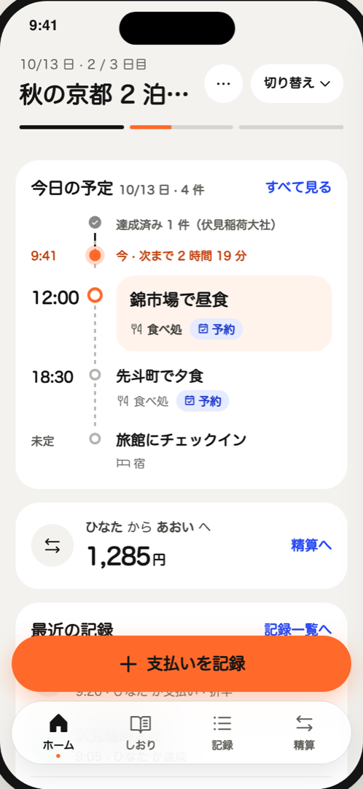
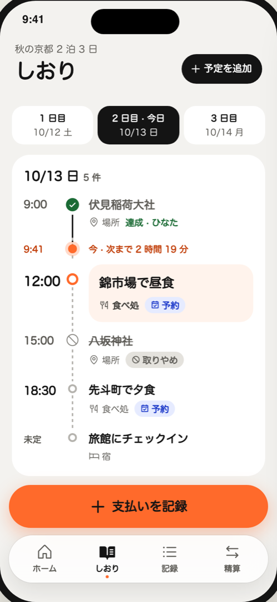
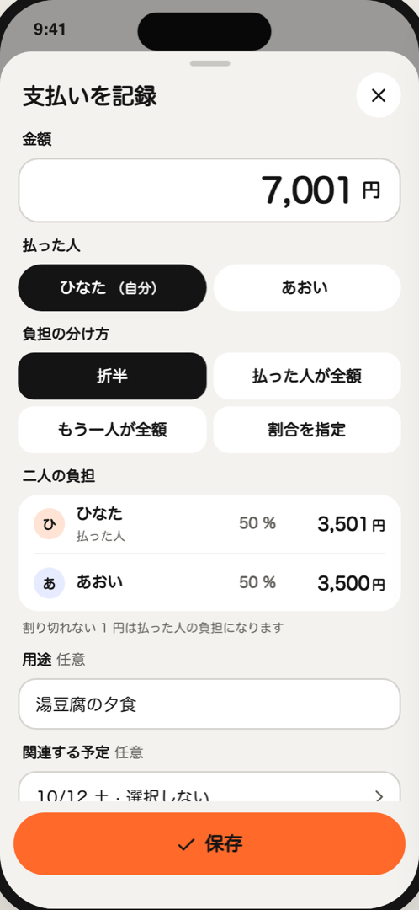
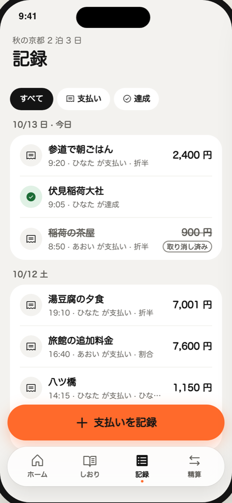
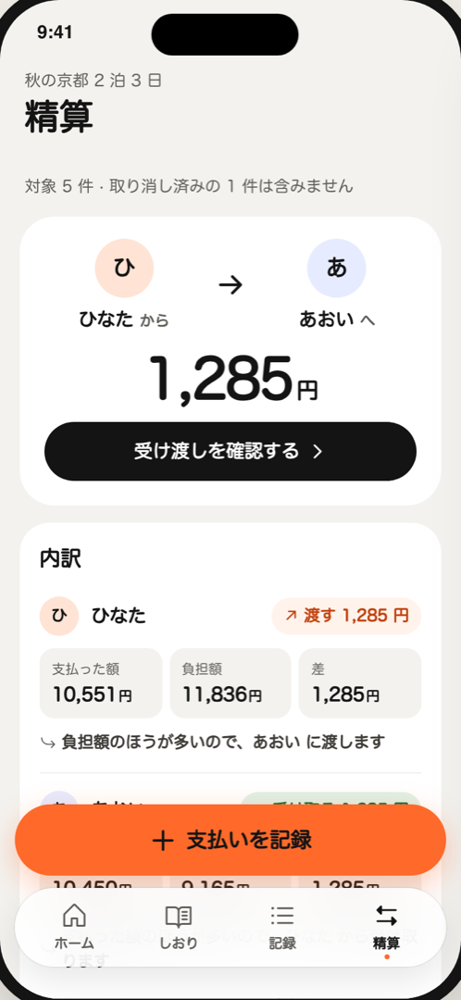
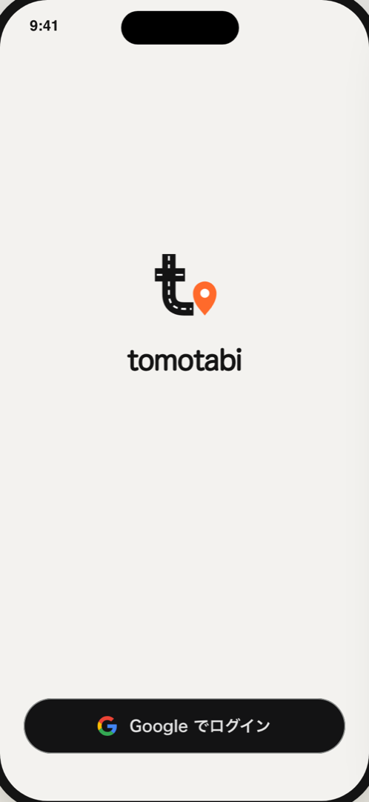
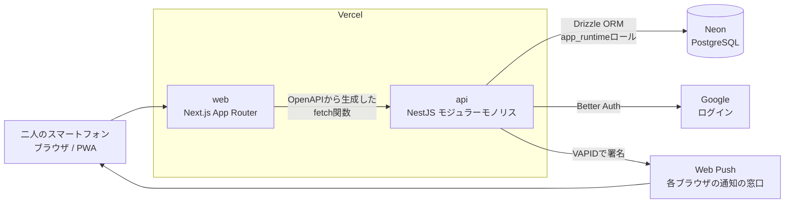
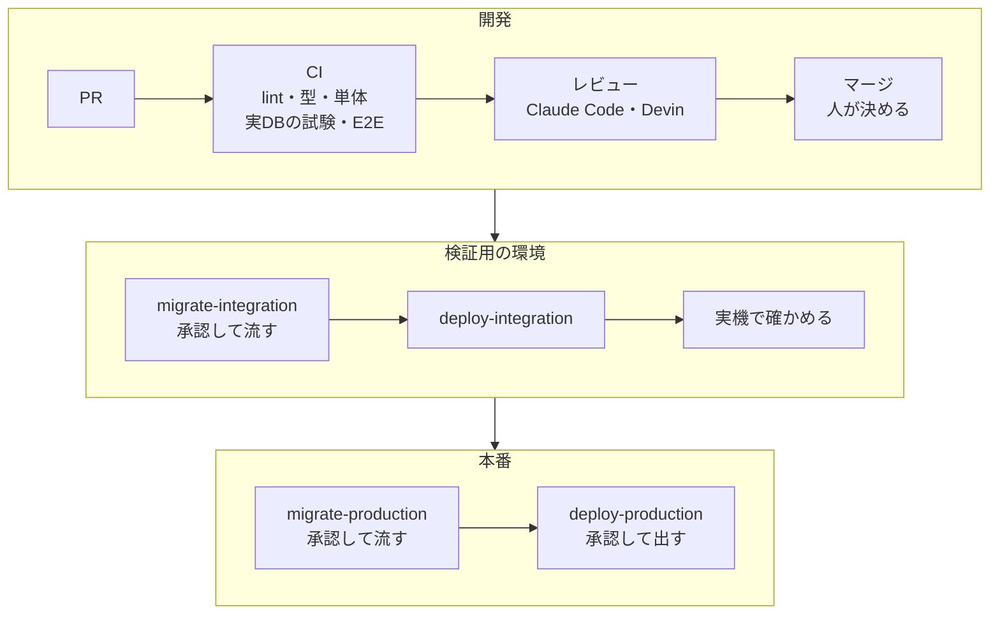
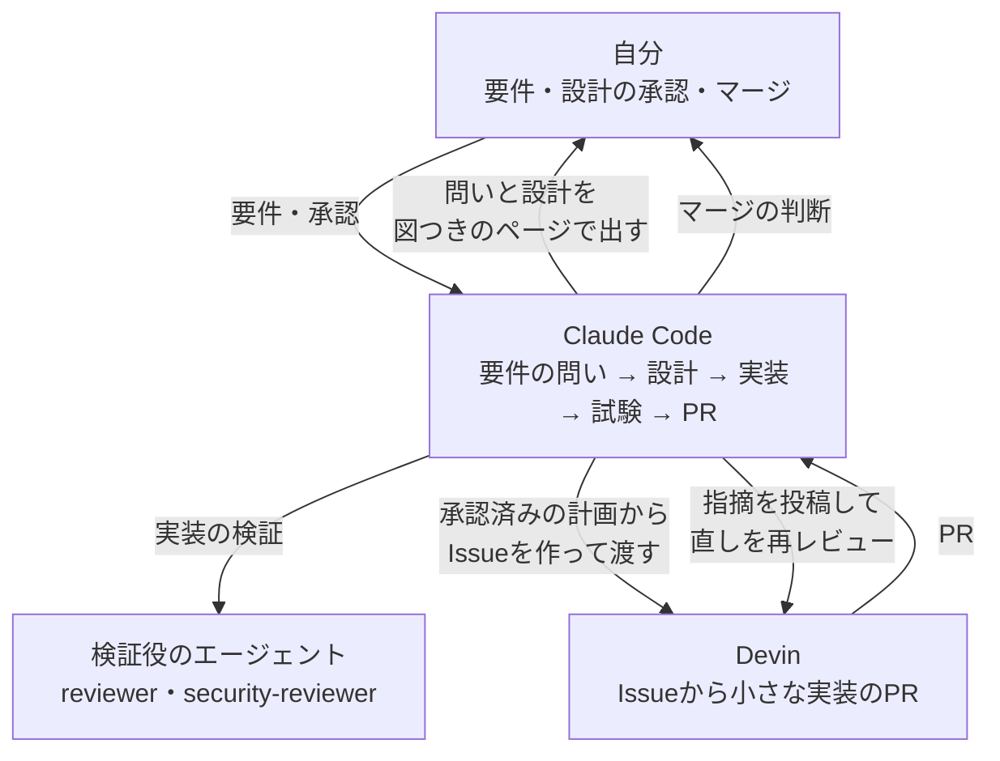

# Tomotabi

**二人旅のしおり・ToDo・支払いと精算を、1つにまとめた旅行Webアプリ**

自分とパートナーの二人だけで使うために作った個人開発のアプリです。旅行の予定を日ごとに並べ、旅先で払ったお金を記録し、最後にどちらがいくら渡せばよいかを出します。2026-11-07に本番へ公開し、実際の旅行で使っています。

設計から実装、試験、デプロイまでを、Claude CodeとDevinに任せるAI駆動開発で進めています。人が決めるのは要件と設計の承認とマージだけで、その線引きもリポジトリのルールとして書いてあります（[AI駆動開発の進め方](#ai駆動開発の進め方)）。

## 画面

|                                               ホーム                                               |                                                しおり                                                |                                         支払いを記録                                          |
| :------------------------------------------------------------------------------------------------: | :--------------------------------------------------------------------------------------------------: | :-------------------------------------------------------------------------------------------: |
|  |                      |  |
|                                              **記録**                                              |                                               **精算**                                               |                                         **ログイン**                                          |
|                             |  |                   |

画像は、実装のもとにした画面のデザイン（[v3の画面一式](docs/design/handoff-v3/README.md)）を書き出したものです。名前と金額は見本です。

## できること

- **旅行とホーム**: 旅行を作って切り替える。ホームで今日の予定、精算額、最近の記録をまとめて見る。
- **しおり**: 日ごとに予定を置き、達成や予約を記録する。
- **ToDo**: 旅行ごとにやることを書く。カテゴリ、担当、期限を付け、予定と関連付けられる。
- **支払いと精算**: 払った人と負担の分け方（折半、払った人が全額、もう一人が全額、割合を指定）を記録する。精算は二人の立て替えを差し引きして、受け渡しの額を出す。アプリは送金しない。
- **記録**: 支払い、達成、予約の履歴を新しい順に見る。取り消した記録も線で消して残す。
- **通知**: 相手が予定を足したり、支払いや精算を記録したりすると、この端末に通知が届く。ホーム画面に置いたアイコン（PWA）にも届く。

ログインはGoogleで、使えるのは管理者が初期登録した二人のアカウントだけです。

## 作りで気をつけたこと

| 困りごと                                     | どうしたか                                                                                                                          | 決めた記録                                                             |
| -------------------------------------------- | ----------------------------------------------------------------------------------------------------------------------------------- | ---------------------------------------------------------------------- |
| 旅先の電波で、保存が成功したか分からなくなる | 送る前の要求をIndexedDBに残し、再読み込みのあとも同じキーで送り直して結果を確かめる。サーバーは同じキーの要求を二重に作らない       | [ADR-0006](docs/decisions/ADR-0006-pending-requests-indexeddb.md)      |
| 二人が同じものを同時に直す                   | 版の番号（`If-Match`）を付けて送り、古い版からの更新は409で止める                                                                   | [設計書](docs/designs/)                                                |
| アプリの接続でテーブルを消せてしまう         | DBのロールを、migrationを流す`migrator`とアプリが使う`app_runtime`に分け、`app_runtime`には要る列の更新だけを許す                   | [ADR-0003](docs/decisions/ADR-0003-m1-migration-and-db-roles.md)       |
| webとapiで型がずれる                         | 公開APIの契約をOpenAPIに置き、webのfetch関数とZodスキーマを生成する。応答は実行時にも検証する                                       | [ADR-0004](docs/decisions/ADR-0004-m2-web-query-and-api-validation.md) |
| migrationを流し忘れたままデプロイする        | デプロイの前に、動いているapiにDBの最後のmigrationを聞き、追いついていなければ止める。migrationは承認つきのボタンで出先からも流せる | [ADR-0011](docs/decisions/ADR-0011-migration-by-manual-workflow.md)    |

決めたことはADR（[docs/decisions/](docs/decisions/)）に、比べた別案と一緒に残しています。

## 全体の構成

apiは、業務ごとに6つのモジュール（`identity`・`planning`・`record`・`settlement`・`notification`・`foundation`）に分けた1つのアプリです。モジュールの中は、Controller → UseCase → Domainの順に呼び、DBや外部への接続はInfrastructureに置いて、UseCaseからはインターフェース越しに使います。

| 領域           | 使っているもの                                                                       |
| -------------- | ------------------------------------------------------------------------------------ |
| 言語・実行環境 | TypeScript、Node.js 24、npm workspaces                                               |
| web            | Next.js App Router、React、TanStack Query、Orvalで生成したfetch関数とZod、neverthrow |
| api            | NestJS、Better Auth、Drizzle ORM、`pg`、web-push                                     |
| 契約           | `packages/contracts`のOpenAPI                                                        |
| DB             | PostgreSQL（Neon）                                                                   |
| 試験           | Vitest、Supertest、Testcontainers（実PostgreSQL）、Playwright（E2E）                 |
| 配信           | Vercel（webとapiの2つ）、GitHub Actions                                              |

## 変更が本番に届くまで

検証用と本番は、VercelもNeonも別のプロジェクトです。デプロイとmigrationのボタンは、GitHubのEnvironmentで承認者と`main`だけのブランチ制限を付けています。DBにつなぐ秘密は、承認のあとに動く手順だけが読みます。出した記録は[docs/releases/](docs/releases/)に残しています。

## AI駆動開発の進め方

コードを書くのは主にAIで、人は判断を受け持ちます。

- **変更の大きさで手順を変える**: 文言の修正から新しい機能までを4段階に分け、大きいもの（L2・L3）だけ要件書と設計書を書いて、人の承認を待ってから実装します（[`classify-change`](.claude/skills/classify-change/SKILL.md)、[`develop-feature`](.claude/skills/develop-feature/SKILL.md)）。
- **人が止まる場所を決めておく**: 設計の承認、技術とアーキテクチャの決定、PRのマージ、データを消す操作の4つは、必ず人が決めます（[AGENTS.md](AGENTS.md)）。
- **危ない操作はフックで止める**: force push、作業の破棄、秘密情報のファイルや設定の読み取り、本番への直接のデプロイなどは、Claude Codeのフックが実行の前に止めます（[`.claude/hooks/`](.claude/hooks/)）。
- **Devinへの委譲を記録して直す**: 渡したIssueごとに、レビューの指摘の種類を記録します。同じ種類の指摘が3つのIssueで出たら、Devinの手順に予防の1行を足す候補にします（[委譲の記録](docs/claude-code/improvements/delegations/)、[改善の候補](docs/claude-code/improvements/improvement-backlog.md)）。
- **文章の書き方もルールにする**: 報告、PR、設計書は、結論を先に書き、AIらしい決まり文句を避ける書き方に揃えます（[書き方のルール](.claude/rules/writing-style.md)）。

このハーネス（スキル、フック、検証役、ハーネス自身の試験）は[`.claude/`](.claude/)にあり、導入の記録は[docs/harness-setup.md](docs/harness-setup.md)です。

## 試験

| 種類     | 何を確かめるか                                     | 動かし方                              |
| -------- | -------------------------------------------------- | ------------------------------------- |
| 単体     | 業務の決まり、UseCase、画面の部品                  | `npm test`                            |
| 実DB     | migration、DBのロールの権限、HTTPから保存まで      | `npm run test:api-db`（Dockerが要る） |
| E2E      | 二人での操作、結果不明の保存、通知、精算までの流れ | `npm run test:e2e`                    |
| ハーネス | フック、ワークフロー、委譲のスクリプト             | `npm run test:harness`                |

単体・実DB・ハーネスの試験はPRのたびに、E2Eはwebかapiを変えたPRで、GitHub Actionsが動かします。

## 手元で動かす

起動の手順、環境変数、コマンド、ディレクトリの構成は[docs/development.md](docs/development.md)にまとめています。

## 文書

| 文書                                                                     | 中身                                               |
| ------------------------------------------------------------------------ | -------------------------------------------------- |
| [AGENTS.md](AGENTS.md)                                                   | 開発のルール、人とAIの分担、ブランチの決まり       |
| [docs/requirements/](docs/requirements/)・[docs/designs/](docs/designs/) | 機能ごとの要件書と設計書                           |
| [docs/decisions/](docs/decisions/)                                       | ADR（技術とアーキテクチャの決定）                  |
| [docs/runbooks/](docs/runbooks/)                                         | 検証用と本番の構築、デプロイ、バックアップの手順書 |
| [docs/glossary.md](docs/glossary.md)                                     | アプリで使う言葉                                   |
| [logs/](logs/)                                                           | 日ごとの作業ログ                                   |
