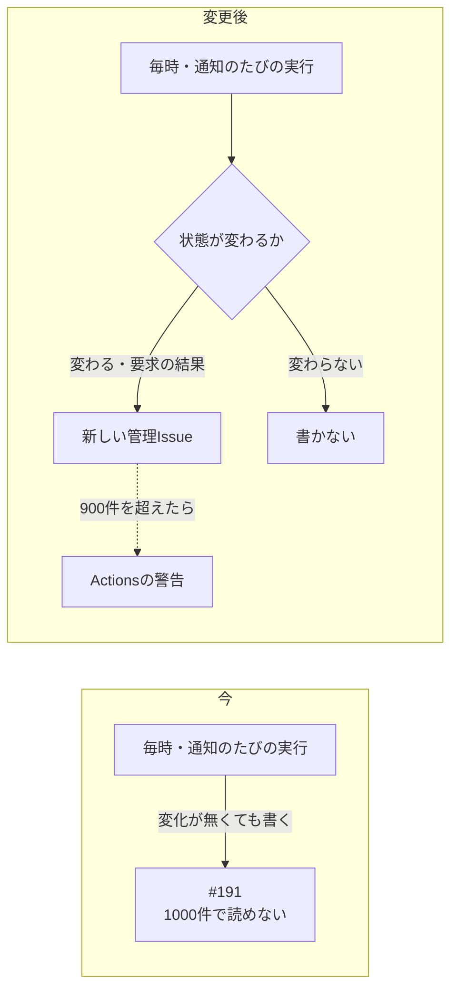
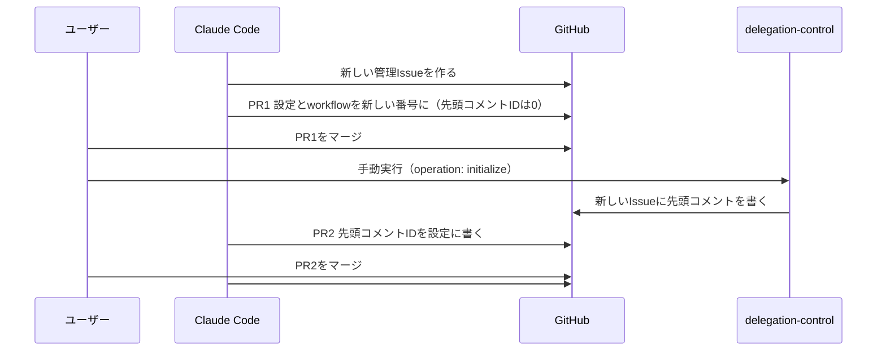

# 設計書: delegation-journal-rollover（委譲の共有状態を新しい管理Issueに移し、同じ状態を書かないようにする）

- ステータス: draft
- レベル: L2
- 関連: 論点の記録 `docs/discussions/delegation-journal-rollover.md`、元の設計 `docs/designs/delegation-review-reliability.md`

## この設計を一言で

上限の1000件に達した管理Issue #191から、空の状態の新しい管理Issueに移る。あわせて、状態が変わらないときはイベントを書かないようにし、900件を超えたら警告を出す。

## 背景

delegation-control-writerが2026-10-11 10時56分から毎回落ちている。#191のコメントが読み込みの上限（1000件）に達し、状態を組み立てられないため。
1000件のうち約680件は、直前と同じ状態をもう一度書いたイベントだった。毎時の定期実行と通知のたびに、PRごと・コミットごとに「確認を始めた」「PRを見た」「結果を書いた」を書いていた。

## 目的

- delegation-control-writerが再び通り、新しいPRの`agent-review`が更新される。
- 同じ状態を書かず、管理Issueの増え方を抑える。
- 上限に近づいたことを、落ちる前に知らせる。

## 要件

- 要求コメントから来たイベント（受付・拒否・結果）は、今までどおり必ず書く。
- 書かずに済ませるのは、要求に結び付かない内部のイベント（`request_id`が無いもの）で、変更が今の状態と同じときだけ。
- 新しい管理Issueの先頭コメントは、今の初期化と同じくworkflow（github-actions）が書く。
- #191のコメントは消さない。

## 対象範囲

- `.claude/scripts/delegation-control.mjs`（イベントを書く処理・初期化・警告）
- `.claude/config/delegation-review.json`（管理Issueの番号・先頭コメントのID）
- `.github/workflows/delegation-control.yml`（要求コメントを拾うIssue番号）
- `.claude/tests/delegation-control.test.mjs`・`.claude/tests/delegation-workflows.test.mjs`

## 対象外

- 直前の状態を新しいIssueへ持ち越す仕組み（論点の記録「上限に当たった管理Issueから、どう抜けるか」でCを選ばなかった）。
- 読み込みの上限（1000件）の変更。
- マージ済みPRのコミットも毎時確かめ直す動き。同じ状態なら書かなくなるので件数は増えないが、APIの呼び出しは残る。気づきとして報告に書き、ここでは変えない。
- 新しい委譲の起動の再開（`migration_complete`）。

## 現状構成

状態は、管理Issueのイベントのコメントを先頭から全部読み、ハッシュの連鎖を確かめて組み立てる。先頭コメント（anchor）は最後のイベントの位置を指す。
`persistEvent`は、渡された変更が今の状態と同じでもイベントを1件書き、そのあと全件を2回読み直す。

## 変更後構成

### 同じ状態は書かない

`persistEvent`の最初で次を確かめ、当てはまれば何も書かずに今の状態を返す。

- `meta.request_id`が`null`（要求に結び付かない内部のイベント）。
- `changes`の`tasks` / `prs` / `checks`の各項目が、今の状態の同じ項目と同じ（`canonicalJson`で比べる）。`tasks`は書くときに付く`updated_seq`を除いて比べる。

`changes`が空の内部イベントもここで書かなくなる。要求の拒否（`request-rejected`）は`request_id`を持つので、今までどおり書く。

### 新しい管理Issueへ移る

PR1のあいだ（先頭コメントIDが0）の定期実行は、今までどおり`uninitialized`で止まる。PR2のマージで通るようになる。

### 初期化の二重実行の防ぎ方

`initializeAnchor`の「過去の手動実行」の確認を、新しい管理Issueの作成時刻（`created_at`）より後の実行だけに絞る。前のIssueの初期化は数えず、同じIssueへの二重実行は今どおり止める（論点の記録「初期化の二重実行を、どう防ぐか」）。

### 上限に近づいたら警告

`readIssueComments`で読んだ件数が900件を超えたら、実行のたびに`::warning::`で件数と上限を出す。処理は続ける。1000件で止まるのは今のまま（論点の記録「上限に近づいたことを、どう知らせるか」）。

## データフロー

イベントの形・ハッシュの連鎖・先頭コメントの形は変えない。新しい管理Issueは`seq: 0`から始まる。

## API 設計

対象外（公開APIは変えない）。

## DB 設計

対象外。

## フロントエンド設計

対象外。

## バックエンド設計

対象外（アプリのコードは触らない）。

## エラー処理

書かずに済ませたときは、新しいエラーを作らない。比べる途中で形が崩れていたら、今までどおり`applyChanges`の検査で落とす（比べる前に`applyChanges`を通す）。

## ログと監視

900件を超えたときのActionsの警告だけを足す。

## セキュリティ

先頭コメントとイベントの作者の確認（github-actionsだけ）は変えない。workflowの`if`は番号を差し替えるだけで、条件は変えない。

## 性能

同じ状態のときは、書き込み1回と全件の読み直し2回がなくなる。今の記録の割合なら、1回の実行のAPI呼び出しは半分ほどになる見込み（未計測）。

## テスト方針

- 内部イベントで変更が今の状態と同じなら、コメントを書かない。
- `tasks`の`updated_seq`だけが違うときも書かない。
- 要求から来たイベントは、変更が同じでも書く。
- 変更が1項目でも違えば書く。
- 初期化: 管理Issueの作成より前の手動実行は数えない。作成より後の別の実行があれば`initialize_unknown`。
- 900件を超えると警告を出し、処理は続く。
- workflowの`if`が設定の管理Issue番号と一致する（既存のテストの番号を差し替える）。

## 移行とリリース

上の図のとおり、PR1（コードと設定）→ 初期化の手動実行 → PR2（先頭コメントID）→ #191のクローズの順に進める。戻すときは、設定とworkflowの番号を#191に戻せば元の（落ちる）状態に戻る。

## リスク

- 書かずに済ませる判定を誤ると、変わった状態が残らない。テストで「1項目でも違えば書く」を固定する。
- 新しいIssueは空から始まるので、移った直後の定期実行は開いているPRの`agent-review`を作り直す。移る時点で開いているPRは無い見込み。

## 決めたこと（問いと答え）

`docs/discussions/delegation-journal-rollover.md`

## 未決事項

仮決定が3件（#191の扱い・上限の知らせ方・初期化の二重実行の防ぎ方）。設計の承認（このPRのマージ）までに異議が無ければ決定に移す。
