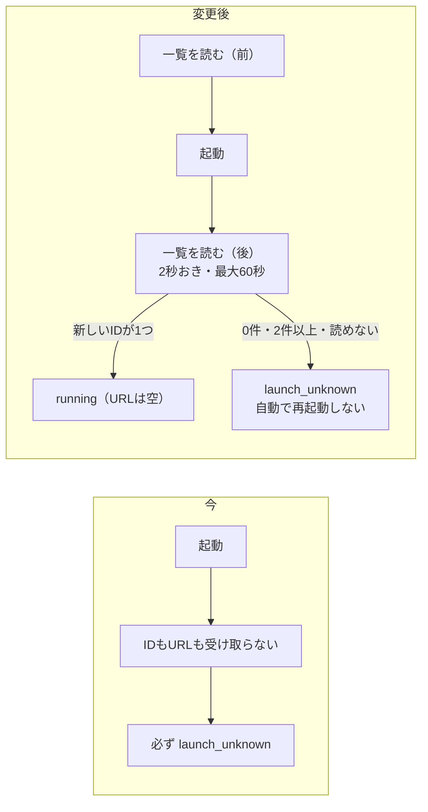
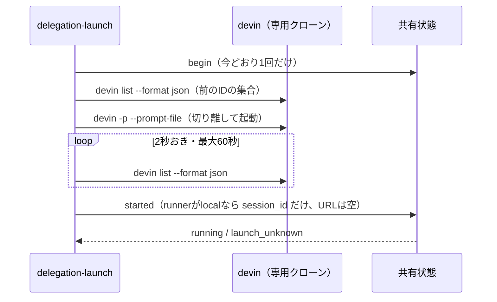

# 設計書: devin-local-session（手元のDevinのセッションを、起動の前後の一覧の読み比べでIDだけで確定する）

- ステータス: draft
- レベル: L2
- 関連: 論点の記録 `docs/discussions/devin-local-session.md`、元の設計 `docs/designs/delegation-review-reliability.md`、移し替え `docs/designs/delegation-journal-rollover.md`

## この設計を一言で

手元でDevinを起動したら、起動の前と後に専用クローンで`devin list --format json`を読み比べ、新しく出たIDが1つだけなら、URLが無くてもそのIDで起動を確定する。害の無い依頼で手元のDevinを1回起動してこれを確かめてから、起動を止めている設定を外す。クラウドの起動は、確かめるまで新しい設定で止めておく。

## 背景

2026-10-24に、手元のDevin CLI（3000.11.3）を読み取りで調べた。手元の`devin list --format json`は、セッションごとに`id`・`short_id`・`working_directory`・`last_activity_at`・`title`を返し、URLを持たない。ところが起動ラッパー（`delegation-launch.mjs`）は起動のあとIDとURLを受け取らず、共有状態の決まり（`delegation-shared.mjs`の`started`、`delegation-control.mjs`の`session_verified`）はIDに加えて`app.devin.ai`のURLを求める。このため、手元の起動は必ず`launch_unknown`で終わり、`cli_launch_verified`を外せない。

## 目的

- 手元の起動で、セッションのIDを確かめて`running`にできる。
- 確かめられないときは、今どおり`launch_unknown`にして自動で再起動しない。
- 確かめていないクラウドの起動は止めたまま、手元の委譲を始められる。

## 要件

- IDは、起動の前後に専用クローンで読んだ一覧の差から取る。新しいIDのうち、`working_directory`が専用クローンの実パスと同じものだけを数える。ちょうど1つのときだけ確定する。
- 一覧は起動のあと2秒おきに読み、最大60秒待つ（論点の記録「起動のあと、一覧を何秒まで待つか」。確かめの起動で測った秒数で見直す）。
- 一覧を読めない・JSONでない・形が違うときは、IDを空にする。起動し直さない。
- 手元のセッションの「始まった」（`started`）は、`session_url`を空（`null`）で送る。共有状態は、タスクの`runner`が`local`のとき、形の合うIDだけで`running`にする。`cloud`のときは今どおりURLを必須にする。
- クラウドの起動は、新しい設定`cloud_launch_verified: false`で止める（論点の記録「クラウドの起動を、どう止めておくか」）。
- `cli_launch_verified`と`migration_complete`は、確かめの起動のあと、同じ設定のPRで外す（論点の記録「移行の完了を、いつ外すか」）。

## 対象範囲

- `.claude/scripts/delegation-launch.mjs`（一覧の読み比べ、クラウドの止め方）
- `.claude/scripts/delegation-shared.mjs`（`started`の決まり）
- `.claude/scripts/delegation-control.mjs`（`session_verified`）
- `.claude/config/delegation-review.json`（`cloud_launch_verified`を足す。2つの設定を外すのは別のPR）
- `.claude/tests/delegation-launch.test.mjs`・`.claude/tests/delegation-control.test.mjs`
- `.claude/skills/review-devin-pr/SKILL.md`・`docs/devin-setup.md`（確かめの起動の例外と、手元のセッションのURLが空であること）

## 対象外

- クラウドの起動の確かめ（内部の再送とURLの形）。クラウドは止めたまま残す。
- 起動の出力（ログ）からIDを読み取ること（論点の記録「手元のセッションのIDの取り方」でBを選ばなかった）。
- 監視の画面（`devin-watch`）。セッションのIDが分かるようになっても、今の見え方は変えない。
- 委譲の流れの他の部分（register・claim・begin・link-pr・finalize）。

## 現状構成

`spawnDevin`は`devin`を切り離して起動し、起動できた時点で`{ session_id: null, session_url: null }`を返す。`launchDelegation`は、IDとURLがそろい、URLの末尾がIDと同じときだけ`started`にIDとURLを入れる。共有状態は、IDとURLとcontrollerの`session_verified`がそろったときだけ`running`にする。

## 変更後構成

### 起動ラッパー

- 前の一覧を読めなければ、起動せずに止める（どれが新しいか分からなくなるため）。この時点ではbeginの許可を使っていないので、`launch_unknown`ではなく起動前の失敗として返す。
- 後の一覧は、新しいIDが1つ見つかった時点で読むのをやめる。2つ以上見つかったら、その時点でIDを空にしてやめる。
- 一覧を読むコマンドは、専用クローンを作業フォルダにして、読み取りだけで動かす（`devin list --format json`）。

### 共有状態の決まり

`started`で`running`にする条件を、タスクの`runner`で分ける。

| runner  | 条件                                        | URL                                                           |
| ------- | ------------------------------------------- | ------------------------------------------------------------- |
| `local` | IDが形に合う（英数字・`_`・`-`、128字まで） | 空（`null`）のときだけ受け付ける。URLが来たら`launch_unknown` |
| `cloud` | 今どおり、IDとURLがそろい、URLの末尾がID    | `app.devin.ai/sessions/<ID>`                                  |

controllerの`session_verified`も同じ分け方にする。

### クラウドを止める設定

`delegation-launch.mjs`は、`--runner cloud`のとき`cloud_launch_verified`が`true`でなければ起動しない（今の`migration_complete`・`cli_launch_verified`の確認と同じ場所）。

### 確かめの起動（論点の記録「確かめのための起動を、どうするか」の推奨A）

1. 一時フォルダ（例: `$TMPDIR/devin-probe-<日時>`）を作る。リポジトリではないフォルダにする。
2. そのフォルダで`devin list --format json`を読み、`devin --model swe-2-medium --permission-mode accept-edits -p --prompt-file <依頼>`を起動する。依頼は「このフォルダに`probe.txt`を作って、中身に`ok`と書いて終わる」だけ。
3. 2秒おきに一覧を読み、新しいIDが出るまでの秒数と、IDの形を記録する。
4. 結果をこの設計書の「確かめの結果」と、試験計画に書く。手順書の「起動する試験はしない」に、この1回を例外として書き足す。

この起動は共有状態を通さない（register・beginを使わない）。委譲の記録には残らない。

## データフロー

`started`の要求の形は変えない。手元のときは`session_url: null`で送る。タスクには`session_id`が入り、`session_url`は`null`のまま残る。

## API 設計

対象外（アプリの公開APIは変えない）。

## DB 設計

対象外。

## フロントエンド設計

対象外。

## バックエンド設計

対象外（アプリのコードは触らない）。

## エラー処理

外部（Devin CLI）の呼び出しを足すので、5つを決める。

- (a) 再試行: 一覧を読むのは2秒おきの読み直しで、最大60秒（30回）。起動そのものは1回だけで、再試行しない。
- (b) 時間切れ: 一覧のコマンド1回は10秒で打ち切る。全体で60秒。
- (c) 冪等性: 起動は今どおりbeginの許可を1回だけ使う（spentの記録）。一覧の読み直しは読み取りだけなので、何回読んでも状態は変わらない。
- (d) 部分失敗: 起動のあとに一覧を読めなくなったら、IDを空にして`started`を送る。共有状態は`launch_unknown`になり、自動で再起動しない。
- (e) フォールバック: Devin CLIが動かないときは、今どおり起動前の失敗として止まり、beginの許可は使わない。

## ログと監視

起動ラッパーの出力（JSON）に、見つけたIDと、一覧に出るまでの秒数を足す。プロンプトの中身やログの本文は出さない。

## セキュリティ

一覧のJSONは、IDと作業フォルダと題名だけを読む。題名は委譲の記録に写さない。IDは今の形の検査を通したものだけを送る。確かめの起動は、リポジトリの外の一時フォルダで、`dangerous`ではなく`accept-edits`の権限で動かす。

## 性能

起動ごとに、一覧のコマンドを最大31回動かす。1回は1秒未満の見込み（未計測）。

## テスト方針

- 起動ラッパー: 前後の一覧の差でIDを1つ見つけたら、`session_id`だけで`started`を送る。0件・2件以上・読めない・形が違う・別のフォルダのセッションだけ、のときはIDを空にする。前の一覧を読めなければ起動しない。`--runner cloud`は`cloud_launch_verified`が`false`なら起動しない。
- 共有状態: `runner: local`はIDだけで`running`。URLが付いたら`launch_unknown`。`runner: cloud`は今どおりURLが要る。
- 確かめの起動: 手動で1回。結果を試験計画に書く。

## 移行とリリース

1. この設計の承認（このPRのマージ）。
2. 実装のPR（起動ラッパー・決まり・`cloud_launch_verified: false`・試験・手順書）。
3. 確かめの起動を1回して、結果を記録する。
4. 設定のPRで`cli_launch_verified`と`migration_complete`を`true`にする。
5. 第1波の委譲（#251・#247・#250）を始める。前に、専用クローンをmainに戻す。

戻すときは、2つの設定を`false`に戻せば、今と同じく起動しなくなる。

## リスク

- 同じ専用クローンで、Devinのデスクトップアプリなど別のセッションが同時に始まると、2つ見つかって`launch_unknown`になる。照合の手間は増えるが、誤ったIDで確定はしない。
- Devin CLIの版が変わり、一覧のJSONの形が変わると、IDを読めずに`launch_unknown`になる。止まる側に倒れるので、誤った状態は残らない。

## 確かめの結果

（確かめの起動のあとに書く）

## 決めたこと（問いと答え）

`docs/discussions/devin-local-session.md`

## 未決事項

なし。回答待ちの2件と仮決定の3件は、2026-10-24にすべて推奨どおり決定した。
