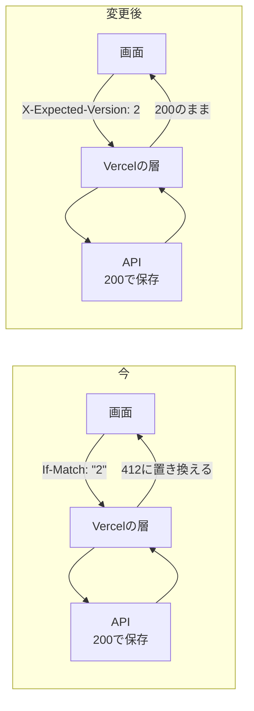
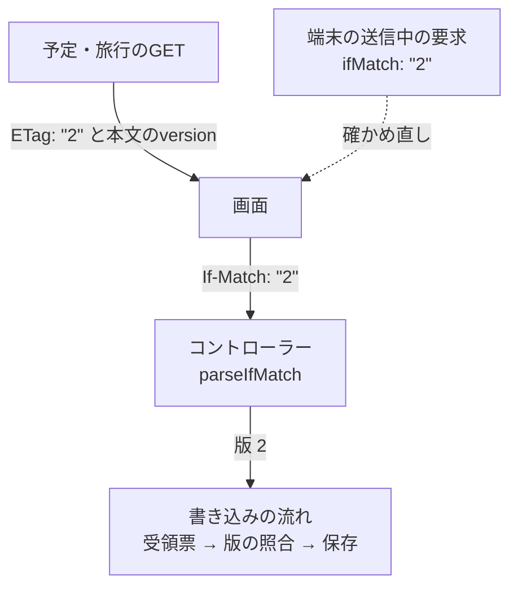
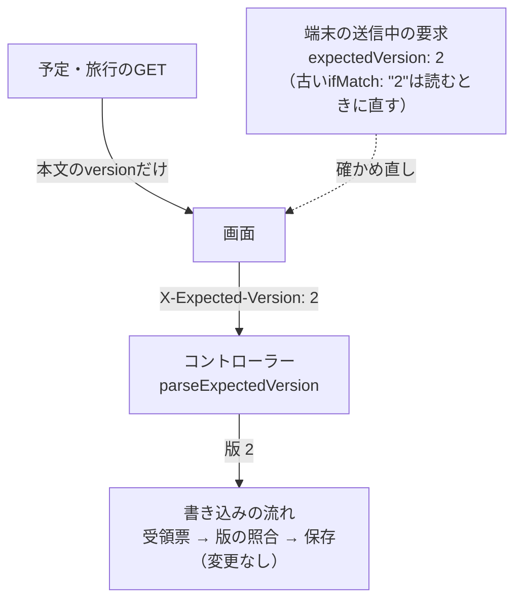
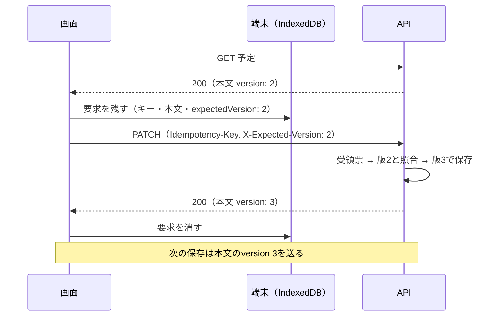

# 設計書: expected-version-header（版の確認を独自のヘッダーで送り、保存の成功が412に見えないようにする）

- ステータス: draft
- レベル: L2
- 関連: 論点の記録 `docs/discussions/expected-version-header.md`、前の直し #240・#255（#246）、ADR-0006（端末に残す送信中の要求）

## この設計を一言で

版の確認（古い版を見て上書きしないための仕組み）を、If-Matchから独自のヘッダー`X-Expected-Version`に移す。Vercelは、If-Matchの付いた要求の成功の応答を412に置き換えるが、知らないヘッダーは評価しない。予定と旅行の保存が、結合検証環境でも成功として閉じるようになる。

## 背景

結合検証環境で予定の編集や旅行名の変更を保存すると、サーバーでは保存できているのに画面に失敗と出る（#246）。#240と#255では、Vercelが「応答のETagと要求のIf-Matchを比べている」と推測し、書き込みの応答からETagを外した。2026-10-23に`0d3a5968`を出して確かめると、まだ失敗と出た。

内蔵のブラウザで調べた結果は次のとおり。

| 要求                                               | If-Match        | 結果                                                                  |
| -------------------------------------------------- | --------------- | --------------------------------------------------------------------- |
| 予定の編集（PATCH）                                | `"1"`           | 412（Vercelの`PRECONDITION_FAILED`の画面）。サーバーでは版2で保存済み |
| 予定のGET（応答のETagは`"2"`）                     | `"2"`           | 200                                                                   |
| 予定のGET                                          | `"999"`         | 412                                                                   |
| `/api/me`（応答にETagなし）                        | `"x"`           | 412                                                                   |
| `/api/me`                                          | なし、または`*` | 200                                                                   |
| APIのプロジェクトの`/api/health`、画面の`/sign-in` | `"x"`           | 412                                                                   |
| 未ログインのPATCH（401）                           | `"1"`           | 401のまま                                                             |

Vercelは、画面とAPIのどちらのプロジェクトでも、2xxの応答をIf-Matchと突き合わせる。応答のETagが一致しなければ、ETagが無くても412にする。保存すると版は必ず進むので、If-Matchを付けた書き込みは必ず412に見える。

## 目的

- 7つの書き込み（予定の編集・日の移動・取りやめ、旅行の名前・期間の変更、開始、終了）が、Vercelの上でも成功として閉じる。
- 版の確認の決まり（無ければ428、違えば409、同じキーの再送は先に元の結果）は変えない。
- If-Matchに戻ってしまわないよう、試験で止める。

## 要件

- APIは版を`X-Expected-Version`ヘッダーから読む。値は10進の正の整数だけ（`3`）。前後の空白・引用符・複数の値は400 `INVALID_REQUEST`。
- ヘッダーが無ければ428 `EXPECTED_VERSION_REQUIRED`。If-Matchだけを送っても、無いものとして428にする。
- 画面は`X-Expected-Version`だけを送り、If-Matchは送らない。版は本文の`version`から取る。
- 予定と旅行のGETはETagヘッダーを返さない。版は本文の`version`だけで渡す。
- 端末に残った古い形の送信中の要求は、読むときに直して送る。`ifMatch: "3"`は`3`に、版の確認を使わない操作の`ifMatch: null`は`expectedVersion: null`にする。
- `request_hash`に入れる版の数字は今と同じなので、デプロイの前に受けた要求の再送も、元の結果を返す。

## 対象範囲

- API: 版の読み方（`apps/api/src/common/http/etag.ts`の置き換え）、予定と旅行のコントローラー、エラーの一覧（`api-error.filter.ts`）、Expressの設定のコメント。
- 契約: `packages/contracts/openapi/planning.json`・`trips.json`の、ヘッダーの定義・428の説明・GETのETag。`packages/contracts/src/plan.ts`・`trip.ts`のコメント。生成コード（`npm run api:generate`）。
- 画面: 書き込みの要求の形（`mutation-request.ts`）、送信中の要求の記録（`pending-requests.ts`）、共通の保存の状態（`save-state.ts`）と成功の結果（`api-result.ts`）、エラーの型（`api-failure.ts`）、予定と旅行の保存（`plan-save.ts`・`trip-save.ts`・各APIの関数・各画面の部品の`etag`）。
- 試験: APIの単体とDBを使う試験、画面の単体の試験。
- 資料: 設計資料（詳細設計「予定・達成・予約」「旅行とホーム」「画面状態と入力操作」「デプロイと無料枠運用」「運用設定と公開チェック」とOpenAPI）、要件（m2・integration-env）、試験計画（m2・integration-env）、ADR-0004の1行、`docs/glossary.md`。

## 対象外

- 版の確認の決まりそのもの（428・409・再送の順番）。
- 版の確認を使わない書き込み（支払い・達成・予約・精算・通知）。今もIf-Matchを送っていない。
- Vercelの設定。If-Matchの評価を止める設定があるかは調べない。
- 画面の文言。失敗の表示は今のまま。

## 現状構成

## 変更後構成

書き込みの流れ（`plan-write-flow.ts`・`trip-write-flow.ts`）と受領票は、受け取る版の数字が同じなので変えない。変わるのは、版をどのヘッダーから読むかと、その値の形だけ。

## データフロー

## API 設計

| 項目             | 今                      | 変更後                                                                           |
| ---------------- | ----------------------- | -------------------------------------------------------------------------------- |
| 版を送るヘッダー | `If-Match: "3"`         | `X-Expected-Version: 3`                                                          |
| 値の形           | `^"[1-9][0-9]*"$`       | `^[1-9][0-9]*$`                                                                  |
| 無いとき         | 428 `IF_MATCH_REQUIRED` | 428 `EXPECTED_VERSION_REQUIRED`（文言は`X-Expected-Version header is required`） |
| 形が違うとき     | 400 `INVALID_REQUEST`   | 変更なし                                                                         |
| 版が違うとき     | 409 `VERSION_CONFLICT`  | 変更なし                                                                         |
| 予定・旅行のGET  | ETagと本文のversion     | 本文のversionだけ                                                                |
| 書き込みの応答   | ETagなし（#240）        | 変更なし                                                                         |

対象の7つの操作は、`PATCH /trips/{tripId}/plans/{planId}`、`POST …/plans/{planId}/move`、`POST …/plans/{planId}/cancel`、`PATCH /trips/{tripId}`、`PUT /trips/{tripId}/period`、`POST /trips/{tripId}/start`、`POST /trips/{tripId}/finish`。

OpenAPIでは、`components.parameters.IfMatch`を`ExpectedVersion`（`name: X-Expected-Version`）に置き換え、7つの操作の参照と428の説明を直す。GETの応答の`ETag`ヘッダーの定義を消す。設計資料側のOpenAPI（`docs/旅行アプリ設計 3/詳細設計/openapi.*.json`）も同じに直す。

## DB 設計

変更なし。受領票（`command_receipts`）の`request_hash`に入れる版の数字は今と同じ。

## フロントエンド設計

- `MutationRequest`と`MutationDraft`の`ifMatch`（`"3"`）を`expectedVersion`（`"3"`。引用符なしの文字列）に変える。`sendMutationRequest`は`x-expected-version`を付け、`if-match`は付けない。
- 予定と旅行の各`…Draft`関数と画面の部品の`etag`は`version`に名前を変え、本文の`version`をそのまま渡す。`etagOf`は消し、`result.data.version`を使う。
- `conflict`のあとの取り直し（`fetchLatest`）は、ETagを見ずに本文の`version`を使う。`getPlanWithMeta`・`getTripWithMeta`のETagの受け渡しは消す。
- 共通の保存の状態（`save-state.ts`）の「あなたの入力で保存」（`saveMineOverLatest`）は、今は取り直した最新のETagを次のIf-Matchにしている。取り直した最新に`version`を持たせ、それを`expectedVersion`にする。成功の結果（`ApiSuccess`）からはETagの欄を消す。
- `pending-requests.ts`は、`expectedVersion`を書く。読むときに`expectedVersion`が無く古い`ifMatch`があれば、次のように直す。`"3"`は`3`にする。`null`（支払い・達成・予約・精算など、版の確認を使わない操作の記録）は`expectedVersion: null`にして、そのまま送り直せるようにする。それ以外の形は、今の「壊れた記録」と同じ扱いにする。
- `api-failure.ts`のエラーの名前の一覧で、`IF_MATCH_REQUIRED`を`EXPECTED_VERSION_REQUIRED`に変える。画面は428の状態コードで見分けているので、表示は変わらない。

## バックエンド設計

- `etag.ts`を`expected-version.ts`に置き換え、`parseExpectedVersion(value: string | undefined): string`を置く。`toStrongETag`と`StrongETag`は使う場所が無くなるので消す。
- 予定と旅行のコントローラーは`@Headers("x-expected-version")`で読む。`commandHeaders`・`computeRequestHash`に渡す値は今と同じ版の数字。
- GETの`response.setHeader("ETag", …)`を消す。
- `configure-app.ts`の`http.set("etag", false)`は残す。Expressの弱いETagを付けない理由（Vercelの層の評価を避ける）のコメントを、確かめた事実に合わせて直す。`plans.controller.ts`・`trips.controller.ts`の`writeResult`のコメントも同じ。

## エラー処理

外部へのI/Oは増えない。版の確認の決まりは今のまま。

- (a) 再試行: 変更なし。自動で再送しない。
- (b) 時間切れ: 変更なし。
- (c) 冪等性: 同じ`Idempotency-Key`の再送は、版の確認より先に元の結果を返す（変更なし）。`request_hash`の版の数字も同じなので、デプロイをまたいだ再送も元の結果になる。
- (d) 部分失敗: 変更なし。
- (e) フォールバック: 古い画面（If-Matchを送る版）が開いたままだと、新しいAPIには版が届かず428になる。画面は428で「最新を取り直す」表示を出すので、保存し直せば通る。

## ログと監視

変更なし。版の数字は秘密ではないので、ログに出ても困らない。

## セキュリティ

`X-Expected-Version`は版の数字だけで、秘密を含まない。画面は同じ生成元の`/api`へ送るので、CORSの事前要求は起きない。Originの検査（OriginGuard）は変わらない。

## 性能

変更なし。

## テスト方針

- API: `parseExpectedVersion`の単体試験（数字・0・負・引用符・空白・複数値・欠落）。DBを使うHTTPの試験で、7つの操作が`X-Expected-Version`で通ること、無いと428 `EXPECTED_VERSION_REQUIRED`、If-Matchだけでも428、違うと409になること。GETにETagが付かないこと。
- 画面: `sendMutationRequest`が`x-expected-version`を付け、`if-match`を付けないこと。`pending-requests`が古い`ifMatch`の記録を読み直せること。予定と旅行の保存が本文の`version`を次に送ること。
- 結合検証環境: 出したあと、7つの書き込み（予定の編集・日の移動・取りやめ、旅行の名前・期間の変更、開始、終了）がすべて成功として閉じることを実機で確かめる。試験計画（`docs/tests/integration-env.md`）の転送の点検（IE-03）を、`X-Expected-Version`が届くことに書き換える。
- 今の手元とCIの試験はVercelを通らないので、この不具合を見つけられなかった。Vercelの層の動きは結合検証環境でしか確かめられない。

## 移行とリリース

APIと画面を同じPRで変え、同じデプロイ（APIを出してから画面）で出す。APIを出してから画面を出すまでのあいだに、古い画面から保存すると428になる。結合検証環境は二人だけで使っているので、このあいだの428は許す。本番の公開はまだなので、本番の移行は要らない。

## リスク

- 途中の層が`X-`で始まるヘッダーを落とすと、版が届かず428になる。結合検証環境で確かめる。2026-10-20の点検で、`Idempotency-Key`など独自のヘッダーが届くことは確かめてある。
- 名前の変更の範囲が広く（画面12ファイル、試験12ファイル、資料18ファイル）、`etag`の名前が残りやすい。最後に`if-match`・`ifMatch`・`etag`を検索して、残りがコメントの履歴だけであることを確かめる。

## 決めたこと（問いと答え）

`docs/discussions/expected-version-header.md`

## 未決事項

仮決定が4件（ヘッダーの値の形、読む応答のETag、エラーの名前、端末に残った古い形の要求）。設計書のPRのマージまでに異議が無ければ決定にする。
