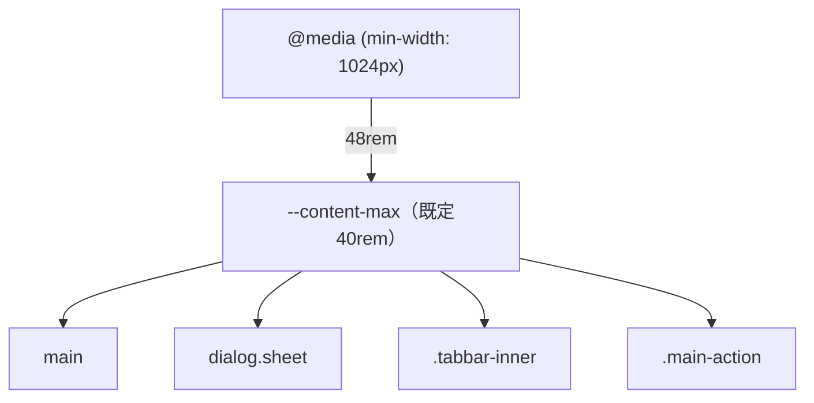

# 設計書: first-use-decisions（初めて使った人のレビューの残り7つを直す）

- ステータス: draft
- レベル: L2（6つの画面の見た目と、履歴の取り消しの行の出し方が変わる。APIとDBは変えない）
- 関連: 論点の記録`docs/discussions/first-use-decisions.md`、#253、実装計画`docs/implementation-plans/first-use-polish.md`（直し方が決まっていた3つ）

## この設計を一言で

初めて使った人のレビュー（#253）の残り7つのうち、6つを直す。旅行の切り替えの入口は両方残すと決めたので、直さない。直すのは次の6つ。

- パソコンの画面では本文を48remまで広げる。
- 精算の画面では「支払いを記録」を枠だけの小さなボタンにする。
- 補足の文字を12pxにして色を一段濃くする。
- 履歴の取り消しの行から金額を外す。
- 旅行の一覧に通知の設定への入口を足す。
- 二人の名前が並ぶ所で相手の名前に「（相手）」を付ける。

どれもブラウザの画面だけの直しで、APIとDBは変えない。

## 背景

#253の9つの指摘のうち、直し方が決まっていた3つは直してマージした（#292・#294・#295）。残りの7つは直し方で見た目と動きが変わるので、問いにして決めてもらった（2026-10-26。論点の記録の7問）。

## 目的

- パソコンで見たときに、狭い列に内容が寄って見えないようにする。
- 精算の画面で、主な操作が「受け渡しの内容を確かめる」だと分かるようにする。
- 薄くて小さい補足を読めるようにする。
- 取り消した支払いが、履歴で2件あるように見えないようにする。
- 通知の設定を、旅行のメニューの奥のほかからも開けるようにする。
- お金の受け渡しの向きで、どちらが相手かを取り違えないようにする。

## 要件

論点の記録の答え（2026-10-26）のとおり。

| 論点                   | 決定                                                                                               |
| ---------------------- | -------------------------------------------------------------------------------------------------- |
| 広い画面の幅           | 横幅1024px以上の画面だけ、本文・下のタブ・主ボタン・下からの小さな画面の4つをそろえて48remに広げる |
| 精算の「支払いを記録」 | 出すが、枠だけの小さなボタンにして、この画面では脇の操作だと分かる見た目にする                     |
| 旅行の切り替えの入口   | メニューとホームのヘッダーの両方に残す（変えない）                                                 |
| 小さい補足の文字       | 補足の文字を12pxにし、色を一段濃くする。下のタブの名前は11pxのまま                                 |
| 取り消した支払いの並び | 2行のまま残し、取り消しの行から金額を外して「精算から外しました」と書く                            |
| 通知の設定への入口     | 旅行の一覧の画面の上に、通知の設定へのリンクを足す                                                 |
| 相手の名前             | 二人の名前が並ぶ所だけ、相手の名前の後ろに小さく「（相手）」と付ける                               |

## 対象範囲

| 何を               | どこで                                                                                                                                                                                             | 今                           | 直したあと                                                                                                                                            |
| ------------------ | -------------------------------------------------------------------------------------------------------------------------------------------------------------------------------------------------- | ---------------------------- | ----------------------------------------------------------------------------------------------------------------------------------------------------- |
| 本文の幅           | `app/globals.css`の`main`・`dialog.sheet`・`.tabbar-inner`・`.main-action`                                                                                                                         | すべて40rem                  | 共通の変数`--content-max`（既定40rem）を使い、`@media (min-width: 1024px)`で48remにする                                                               |
| 精算の主ボタン     | `features/trips/ui/trip-tab-bar.tsx`、`screens/settlement/settlement-screen.tsx`                                                                                                                   | 黒の主ボタン「支払いを記録」 | `TripTabBar`に`quiet`を足し、精算の画面だけ枠線だけの小さなボタン（`.main-action-quiet`）にする。行き先と押せる条件（オフラインで押せない）は変えない |
| 補足の文字         | `.field-optional`・`.pay-share-sub`・`.settle-tile-label`・`.settle-item-confirm .settle-item-share`・`.rrow-pill`・`.home-rec-voided-badge`・`.conflict-diff`・`.conflict-same`・`.conflict-side` | 11px、`--color-text-muted`   | 12px、`--color-text-secondary`                                                                                                                        |
| 下のタブの名前     | `.tabbar-item`                                                                                                                                                                                     | 11px                         | 変えない                                                                                                                                              |
| 取り消しの行       | `features/records/ui/record-list.tsx`                                                                                                                                                              | 元の金額を出す               | 種類が支払いの取り消しのときは金額を出さず、行の補足の末尾に「精算から外しました」と書く                                                              |
| 通知の設定への入口 | `screens/trips/trips-screen.tsx`                                                                                                                                                                   | 無し                         | 見出し「旅行を切り替え」の右に、鈴のアイコンと「通知の設定」のリンク。行き先は`/settings/notifications`（`from`なし。戻る先は旅行一覧になる）         |
| 相手の名前         | `screens/home/home-balance-card.tsx`、`features/settlement/ui/transfer-card.tsx`、`screens/payment-detail/payment-detail-screen.tsx`の払った人と負担の内訳                                         | 表示名だけ                   | 自分でない人の名前の後ろに、小さな文字で「（相手）」を付ける                                                                                          |

## 対象外

- 旅行の切り替えの入口は変えない（論点の記録の3問目）。
- 2段の並び（広い画面で横に並べる）は作らない。
- 履歴の行・通知の文・予定の詳細など、名前が1つだけ出る所には「（相手）」を付けない。
- 取り消しの記録の保存の仕方と、履歴の絞り込みは変えない。

## 現状構成

本文・下のタブ・主ボタン・下からの小さな画面は、それぞれ40remを直接書いている（`globals.css:108`・`:314`・`:2233`・`:2290`）。主ボタンは`TripTabBar`が出し、指定が無ければ「支払いを記録」へのリンクになる。履歴の行は、支払いとその取り消しの両方で支払いの名前・払った人・金額を出す。名前は`displayNameOf`で表示名を返し、自分か相手かの区別は出していない。

## 変更後構成

- 幅は`:root`の`--content-max`だけで決める。4か所が同じ値を読むので、ずれない。
- 主ボタンの見た目の切り替えは`TripTabBar`の`quiet`だけで行い、行き先とオフラインの扱いは共通のまま。
- 「（相手）」は、名前と一緒に出す小さな部品（`PartnerTag`）にする。`features/trips`に置き、自分のIDと比べて自分でなければ出す。

## データフロー

対象外（APIへの要求は変えない）。

## API 設計

対象外。

## DB 設計

対象外。

## フロントエンド設計

- 精算の主ボタンは`.main-action-quiet`で、背景を白（暗い色のときは背景の色）にし、枠線と文字を墨の色にする。高さは今の主ボタンより小さくし（例: 40px）、幅は文字に合わせる。オフラインのときの見た目（押せない）も同じ形で出す。
- 「精算から外しました」は行の補足（`meta`）の末尾に足す。行を押すと支払いの詳細を開く動きは変えない。
- 通知の設定へのリンクは、文字つきで出す（鈴だけだと「お知らせの一覧」と思われやすいため。論点の記録の6問目）。
- 「（相手）」は`aria-hidden`にせず、読み上げでも名前と一緒に読む。
- 色の一段濃い補足は、明るい画面と暗い画面の両方で`--color-text-secondary`を使う。

## バックエンド設計

対象外。

## エラー処理

対象外（保存と取得の扱いは変えない）。

## ログと監視

対象外。

## セキュリティ

対象外（認可と入力の扱いは変えない。通知の設定へのリンクは`from`を付けないので、戻る先の検証は今のまま）。

## 性能

対象外。

## テスト方針

- 精算の画面の主ボタンが`main-action-quiet`を持ち、「支払いを記録」へのリンクのままであること。ホームの主ボタンは今の見た目のままであること。
- 履歴で、支払いの取り消しの行に金額が出ず、「精算から外しました」が出ること。元の支払いの行には金額と「取り消し済み」が出ること。
- 旅行の一覧に「通知の設定」のリンクがあり、`/settings/notifications`へ行くこと。
- ホームの精算のカード・精算の受け渡しのカード・支払いの詳細で、相手の名前に「（相手）」が付き、自分の名前には付かないこと。
- 幅と文字の大きさは単体の試験で見られないので、結合検証環境で、パソコンの幅（1280px）とスマートフォンの幅（375px）の両方で見て確かめる。

## 移行とリリース

1. この設計の承認（このPRのマージ）。
2. 実装の計画（Devinに渡す単位に分ける）と実装のPR。
3. 結合検証環境に出して、パソコンとスマートフォンの幅で見て確かめる。

戻すときは、実装のPRを戻せば今の見た目に戻る。保存されたデータには触らない。

## リスク

- 48remにすると、金額や時刻が行の右端に寄り、名前から離れて見える行が出るかもしれない。結合検証環境で見て、離れすぎる行があれば、その行だけ幅を抑える。
- 補足を12pxにすると、精算の小見出しのように詰めて並べた所で折り返しが出るかもしれない。スマートフォンの幅で見て確かめる。
- 精算の主ボタンだけ見た目が違うので、ほかの画面から来たときに別の操作に見えるかもしれない。文字は「支払いを記録」のままにして、同じ操作だと分かるようにする。

## 決めたこと（問いと答え）

論点の記録`docs/discussions/first-use-decisions.md`を参照（7問のうち6問は推奨どおり。精算の「支払いを記録」は、推奨の「出さない」ではなく「枠だけの小さなボタン」に決定）。

## 未決事項

なし。
