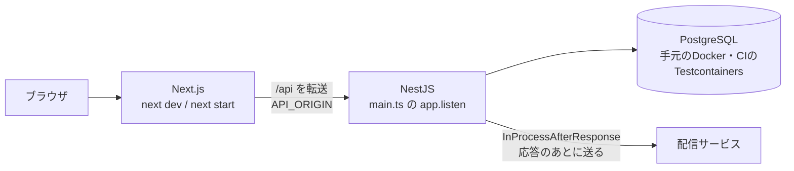
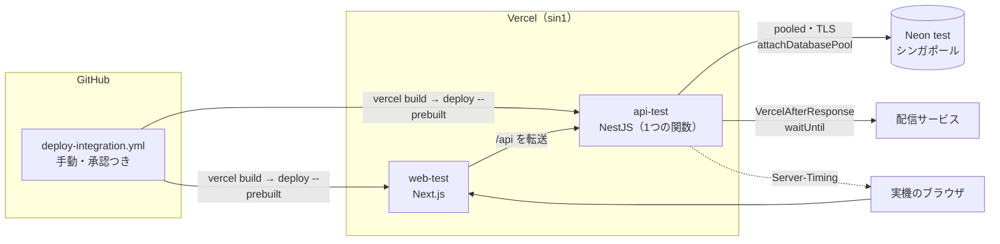
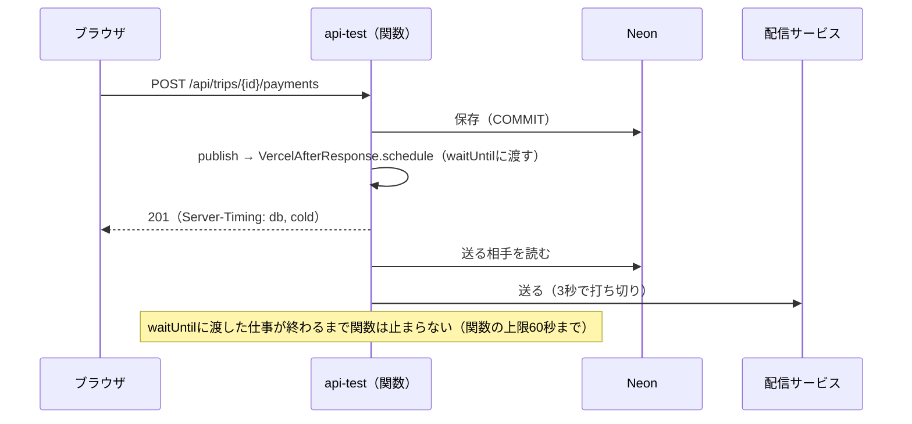
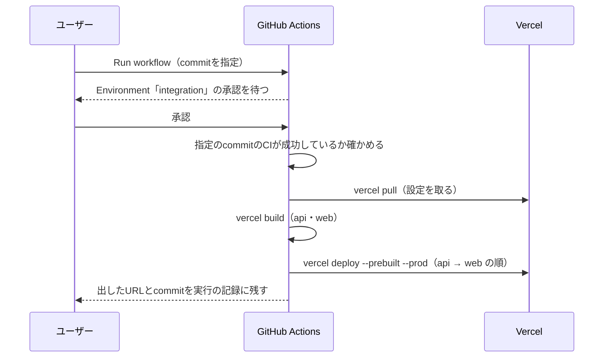

# 設計: 結合検証環境（integration-env）

- 変更レベル: L3
- 要件: [docs/requirements/integration-env.md](../requirements/integration-env.md)（PR #213で承認）
- 論点の記録: [docs/discussions/integration-env.md](../discussions/integration-env.md)
- 作成日: 2026-10-12

## この設計を一言で

今のアプリを、ほぼそのままVercelとNeonの上で動かせるようにする。アプリ側で足すのは、Vercelのときだけ切り替わる3つの部品（応答のあとの通知の送信、DBの接続の後片付け、時間の内訳のヘッダー）と、全部のAPIの応答を共有のキャッシュに載せない設定と、GitHub Actionsからの手動のデプロイだけ。ユーザーは手順書に沿って検証用の環境を作り、Actionsのボタンで出して、実機で確かめる。

## 背景

要件のとおり。アプリは手元とCIでは確かめたが、Vercel・Neonの上では動かしていない。今のAPIは`app.listen`で待ち受け、保存のあとの通知は手元の`InProcessAfterResponse`で送る。Vercelの関数は応答を返すと止まるので、このままでは通知が送られない。

## 目的

- 手元・CI・Vercelで、同じ`main.ts`と同じ組み立てを通す。違いは「Vercelのときに差し替える部品」に閉じ込める。
- 検証用の環境の作り方とデプロイを、手順書とボタンで、誰がやっても同じになるようにする。
- 描画の遅れの内訳（PERF-01）を、実機のブラウザで操作ごとに見られるようにする。

## 要件

要件定義書のR-01〜R-12と、確かめること（OPS-03〜11・17・18、PM-03、PERF-01）。この設計で作りを決めるのは、R-02（Vercelの入口）、R-03（`waitUntil`）、R-04（転送とキャッシュ）、R-05〜R-08（設定と手順）、R-09（手動のデプロイ）、PERF-01の測り方。

## 対象範囲

- `apps/api`: Vercelのときに差し替える部品、`Server-Timing`のヘッダー、全体のキャッシュの設定、`@vercel/functions`の追加
- `apps/web`: 変更なし（`next.config.ts`の転送は今のままで足りる。下の「フロントエンド設計」）
- `.github/workflows/deploy-integration.yml`: 検証用の環境への手動のデプロイ
- `vercel.json`（`apps/api`と`apps/web`）: 関数の実行場所（時間の上限はVercelのプロジェクトの設定）
- `docs/runbooks/integration-env.md`: 作る順番どおりの手順書
- `docs/tests/integration-env.md`: 確かめることの手順と記録の表
- 設計資料`運用設定と公開チェック.md`の環境変数の表を、今のコード（`VAPID_KEYS`）に合わせる

## 対象外

- 本番の環境、バックアップと復元、独自ドメイン（要件の「対象外」のとおり）
- DBの表・API・画面の変更
- PRごとのPreviewへのDBのつなぎ込み

## 現状構成

## 変更後構成

手元とCIでは、今の構成のまま変わらない。Vercelのときだけ、点線の囲みの部品が差し替わる。

## データフロー

### 保存のあとの通知（Vercelのとき）

### 手動のデプロイ

## API 設計

業務のAPIの形は変更なし。全部の`/api`の応答に、次の2つを足す。

- キャッシュ: `Cache-Control: private, no-store`、`CDN-Cache-Control: no-store`、`Vercel-CDN-Cache-Control: no-store`。認証の経路（Better Auth）、経路の制限の404・403・503、エラーの応答も含める。今はコントローラーごとに付けている`private, no-store`は、そのまま残す（二重になっても同じ値）。
- 時間の内訳: `Server-Timing: app;dur=<ミリ秒>, db;dur=<ミリ秒>, cold;desc="<true|false>"`。起動直後の要求にだけ`boot;dur=<ミリ秒>`も付ける。`app`は要求を受けてから応答を返すまで、`db`はその要求でDBの問い合わせにかかった時間の合計、`cold`は関数の実行の単位（インスタンス）が起動して最初の要求かどうか、`boot`はプロセスが起動してからその最初の要求がアプリに届くまで（NestJSの組み立てを含む）。数値と真偽だけを入れ、SQLや中身は入れない。手元とCIでも同じヘッダーを付ける（試験で確かめられるように）。

## DB 設計

表は変更なし。DBの接続（`apps/api/src/infrastructure/database/pool.ts`）は、Vercelのときだけ`attachDatabasePool(pool)`を呼ぶ。`max: 2`・`idleTimeoutMillis: 5000`・`connectionTimeoutMillis: 10000`は今のまま（詳細設計08の5節）。Neonのpooledの接続文字列（`sslmode=require`）をそのまま使い、TLSの検証を無効にしない。

ロールと権限は、今の`apps/api/db/admin/create-roles.sql`・`grant-database.sql`とmigrationをそのまま使う（手順書で、管理者の端末からNeonに対して1回だけ適用する）。

## フロントエンド設計

変更なし。`apps/web/next.config.ts`の外部rewrite（`/api/:path*`を`API_ORIGIN`へ）は、Vercelでもそのまま動く。`API_ORIGIN`はビルドのときに決まるので、デプロイのワークフローが、GitHubのEnvironment「integration」の変数`API_ORIGIN`（APIの固定のURL）を渡してビルドする（R-05）。`vercel deploy`の出力はデプロイごとのURLで、Deployment Protectionがかかるので使わない。画面のHTMLには個人の情報が入らず、業務のデータはブラウザから`/api`で取る（詳細設計08の4節）ので、画面のHTMLのキャッシュの設定は変えない。

## バックエンド設計

### Vercelのときに差し替える部品

見分け方は、Vercelが関数に必ず渡す環境変数`VERCEL=1`。部品の差し替えは、組み立て（composition）の`useFactory`の中だけで行い、業務のコードは見分けない。

| 部品 | 手元・CI | Vercel | 置き場所 |
| --- | --- | --- | --- |
| 保存のあとの処理の口（`AFTER_RESPONSE`） | `InProcessAfterResponse`（今のまま） | `VercelAfterResponse`（新規。今の実装と同じく`setImmediate`で応答のあとに仕事を始め、その約束を`waitUntil`に渡す。例外はログに出す。`drain`は渡した仕事を待つ） | `apps/api/src/infrastructure/after-response/` |
| DBの接続 | `getPool()`（今のまま） | `getPool()`のあとに`attachDatabasePool`を1回だけ呼ぶ | `apps/api/src/infrastructure/database/pool.ts` |
| 時間の内訳 | 同じ（両方で付ける） | 同じ | `apps/api/src/bootstrap/server-timing.ts`（新規） |

`VercelAfterResponse`は、`InProcessAfterResponse`と同じく、仕事の例外を外に出さず、ログには例外の型名だけを出す（通知の設計書「ログと監視」）。

### 入口

`apps/api/src/main.ts`は変えない。Vercelの公式のNestJS対応（設定なし）が、`src/main.ts`のアプリを1つの関数として動かす。`app.listen`の扱いと`enableShutdownHooks`がVercelで問題にならないかは、検証用の環境の最初のデプロイで確かめる（試験計画のIE-01）。動かなければ、Vercel専用の入口に切り替える（論点の記録「APIをVercelで動かす入口をどう作るか」の選ばなかった案）。

### 時間の内訳の測り方

- `app`: `configureApp`の最初のミドルウェアで要求の受け取りの時刻を取り、応答のヘッダーを書く直前に差を出す（`on-headers`の形で、`res.writeHead`の前に足す）。
- `db`: 要求ごとの入れ物（`AsyncLocalStorage`）に合計の時間を持ち、接続（`pg.Client`）の`query`の前後で足す。プールが新しい接続を作ったとき（`pool.on("connect")`）にその接続の`query`を包む。`pool.query`は内部で接続の`query`を呼ぶので、`pool.query`は包まない（二重に数えないため）。業務のコードは変えない。
- `cold`と`boot`: モジュールの最初の読み込みで`true`にし、最初の要求で`false`に変える。最初の要求では、`process.uptime()`から、プロセスの起動から要求が届くまでの時間を`boot`として付ける。

### 関数の設定

`apps/api/vercel.json`で、関数の実行場所を`sin1`にする。時間の上限（`maxDuration`）の60秒は、Vercelのプロジェクトの設定（Functions > Max Duration）で決める。`vercel.json`の`functions`に`src/main.ts`を書くと、NestJSの自動の対応ではその名前の関数ができないため、「`src/main.ts`に合う関数が無い」というエラーでデプロイが止まった（2026-10-13、プロジェクトを作ったときの最初のデプロイ）。`apps/web/vercel.json`も`sin1`にする（画面の関数もシンガポール）。Nodeは24.x（`package.json`の`engines`と、Vercelのプロジェクトの設定）。VercelのNode 22の実行環境では`require()`でESMを読めず、ESMだけの`better-auth`の読み込みで関数が落ちたため、24.xにした（ADR-0008）。

デプロイのワークフローはリポジトリのルートから`vercel deploy`を動かすので、`apps/*/vercel.json`のトップレベルの`regions`はVercelに送られない（Vercel CLI 62.4.0で、deployの地域は`--regions`かカレントディレクトリの`vercel.json`からだけ決まる）。そこで、関数の実行場所はVercelのプロジェクトの設定（Function Region）でも`sin1`にする（手順書3章）。最初のデプロイ（IE-01）で、関数の実行場所を確かめる。

### デプロイのワークフロー（`.github/workflows/deploy-integration.yml`）

- きっかけは`workflow_dispatch`だけ。入力は出すcommit（既定はmainの最新）。
- `environment: integration`。Environmentの設定で、承認者をユーザー、動かせるブランチをmainだけにする（手順書）。
- 手順: 指定のcommitをcheckout → そのcommitが`origin/main`の履歴に含まれるか（`git merge-base --is-ancestor`）を確かめる（含まれなければ止める。mainに入っていないcommitを出さないため）→ そのcommitの`ci.yml`が成功しているかを`gh api`で確かめる（成功していなければ止める）→ `npm ci` → `vercel pull --environment=production`（api・webそれぞれ）→ `vercel build --prod` → `vercel deploy --prebuilt --prod`（apiを出してからweb）→ 出したURLとcommitを実行の要約（`$GITHUB_STEP_SUMMARY`）に書く。
- 秘密情報は`VERCEL_TOKEN`だけ（Environmentの秘密情報）。`VERCEL_ORG_ID`・`VERCEL_PROJECT_ID_API`・`VERCEL_PROJECT_ID_WEB`は秘密ではないのでEnvironmentの変数に置く。
- ログにトークンや設定の値を出さない（`vercel`のコマンドに`--token`で渡し、`set -x`を使わない）。
- 本番の環境への出し方は、公開準備で同じワークフローを`environment`だけ変えて足す。

### Vercelのプロジェクトの設定（手順書で行う）

- web-test: Root Directoryを`apps/web`、api-test: Root Directoryを`apps/api`。どちらも「ルートの外のファイルを含める」を有効にする（npm workspacesと`packages/contracts`のため）。
- Git連携の自動デプロイは止める（mainへのpushで検証用の環境が変わらないようにする）。
- Deployment Protection（Vercelのログイン）は、固定のURLでは外す（パートナーにVercelのアカウントを求めない。詳細設計08の4節）。
- 秘密情報は「Sensitive」の種類で登録する。

## エラー処理

外部のI/O（Neon、配信サービス、Vercel、GitHub）を含むので、5つの項目を決める。

- (a) 再試行: アプリは今のまま、DBのエラーにも通知の送信にも自動で再試行しない（詳細設計08の5節、通知の設計書）。デプロイのワークフローも自動で再試行しない。失敗したらユーザーがもう一度押す。
- (b) 時間切れ: 関数は60秒、DBのロック待ち3秒・SQLは5秒（実行用のロールの既定）・接続10秒（今のまま）、通知の送る処理の読み取りは2秒・送るのは購読あたり3秒（今のまま）。`waitUntil`に渡した仕事も関数の60秒の中で終わる。デプロイのワークフローは全体で20分。
- (c) 冪等性: 業務の書き込みは今の受領票（`Idempotency-Key`）のまま。デプロイは同じcommitを何度出しても同じものになる。
- (d) 部分失敗: apiだけ出てwebが失敗したときは、webをもう一度出す（apiは後方互換を保つので、古いwebのままでも動く）。通知の送信が失敗しても保存は成功のまま（今のまま）。
- (e) 縮退: Neonが休止から戻るあいだは、画面の読み込み中の表示のまま待つ。DBにつながらないときは今のエラーの表示（「保存結果が不明な操作は、復旧後に確認してください」）。

## ログと監視

- Vercelの関数のログに、今のPinoの1要求1行のログがそのまま出る。足すログは、`VercelAfterResponse`の仕事の失敗（型名だけ）。
- 外部の監視やログの転送は入れない（詳細設計08の9節）。
- 無料枠の消費は、確かめたあとにVercelとNeonの管理画面で読み、試験計画の表に書く（OPS-18）。

## セキュリティ

- 秘密情報は、ユーザーがVercelとGitHubの管理画面で登録する。Claude Code・Devinは値を見ない。Vercelでは「Sensitive」にする。
- `VERCEL_TOKEN`は、期限つき（90日）で作り、GitHubのEnvironment「integration」にだけ置く。承認者はユーザー、動かせるブランチはmainだけ。DevinやCodexがワークフローを書き換えたブランチからは動かない。
- `trustedOrigins`は検証用の画面のURLだけ。`*.vercel.app`を許さない（今のコードのまま、`PUBLIC_APP_ORIGIN`だけを許す）。
- `Server-Timing`には時間と真偽だけを入れる。SQL・引数・利用者の情報を入れない。
- 初期登録用のGoogleのOAuthのクライアント（デスクトップ型）とその秘密は、管理者の端末にだけ置き、VercelにもGitHubにも置かない。

## 性能

PERF-01で測る。`Server-Timing`の`app`から`db`を引いたものがアプリの処理、ブラウザで見た全体の時間から`app`を引き、起動直後の要求ならさらに`boot`を引いたものが距離と転送の時間になる。`boot`が関数の起動、`db`が休止のあと最初だけ大きければNeonの休止からの復帰と読む。起動直後と続けての要求の全体の時間の差でも、起動の時間を確かめる。

## テスト方針

| 層 | 確かめること |
| --- | --- |
| 単体 | `VercelAfterResponse`（仕事を応答のあとに始めて`waitUntil`に渡す、例外を外に出さない、型名だけをログに出す）。部品の差し替え（`VERCEL=1`のときだけVercelの部品になる）。`Server-Timing`の形（`app`・`db`・`cold`、起動直後だけ`boot`、数値と真偽だけ）。DBの時間が二重に数えられない |
| HTTP | 全部の`/api`の応答（業務・認証の経路・404・エラー）に、キャッシュを止めるヘッダー3つと`Server-Timing`が付く |
| 実DB | `db`の時間が、DBに問い合わせた要求で0より大きく、問い合わせない要求で0 |
| ワークフロー | `deploy-integration.yml`の形（`workflow_dispatch`だけ、`environment: integration`、CIの成功を確かめる手順、`--prebuilt`、秘密を`--token`で渡す、`set -x`が無い）をハーネスの試験のように静的に確かめる |
| 検証用の環境 | 試験計画のIE-01（入口が動く）と、要件の確かめること（OPS・PM-03・PERF-01）を、手順書に沿ってユーザーとClaude Codeが確かめる |

## 移行とリリース

- アプリの変更は、手元とCIでの動きを変えない（差し替えはVercelのときだけ、ヘッダーの追加は応答の形を変えない）。
- 検証用の環境は新しく作るので、データの移行は無い。
- 順番: アプリ側の変更とワークフローをマージ → ユーザーが手順書でVercel・Neon・Google・GitHubを準備 → ワークフローで出す → 確かめる。

## リスク

| リスク | 対策 |
| --- | --- |
| Vercelの設定なしのNestJSの対応が、`app.listen`や`enableShutdownHooks`とぶつかる | IE-01で最初に確かめる。だめならVercel専用の入口に切り替える |
| `vercel build`がnpm workspacesの`packages/contracts`を解決できない | Root Directoryと「ルートの外のファイルを含める」で解決する。だめならワークフローで`packages/contracts`を先にビルドする |
| `waitUntil`の仕事が関数の60秒を超える | 通知は購読あたり3秒・最大3件の並列なので、超えない見込み。OPS-11で確かめる |
| 描画の遅れが距離によるものだった | PERF-01の結果で、本番の前にDBのサービスの変更をADRで検討する（要件のとおり） |
| トークンの漏れ | Environmentの承認・mainだけ・期限つき・Sensitiveの4つで、漏れにくく、漏れても値は読めないようにする |

## 決めたこと（問いと答え）

[docs/discussions/integration-env.md](../discussions/integration-env.md)

## 未決事項

[docs/discussions/integration-env.md](../discussions/integration-env.md)の「仮決定」が3件（APIの入口、描画の遅れの測り方、手順書の置き場所）。この設計書のPRのマージまでに異議が無ければ「決定」にする。
