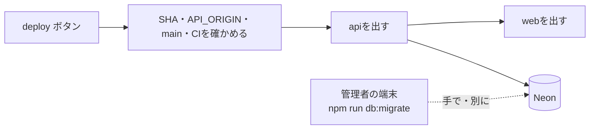
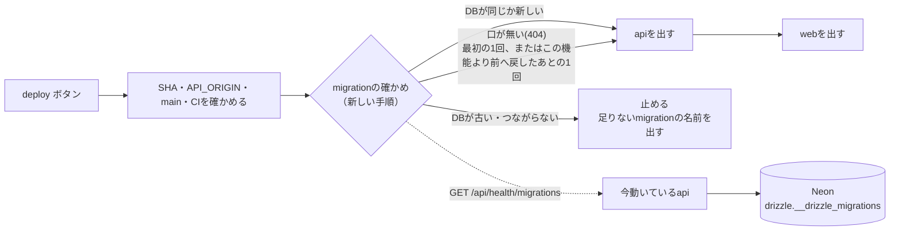
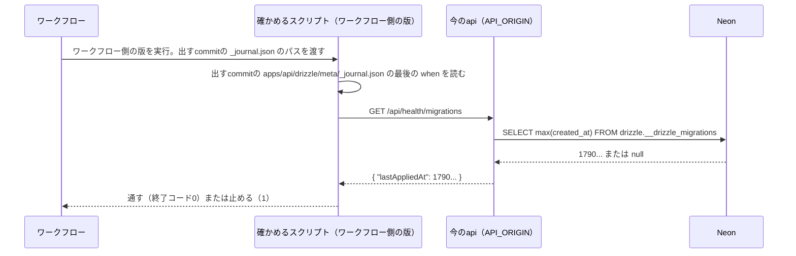

# 設計書: migration-deploy-check（migrationの流し忘れをデプロイの前に止める）

- ステータス: draft
- レベル: L3
- 関連: docs/requirements/migration-deploy-check.md / ADR-0003（本番migrationの方式とDBロールの分離） / 論点の記録 docs/discussions/migration-deploy-check.md

## この設計を一言で

デプロイのワークフローが、出す前に今のapiへ「最後に流したmigrationの時刻」を聞き、出すcommitの最後のmigrationより古ければ、apiもwebも出さずに止める。

## 背景

要件定義の「背景」のとおり。ToDoの表のmigrationを流さないままデプロイでき、ToDoの画面が開けなくなった。

## 目的

要件定義のF-01〜F-08を満たす。ADR-0003（migrationは管理者の端末だけで流す）は変えない。

## 要件

docs/requirements/migration-deploy-check.md

## 対象範囲

- api: 公開の口`GET /api/health/migrations`と、それが読むDrizzleの履歴の表への読む権限（migration 1本）。
- 確かめるスクリプト: 出すcommitの`_journal.json`と今のapiの答えを比べる、依存のないNodeのスクリプト（`.github/scripts/check-deployed-migrations.mjs`）。ワークフロー自身の版を使い、出すcommitの作業ツリーには置かない。
- ワークフロー: `deploy-vercel.yml`に、apiを出す前の手順を2つ（スクリプトの取り出しと確かめ）足す。
- 文書: PRのひな形、`implement-change`スキル、本番と検証用の手順書。

## 対象外

要件定義の「対象外」のとおり。webの画面は変えない。

## 現状構成



ワークフローはDBの状態を見ない。migrationを流したかどうかは、人が覚えておくしかない。

## 変更後構成



## データフロー



比べるのは今動いているapiで、これから出すapiではない。DBの状態はコードの版によらないので、前の版のapiに聞いても同じ答えになる。出す前に聞けるので、DBが古いまま新しいapiが出ることも無い。

## API 設計

`GET /api/health/migrations`（`@PublicRoute()`）。

```json
{ "lastAppliedAt": 1794133200000 }
```

- `lastAppliedAt`: 最後に流したmigrationの`when`（ミリ秒の整数）。1本も無ければ`null`。
- ログインの有無で答えは変わらない。If-Matchなどの書き込み用のヘッダーは要らない。
- DBにつながらない・権限が無いときは、今の共通のエラー処理のまま500を返す。

置き場所は、確認のページの選択肢の文（「`/api/health`に足す」）から変えて、`/api/health`の下の別の口にした。`/api/health`はプロセスが動いているかだけを返し、DBを読まない作りで、次の2つがそれに頼っている。

- E2Eと`manual-push.mjs`の起動待ち（`e2e/playwright.config.ts:49`）。DBを読むと、DBの準備が遅いだけで起動待ちが失敗する。
- `server-timing.db.test.ts:73`の「`/api/health`はDBの時間が0」という試験。

誰でも読めて、返すのは時刻1つだけという、決めたことの中身は変わらない。

契約は`packages/contracts/openapi/foundation.json`に足し、`npm run api:generate`で型を作る。webは使わないが、生成の対象には入る。

## DB 設計

カスタムmigration `0013_app_runtime_read_migrations.sql`を1本足す。

```sql
GRANT USAGE ON SCHEMA "drizzle" TO app_runtime;
GRANT SELECT ON "drizzle"."__drizzle_migrations" TO app_runtime;
```

- 表とデータは変えない。書く権限は足さない。
- `drizzle`のスキーマと履歴の表は、`drizzle-kit migrate`が最初に作り、migratorが持ち主になる。このmigrationが流れる時点では必ずある。
- 履歴の表にはmigrationのハッシュも入っているが、apiが返すのは`created_at`の最大だけ。

## フロントエンド設計

対象外（webは変えない）。

## バックエンド設計

既存の`foundation`モジュール（`/api/health`を持つ）に置く。

| ファイル                                       | 役割                                                                  |
| ---------------------------------------------- | --------------------------------------------------------------------- |
| `adapter/outbound/migration-status.port.ts`    | `lastAppliedAt(): Promise<number \| null>`                            |
| `infrastructure/pg-migration-status.ts`        | `SELECT max(created_at)`を1回。bigintは文字列で返るので`Number`にする |
| `infrastructure/in-memory-migration-status.ts` | `DATABASE_URL`が無いとき（DBなしの試験）。`null`を返す                |
| `usecase/get-migration-status.usecase.ts`      | 上の口を呼び、`{ lastAppliedAt }`を返す                               |
| `controller/health.controller.ts`              | `GET migrations`を足す。`@PublicRoute()`                              |

DBの接続は既存の`getPool()`を使う。トランザクションは要らない。

### 確かめるスクリプト（`.github/scripts/check-deployed-migrations.mjs`）

`node .github/scripts/check-deployed-migrations.mjs <API_ORIGIN> <_journal.jsonのパス>`。Node 24の`fetch`だけを使い、`npm ci`も`nest build`も要らない。判定は同じファイルの純粋関数（`compareMigrations`）に分けて試験する。

置き場所を`apps/api`のCLIにしないのは、出すcommitの作業ツリーに置くと、この機能より前のcommitへ戻して出すときにスクリプトが無く、確かめの手順で止まるため。ワークフローは、出すcommitとは別に、ワークフローを動かした版（`github.sha`）を取り出して使う。出すcommitから読むのは`_journal.json`だけで、これはデプロイのワークフローができた版（`befb700`、2026-10-18）以降のどの版にもある。それより前のcommitは、読めないので止まる（出す対象外）。

試験で本体を読み込めるよう、スクリプトは直接実行されたときだけ本体を動かす（`import.meta.main`で判定する）。

| 今のapiの答え                                     | 判定                                                  | 終了コード |
| ------------------------------------------------- | ----------------------------------------------------- | ---------- |
| 200、`lastAppliedAt` ≥ commitの最後の`when`       | 通す                                                  | 0          |
| 200、`lastAppliedAt` < commitの最後、または`null` | 止める。`when`がDBより新しいmigrationの名前を全部出す | 1          |
| 404                                               | 警告（`::warning::`）を出して通す                     | 0          |
| それ以外の状態・つながらない・返す形が違う        | 止める                                                | 1          |
| `_journal.json`が読めない・空                     | 止める                                                | 1          |

止めたときの案内は次の1文にする。「DBに流していないmigrationがあります: 0011_planning_todos, 0012_planning_todos_grants。管理者の端末でmigrationを流してから、もう一度出してください（docs/runbooks/production.md の10章）」。

`fetch`は10秒で打ち切る。再試行はしない（失敗したら人がもう一度ボタンを押す）。

### ワークフロー（`deploy-vercel.yml`）

`setup-node`のあと、`npm ci`の前に手順を2つ足す。確かめは依存が要らないので、`npm ci`を待たずに早く止める。出すcommitのcheckoutは今のまま変えない。

```yaml
- name: Checkout deploy tooling from the workflow ref
  uses: actions/checkout@v5
  with:
    ref: ${{ github.sha }}
    path: .workflow
    sparse-checkout: .github/scripts
    sparse-checkout-cone-mode: false
    persist-credentials: false
- name: Verify database migrations are applied
  env:
    API_ORIGIN: ${{ vars.API_ORIGIN }}
  run: node .workflow/.github/scripts/check-deployed-migrations.mjs "$API_ORIGIN" apps/api/drizzle/meta/_journal.json
```

`github.sha`は、ボタンを押したブランチの先頭で、出すcommit（`inputs.sha`）とは別。検証用・本番のEnvironmentはどちらも`main`だけに限っている（`docs/runbooks/production.md`・`docs/runbooks/integration-env.md`）ので、mainの先頭になる。前のcommitを指定しても、確かめるスクリプトは今のmainの版で動く。

検証用と本番は同じファイルを呼ぶので、両方に効く。

## エラー処理

- api: 履歴の表を読めないとき（権限が無い・DBが落ちている）は、ほかの口と同じ共通のエラー処理で500になる。ワークフローはこれを「止める」に数える（E-04）。
- スクリプト: 通すのは「DBが同じか新しい」と「口が無い」の2つだけ。判定できないものは、すべて止める。

## ログと監視

- ワークフローの記録（Step Summary）に、比べた2つの時刻と、止めたときは足りないmigrationの名前を書く。
- apiの口は既存の要求ログに1行出る。足すものは無い。

## セキュリティ

- 誰でも読める口が1つ増える。返すのは時刻1つで、利用者のデータ・migrationの名前やハッシュは返さない（F-02）。わかるのは「いつスキーマを変えたか」だけ。
- 実行用のロールに足すのは、履歴の表を読む権限だけ。スキーマの`USAGE`は表の名前を引くためだけで、DDLにはつながらない。
- migratorの接続をGitHub・Vercelに置かない（ADR-0003のまま）。
- `security-reviewer`を起動する（公開の口とロールの権限を足すため）。

## 性能

対象外。デプロイのときに1回、1行を読むだけ。

## テスト方針

- 判定は純粋関数の単体試験で、表の行を全部確かめる。試験は`.claude/tests/check-deployed-migrations.test.mjs`に置き、今の`npm run test:harness`（CIの`harness`ジョブ）で動かす。
- 「この機能より前のcommitへ戻して出す」ことを確かめる。スクリプトを出すcommitの作業ツリーに依らず動くこと（出すcommitの`_journal.json`のパスだけを渡すこと）を、スクリプトの試験で確かめる。ワークフローの2つの手順は、結合検証環境で前のcommitのSHAを指定して1回動かして見る。
- apiの口は、DBつきの試験で「ログインなしで200」「返すのは`lastAppliedAt`だけ」「最後のmigrationの`when`と一致」を確かめる。DBなしの試験で`null`を返すことも確かめる。
- ワークフローは手元で動かせないので、結合検証環境へのデプロイで、通る場合を1回見る。止まる場合は単体試験で確かめる。
- 詳しくは`docs/tests/migration-deploy-check.md`。

## 移行とリリース

この機能を最初に出す順番は次のとおり。

1. 検証用のDBに、管理者の端末から`0011`〜`0013`を流す（ToDoの分と、この機能の権限）。
2. `deploy-integration`で出す。今のapiに口がまだ無いので、警告が出て進む（F-06）。
3. もう一度`deploy-integration`を押し、今度は確かめが通ることを見る。
4. 結合検証環境で、この機能より前のcommitのSHAを指定して出し、確かめの手順で止まらないことを見る。
5. 4で戻したので、動くapiに口が無い。検証用を最新へ出し直し、404の警告で進むことを見る（F-06）。
6. 本番は、バックアップを取って照合してから`0011`〜`0013`を流し、`deploy-production`で出す。

`0013`を流さずに出すと、新しいapiの口が500を返し、次のデプロイから止まる。流し忘れは次の回で必ず見つかる。

## リスク

| リスク                                                     | 起きたとき                   | 手当て                                                                                                                                                                        |
| ---------------------------------------------------------- | ---------------------------- | ----------------------------------------------------------------------------------------------------------------------------------------------------------------------------- |
| `_journal.json`の`when`が前のものより小さいmigrationが入る | 足りないのに通る             | Drizzleは`when`の順に流す。`npm run db:check`が通るcommitだけを出す。ここでは足さない                                                                                         |
| 今のapiが落ちていて、直す版を出したいのに止まる            | 障害のときに出せない         | 落ちている原因がDBでないなら、管理者がワークフローの手順を一時的に外す。手順書の障害の章に書く                                                                                |
| この機能より前のcommitへ戻して出す                         | 確かめが止まり、戻せない     | 確かめるスクリプトはワークフロー側の版を使い、出すcommitからは`_journal.json`だけを読む。この機能より前のcommitにも`_journal.json`はあるので動く                              |
| 404で通す道が、最初の1回のあとも残る                       | 口が消える壊れ方をしても通る | 次のデプロイで同じ警告が出るので気づける。この機能より前のcommitを戻し先にしなくなってから、404を止める側に変えるかを振り返りで決める。それまでは、戻したあとの1回も404で通る |

## 決めたこと（問いと答え）（docs/discussions/migration-deploy-check.md へのリンクだけ）

- [論点の記録](../discussions/migration-deploy-check.md)

## 未決事項（論点の記録の「回答待ち」「仮決定」へのリンクと、件数）

- 仮決定4件（口が無いときの扱い、DBの方が新しいとき、マージのあとの作業の書き場所、確かめるスクリプトの置き場所）。設計のPRのマージまでに異議がなければ決定にする。
