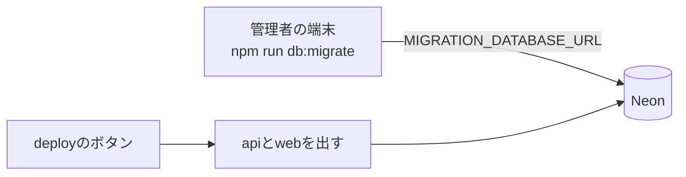
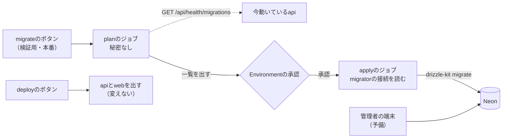
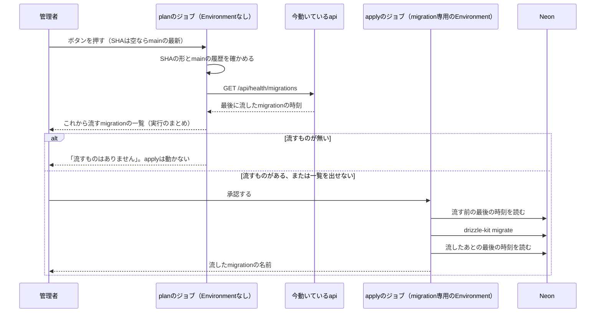

# 設計書: migration-workflow（migrationを出先からも流せるようにする）

- ステータス: draft
- レベル: L3
- 関連: docs/requirements/migration-workflow.md（PR #362で承認）、ADR-0011（承認つきの手動のワークフローからも流す）、ADR-0003（migrationの方式とDBロール）、docs/designs/migration-deploy-check.md（流し忘れをデプロイの前に止める）、論点の記録`docs/discussions/migration-workflow.md`

## この設計を一言で

GitHub Actionsに、検証用と本番のmigrationのボタンを足す。ボタンを押すと、秘密を使わずに「これから流すmigration」の一覧を出し、承認のあとでmigratorの接続を使って流す。管理者は、スマートフォンからでもDBを変える変更を出せるようになる。

## 背景

要件定義のとおり。migrationは管理者の端末からしか流せず、出先ではDBを変える変更を出せない。

## 目的

- 承認の前は秘密を読まず、承認のあとの流すジョブだけがmigratorの接続を読む。
- 流れるのは`main`の履歴にあるcommitのmigrationだけにする。
- デプロイのボタンと同じ見た目と手順（SHAの入力、承認、実行の名前）にそろえる。

## 要件

`docs/requirements/migration-workflow.md`のF-01〜F-12、E-01〜E-08、B-01〜B-03。

## 対象範囲

- ワークフロー: `.github/workflows/migrate-integration.yml`・`migrate-production.yml`（ボタン）、`migrate-db.yml`（共通の手順）。
- スクリプト: `.github/scripts/plan-migrations.mjs`（一覧を作る）。比べる関数は`migration-deploy-check`の`.github/scripts/check-deployed-migrations.mjs`の`compareMigrations`を使う。
- 試験: `.claude/tests/plan-migrations.test.mjs`、`.claude/tests/migrate-workflow.test.mjs`。
- 文書: 手順書（`docs/runbooks/integration-env.md`・`production.md`）、`docs/designs/migration-deploy-check.md`と`.github/scripts/check-deployed-migrations.mjs`の、止めたあとの案内の文。
- GitHubの設定（ユーザーが行う）: Environmentを2つ、秘密を2つ、リポジトリの変数を2つ。

## 対象外

要件定義の「対象外」のとおり。apiとwebのコード、DBの表は変えない。`GET /api/health/migrations`は`migration-deploy-check`が作る。

## 現状構成

migrationを流せるのは端末だけ。デプロイのボタンはDBの状態を見ない（`migration-deploy-check`の実装で、流し忘れを止めるようになる）。

## 変更後構成

## データフロー

planのジョブは、Environmentを使わない。GitHubは、承認が必須のEnvironmentの秘密と変数を、承認されるまでジョブに渡さないため。

## API 設計

変更なし。planのジョブは、`migration-deploy-check`が作る`GET /api/health/migrations`（ログインなし。`{ "lastAppliedAt": 数 | null }`）を読む。

## DB 設計

変更なし。applyのジョブは、migratorの接続で`drizzle.__drizzle_migrations`の`created_at`の最大を読む（migratorは持ち主なので、権限は足さない）。

## フロントエンド設計

対象外。

## バックエンド設計

### ワークフローの分け方

デプロイと同じ形にする。ボタンのファイルは入力と同時実行の決まりだけを持ち、手順は共通のファイルに置く。

| ファイル                  | 中身                                                                                                                                           |
| ------------------------- | ---------------------------------------------------------------------------------------------------------------------------------------------- |
| `migrate-integration.yml` | `workflow_dispatch`（入力`sha`）。`migrate-db.yml`を、Environment `migrate-integration`、apiのURLの変数`MIGRATE_API_ORIGIN_INTEGRATION`で呼ぶ  |
| `migrate-production.yml`  | 同じ。Environment `migrate-production`、変数`MIGRATE_API_ORIGIN_PRODUCTION`、バックアップの確かめの文を出す印（`backup_reminder: true`）を渡す |
| `migrate-db.yml`          | `workflow_call`。planとapplyの2つのジョブ                                                                                                      |

- 実行の名前は`migrate-integration <SHA>`（空なら`main latest`）。承認の画面で、どの環境の何を流すかが見える。
- 同時実行は、環境ごとの`concurrency`の組（`migrate-integration`・`migrate-production`）で1つにし、あとのものを待たせる（`queue: max`、`cancel-in-progress: false`。デプロイと同じ）。
- 権限は`contents: read`だけ。

### planのジョブ（Environmentなし）

1. `sha`の形を確かめる（空か40桁の16進）。
2. 流すcommitを`fetch-depth: 0`で取り出し、`main`の履歴にあるかを確かめる（`git merge-base --is-ancestor`。デプロイと同じ）。
3. ワークフローを動かした版（`github.sha`）の`.github/scripts/`を別の場所に取り出す。流すcommitの作業ツリーのスクリプトは使わない（`migration-deploy-check`と同じ理由。古いcommitにはスクリプトが無い）。
4. `node <ワークフローの版>/plan-migrations.mjs <apiのURL> <流すcommitの_journal.json>`を動かす。
5. 結果を、読みに行ったapiのホスト名とあわせて実行のまとめ（`GITHUB_STEP_SUMMARY`）に書き、applyへ渡す値（`state`と`count`）を出力する。`backup_reminder`が付いていれば、バックアップの確かめの文と手順書の場所を足す。

apiのURLは、リポジトリの変数（Environmentの変数ではない）から読む。デプロイ用のEnvironmentの`API_ORIGIN`は、承認の前は読めないため。URLは秘密ではない。

### 一覧を作るスクリプト（`plan-migrations.mjs`）

Node 24の`fetch`だけを使う。`npm ci`は要らない。判定は純粋関数`planMigrations(journal, apiAnswer)`に分けて試験する。

| 今のapiの答え                                             | `state`   | 実行のまとめに出すもの                                                                   | applyは動くか    |
| --------------------------------------------------------- | --------- | ---------------------------------------------------------------------------------------- | ---------------- |
| 200、`lastAppliedAt`がcommitの最後の`when`以上            | `none`    | 「流すものはありません」                                                                 | 動かない         |
| 200、`lastAppliedAt`がcommitの最後より古い                | `pending` | `when`が`lastAppliedAt`より新しいmigrationの名前を、流す順に全部                         | 承認のあとに動く |
| 404・つながらない・200以外・返す形が違う・URLの変数が無い | `unknown` | 「一覧を出せません（理由）。承認すると、DBの履歴を見て、流していないものだけを流します」 | 承認のあとに動く |

- 200で`lastAppliedAt`が`null`（1本も流していない）は、最初の構築の途中を表す。ボタンでは扱わないので、端末で最初の構築をするよう出して止める（要件B-02）。
- `_journal.json`が読めない・空なら止める。
- スクリプトは、`unknown`でも終了コード0で終わる（承認へ進むため）。止めるのは、`_journal.json`が読めないときと`null`のときだけ。

### applyのジョブ（migration専用のEnvironment）

`needs: plan`、`if: needs.plan.outputs.state != 'none'`、`environment: <migrate-…>`。承認のあとに始まる。

1. `secrets.MIGRATION_DATABASE_URL`があるかを確かめる。無ければ、Environmentの名前を出して止める（値は出さない）。
2. 流すcommitを取り出し、`main`の履歴にあるかをもう一度確かめる（承認を待つあいだに`main`が変わっても、同じSHAを使う。SHAはplanの出力から受け取る）。
3. `actions/setup-node`（24）と`npm ci`。
4. 流す前の時刻を読む（`psql`で`select coalesce(max(created_at), 0) from drizzle.__drizzle_migrations`）。
5. `npm run db:migrate -w @tomotabi/api`を、`MIGRATION_DATABASE_URL`を環境変数で渡して動かす。
6. 流したあとの時刻を読み、`_journal.json`から、時刻が4より新しく6以下のmigrationの名前を実行のまとめに書く。0本なら「流すものはありませんでした」。

- 接続文字列は環境変数で渡し、コマンドの引数に置かない。GitHubは、登録した秘密と同じ文字列をログで伏せる。
- `MIGRATION_DATABASE_URL`は、使う手順（1・4・5・6）の`env`にだけ置く。ジョブの`env`と、3番目の`npm ci`の手順には置かない。`npm ci`は依存パッケージのinstallスクリプトを動かすので、そこに秘密があると、乗っ取られた依存パッケージがDBの持ち主の接続を読める。
- Drizzleは、1回の実行で流すmigrationを1つのトランザクションにまとめる（`drizzle-orm` 0.45.4の`pg-core/dialect.js`の`migrate`。SQLと履歴への追加を、全部まとめて`session.transaction`の中で流す）。途中のSQLが失敗すると、その回に流そうとしたmigrationは全部が巻き戻り、履歴にも入らない（要件E-04）。5が失敗しても6を動かし（`if: always()`）、流す前と同じ時刻であることを読んで「何も流れていません」と出す。
- planとapplyのあいだに端末から流されていても、`drizzle-kit migrate`は流していないものだけを流す（要件E-06）。

### `migration-deploy-check`の案内の文

`check-deployed-migrations.mjs`が止めるときの文を、「管理者の端末でmigrationを流してください」から、「`migrate-integration`（本番は`migrate-production`）のボタンで流してください。端末からも流せます」に変える。設計書と手順書の同じ文も直す。

## エラー処理

外部への入出力は、今動いているapiへのGETが1回と、DBへの接続。

- リトライ: しない。apiを読めなければ`unknown`として進み、DBにつながらなければ止める。押し直せば、流していないものだけが流れる。
- タイムアウト: apiへのGETは10秒。ジョブはplanが5分、applyが15分。
- 冪等性: `drizzle-kit migrate`は、履歴の表にあるものを流さない。同じボタンを続けて押しても、2回目は何も流れない。
- 部分失敗: 起きない。途中で失敗したら、その回に流そうとしたmigrationは全部が巻き戻り、DBは流す前の状態のまま残る。今動いているapiはそのまま動く。直したmigrationをマージして、押し直す。トランザクションの中で流せないSQL（`CREATE INDEX CONCURRENTLY`など）は、今のmigrationでは使っていない。使うときは、この前提を見直す。
- フォールバック: GitHubが使えないときは、端末から流す。

## ログと監視

実行のまとめに、環境・commit・流したmigrationの名前を書く。誰がいつ承認して流したかは、GitHubの実行の履歴に残る。接続文字列・パスワード・SQLの中身は書かない。

## セキュリティ

- migratorの接続は、Environment `migrate-integration`・`migrate-production`の秘密`MIGRATION_DATABASE_URL`に置く。どちらも、Required reviewersを自分、使えるブランチを`main`だけにする。保護を付けてから秘密を置く（デプロイのEnvironmentと同じ順）。
- デプロイのジョブ、PRのCI、ブランチのワークフローは、この秘密を読めない。`main`以外のブランチのワークフローが同じEnvironmentを指定しても、ブランチの決まりで始まらない。
- planのジョブは秘密を読まない。読むのは、公開のリポジトリの中身と、ログインなしで読める時刻1つだけ。
- 流すcommitは、planとapplyの両方で`main`の履歴にあるかを確かめる。SHAの入力は、形を確かめてから使い、シェルに直接埋め込まない（環境変数で渡す）。
- 使う外部のアクションは、今のワークフローと同じ`actions/checkout@v5`・`actions/setup-node@v4`だけ。
- Required reviewersは、公開のリポジトリか、GitHub Enterpriseでしか使えない（このリポジトリは公開）。リポジトリを非公開にすると承認が外れるので、その前にこのボタンをやめるか、プランを確かめる。手順書に書く。
- 実装のあと`security-reviewer`を起動する（秘密とワークフローの権限を扱うL3）。

## 性能

対象外（手で押すときだけ動き、migrationは数本）。

## テスト方針

- `plan-migrations.test.mjs`: `planMigrations`の判定（流し済み・一部だけ・0本・DBの方が新しい・`null`・404・つながらない・返す形が違う・`_journal.json`が空）と、まとめに出す文。
- `migrate-workflow.test.mjs`: ワークフローのファイルを読み、planにEnvironmentが無いこと、applyにEnvironmentと`needs`と`if`があること、秘密を読むのがapplyだけであること、`main`の確かめが両方にあること、`concurrency`の組、`permissions`を確かめる（今の`deploy-integration-workflow.test.mjs`と同じやり方）。
- 検証用での手の確かめ: 流すものがある・無い・承認しない・apiのURLの変数を外して`unknown`になる、の4つ。ブランチから動かして秘密を読めないこと、ログに接続文字列が出ないことも見る。
- 本番のボタンは、検証用で確かめたあと、次にDBを変える変更で初めて使う。

## 移行とリリース

1. `migration-deploy-check`を実装して出す（承認済みの計画。権限のmigrationの番号は、`0013`・`0014`をToDoのカテゴリが使ったので`0015`に直す）。
2. この機能のワークフロー・スクリプト・試験・手順書をマージする。
3. ユーザーが、手順書に沿ってEnvironmentを2つ作り、保護を付け、秘密と変数を置く。
4. 検証用のボタンで手の確かめをする。
5. ADR-0011の「Migration」の手順が済んだことを、公開の記録に書く。

戻すときは、ワークフローのファイルを消し、Environmentと秘密を消して、migratorのパスワードを替える。DBは変えていないので、戻すものは無い。

## リスク

- `drizzle-kit migrate`のログに、つながらないときの接続先の名前が出ることがある。秘密そのものはGitHubが伏せるが、検証用の最初の実行でログを見て確かめる。
- Environmentの保護を付ける前に秘密を置くと、保護なしで読める時間ができる。手順書で順番を決め、保護の付いていることを確かめてから置く。
- apiのURLの変数を取り違えると、別の環境の時刻で一覧を作ってしまう。その時刻が最新なら`none`になり、applyのジョブは動かず、何も流れずに終わる（例: 本番用の変数に検証用のURLを置き、検証用に流したあとで本番のボタンを押す）。一覧が実際と違っても、applyのジョブは流す前後の時刻をDBから読み直すので、違うものが流れることはない。planのまとめに、読みに行ったapiのホスト名を出して気づけるようにする。流し忘れたままデプロイしても、`migration-deploy-check`が止める。

## 調べたこと: Neonの「時点を指定して戻す」機能

要件の対象外だが、設計で調べると約束したので結果を書く。

- 無料枠では、戻せるのは6時間前までで、変更の履歴は1GBまで。有料のLaunchは7日、Scaleは30日まで。
- 無料枠でも、手で取るスナップショットを1つ持てる。
- 今のバックアップ（端末で取るdump）は、戻して照合するところまでが手順に入っている。6時間の窓は、流した直後の失敗には足りるが、数日後に気づいた不具合には足りない。
- 出先で本番に流す前の備えとして、Neonの画面からスナップショットを取る方法はありうる。戻す手順と、戻したあとの照合を確かめていないので、今回は採らない。試す価値があるかは、ユーザーに決めてもらう。

出典: https://neon.com/docs/introduction/plans 、https://neon.com/docs/introduction/history-window 、https://neon.com/docs/postgres/backup-restore/backups

## 決めたこと（問いと答え）

`docs/discussions/migration-workflow.md`

## 未決事項

なし。論点の記録の問いは、すべて決定した。
