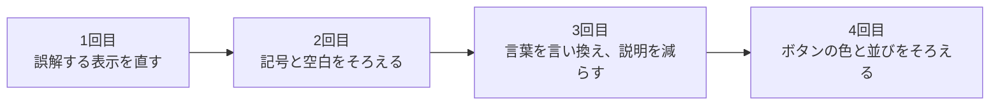
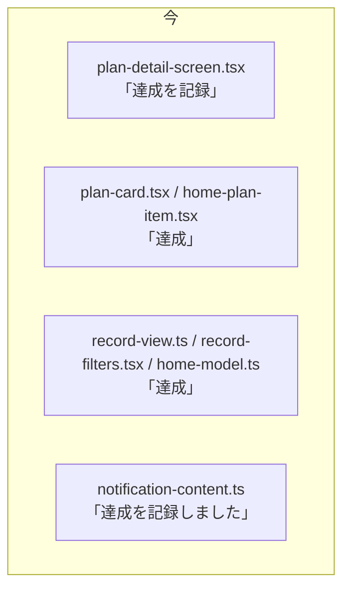
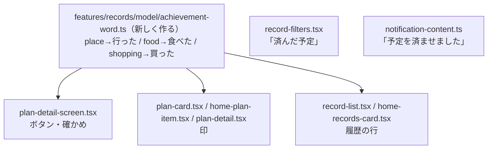
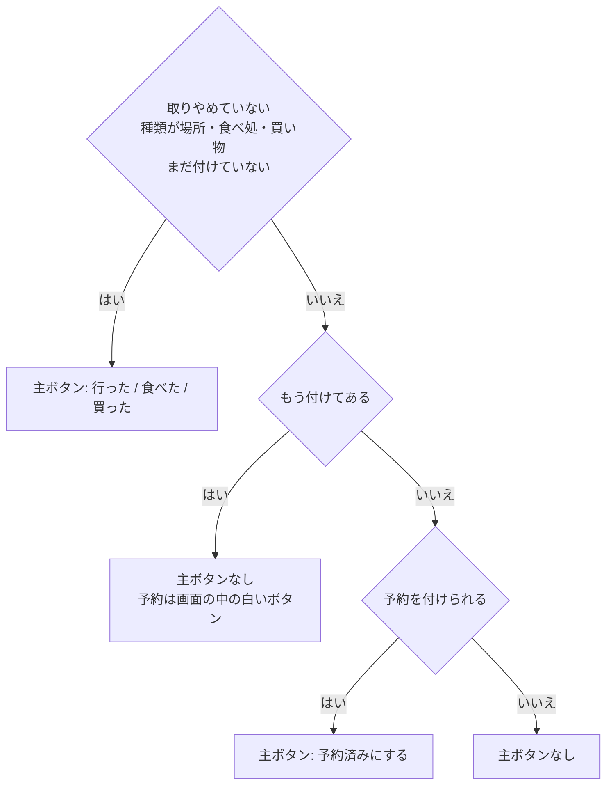

# 設計書: natural-wording（画面の言葉と表示を、使う人の言い方に直す）

- ステータス: draft
- レベル: L2（`apps/web`の文言・表示の条件・見た目を、複数の画面で直す。APIとDBは変えない）
- 関連: 論点の記録`docs/discussions/natural-wording.md`、点検のページ https://claude.ai/artifact/NW6skTYETAVFTmMqzBciYT

## この設計を一言で

画面の言葉を、設計のときの呼び名から、二人がふだん言う言い方に直す。「達成」は「行った」「食べた」「買った」に、精算の「受け渡し」「確認」「対象」「明細」は「精算」と「支払い」に変える。名前で伝わるようにして、小さい説明の文を減らす。直しは4回のPRに分け、実装はDevinに渡す。

## 背景

画面の文言およそ700行と、手元で動かした実物の画面30枚を点検した（2026-11-10）。画面の言葉が、使う人の言い方ではなく、アプリの仕組みの説明になっているとわかった。原因は5つあった。設計のときの言葉がそのまま出ている。ボタンの名前で伝わらないぶんを説明文で補っている。表示が状況と合わない所がある。同じことに違う言葉を使っている。記号と空白の入れ方が日本語のアプリと違う。

これまでの直し（論点の記録「plan-record-buttons」「words-and-landing」）は、名前を変えずに説明の一行を足す形が多かった。その結果、小さい灰色の文が増えた。

## 目的

- ボタンと見出しの名前だけで、何が起きるかがわかるようにする。
- 表示が状況と食い違う所をなくす。
- 同じことは、どの画面でも同じ言葉・同じ記号・同じ色で出す。

## 要件

論点の記録の答え（2026-11-10）のとおり。

- 「達成」は、予定の種類ごとに「行った」「食べた」「買った」にする。履歴の絞り込みは「済んだ予定」にまとめる。
- 精算の「受け渡し」と、物の名前としての「確認」は、「精算」にそろえる。
- 「取りやめ」「取り消し」は残し、確かめを閉じるボタンを「やめる」から「戻る」に変える。
- 旅行を手で開始する仕組みは変えず、期間に入った旅行の文と印を直す。
- 「行った」などを付けたあとの予定では、予約を橙の主ボタンにしない。
- 予定の詳細の「別の日に移す」「取りやめにする」は、右上のメニューに移す。

仮に決めて進めるもの（異議があれば設計の承認までに変える）は、記号と空白、自分と相手の呼び方、主ボタンの色、説明の削り方、やり直しのボタンとエラーの文、予約の印とボタン、通知の文の7つ。

## 対象範囲

`apps/web/src`の文言・表示の条件・見た目、通知の文（`shared/push/notification-content.ts`）、`docs/glossary.md`、それらの試験（`apps/web/tests`と`e2e/tests`）。

### 1回目のPR: 誤解する表示を直す

| 何を                                              | どこで                                                                                                                                                               | 今                                                                                         | 直したあと                                                                                               |
| ------------------------------------------------- | -------------------------------------------------------------------------------------------------------------------------------------------------------------------- | ------------------------------------------------------------------------------------------ | -------------------------------------------------------------------------------------------------------- |
| 期間に入ったが開始していない旅行の知らせ          | `screens/home/home-screen.tsx`（期間中で開始前）                                                                                                                     | 見出し「この旅行はまだ開始していません」、本文「旅行を開始すると、記録や精算ができます。」 | 見出し「旅行の日になりました」、本文「「旅行を開始する」を押すと、印が「旅行中」に変わります。」         |
| 同じ旅行の印                                      | `features/trips/ui/trip-status-badge.tsx`と、それを使うしおり・メニュー・旅行の一覧                                                                                  | 「出発前」                                                                                 | 開始していない旅行で、今日が開始日以降なら「開始待ち」。開始日より前は「出発前」のまま                   |
| 「行った」などを付けたあとの主ボタン              | `screens/plan-detail/plan-detail-screen.tsx`                                                                                                                         | 達成があると、予約が橙の主ボタンになる                                                     | 達成があるときは主ボタンを出さない。予約のボタンは、画面の中の白いボタンとして残す                       |
| 残り時間                                          | `features/plans/ui/plan-detail.tsx`                                                                                                                                  | 達成のあとも「あと 3 時間 19 分」                                                          | 達成があるとき・取りやめのときは出さない                                                                 |
| 旅行の一覧の見出し                                | `screens/trips/trips-screen.tsx`                                                                                                                                     | いつも「旅行を切り替え」                                                                   | 「旅行」。旅行の中から開く入口（メニューの「旅行を切り替え」、ホームの「切り替え」）の名前は変えない     |
| 「画面を更新してからやり直してください」（8か所） | `plan-move-sheet.tsx`、`cancel-plan-dialog.tsx`、`finish-trip-dialog.tsx`、`trip-menu.tsx`、`trip-edit-sheet.tsx`、`payment-form-screen.tsx`、`plan-form-screen.tsx` | 文だけ                                                                                     | 「最新の内容を読み込めませんでした。」と「もう一度読み込む」のボタン。押すと、その画面のデータを読み直す |

開始の前でも支払いを記録できるかは、1回目のPRで試験を書いて確かめる。APIに開始前を断る処理は見当たらなかった（`apps/api/src/modules/record`・`settlement`に旅行の状態を見る分岐が無い）。もし断られるなら、知らせの本文を「「旅行を開始する」を押すと、支払いを記録できます。」にして、ユーザーに報告する。

### 2回目のPR: 記号と空白をそろえる

- 区切りの「·」（39行）は「・」にする。3つ以上つながる行は、意味の切れ目で改行するか、全角の空白で分ける（例: 履歴の行は「9:11　ひなたが支払い・折半」）。
- 名前の前後の半角の空白を消す（「ひなた が支払い」→「ひなたが支払い」、「あおい から ひなた へ」→「あおいからひなたへ」）。
- 数字と単位のあいだの半角の空白を消す（「12,000 円」→「12,000円」、「2 件」→「2件」、「3 時間 19 分」→「3時間19分」、「100 文字以内」→「100文字以内」、「2 / 3 日目」→「3日のうち2日目」）。
- 日付は「11/10(火)」、時刻つきは「11/10(火) 9:11」にそろえる（`shared/lib/local-date.ts`の`formatDateTime`）。通知の設定の「11月10日」も同じ形にする。
- 読み込みの文は「読み込み中」にそろえる。文になっているエラーと案内は句点で終える。ボタン・見出し・印には句点を付けない。
- ホームの進み具合の下の文（「3日のうち 過ぎた日 1日 · 今日 · これから 1日」）は消す。上の「3日のうち2日目」と同じ内容のため。

### 3回目のPR: 言葉を言い換え、説明を減らす

言い換えの表。左の言葉が出ている所は、すべて右に直す。

| 何の話か                               | 今                                                                                                                                                          | 直したあと                                                                                                         |
| -------------------------------------- | ----------------------------------------------------------------------------------------------------------------------------------------------------------- | ------------------------------------------------------------------------------------------------------------------ |
| 達成のボタン                           | 達成を記録                                                                                                                                                  | 場所は「行った」、食べ処は「食べた」、買い物は「買った」                                                           |
| 達成の印（しおり・ホーム・予定の詳細） | 達成 / 達成 · ひなた                                                                                                                                        | 行った / 食べた / 買った。人の名前つきは「行った・ひなた」                                                         |
| 達成の確かめ                           | 「{予定名}を達成にしますか？」                                                                                                                              | 見出し「行ったことを記録しますか？」（種類で「食べた」「買った」）。本文は予定の名前と「相手に通知が届きます。」   |
| 達成のあとの知らせ                     | 達成を記録しました                                                                                                                                          | 記録しました                                                                                                       |
| 履歴の絞り込み                         | 達成                                                                                                                                                        | 済んだ予定                                                                                                         |
| 履歴の行                               | ひなた が達成                                                                                                                                               | ひなたが行った（種類で「食べた」「買った」）                                                                       |
| 通知                                   | 達成を記録しました / 達成の記録を取り消しました                                                                                                             | 予定を済ませました / 済ませた記録を取り消しました                                                                  |
| 予約のボタン                           | 予約を記録                                                                                                                                                  | 予約済みにする                                                                                                     |
| 予約の印                               | 予約 / 予約済み                                                                                                                                             | 予約済み                                                                                                           |
| 予約の確かめ                           | 「{予定名}の予約を記録しますか？」                                                                                                                          | 見出し「予約済みにしますか？」。本文は予定の名前と「お店の予約は、このアプリではしません。相手に通知が届きます。」 |
| 通知（予約）                           | 予約を記録しました / 予約済みの記録を取り消しました                                                                                                         | 予約済みにしました / 予約済みを取り消しました                                                                      |
| 精算の主ボタン                         | 受け渡しの内容を確かめる / 受け渡し不要の内容を確かめる                                                                                                     | 精算の金額を確かめる（0円のときも同じ）                                                                            |
| 精算の金額の画面の見出し               | 受け渡しの確認                                                                                                                                              | 精算の金額                                                                                                         |
| 全額を渡した印                         | 表示の全額を受け渡しました                                                                                                                                  | この金額のやり取りが済みました                                                                                     |
| 精算の最後のボタン                     | 受け渡し完了を記録 / 受け渡し不要として精算を記録                                                                                                           | 精算したことを記録                                                                                                 |
| 精算の最後の確かめ                     | 受け渡し完了を記録しますか？                                                                                                                                | 精算したことを記録しますか？本文は「あおいからひなたへ7,500円。このアプリは送金しません。」                        |
| 0円のとき                              | 受け渡しは不要です                                                                                                                                          | お金のやり取りはありません                                                                                         |
| 精算の履歴の行                         | 受け渡し不要として記録                                                                                                                                      | 0円で精算                                                                                                          |
| 途中のもの                             | 未完了の確認                                                                                                                                                | 途中の精算                                                                                                         |
| 作るとき・作り直すとき                 | 確認を作成中 / 確認を作成できませんでした / 最新の残額で確認を作り直す                                                                                      | 計算中 / 金額を計算できませんでした / いまの支払いで計算し直す                                                     |
| 記録できないとき                       | この確認では記録できません。精算の画面に戻って確認し直してください。                                                                                        | この金額では記録できません。精算の画面で計算し直してください。                                                     |
| 精算する支払い                         | まだ精算していない明細 2 件 / 現在、精算する対象はありません / 対象の明細 / 明細                                                                            | まだ精算していない支払い2件 / 精算する支払いはありません / この精算に入る支払い / まだ精算していない支払い         |
| 精算のあとの取り消し                   | 取り消し済みの戻し / 精算済みの分は次回の調整になります                                                                                                     | 精算のあとに取り消した分 / 精算済みの分は、次の精算で差し引きます                                                  |
| 確かめを閉じるボタン（7か所）          | やめる                                                                                                                                                      | 戻る                                                                                                               |
| 履歴の中の「記録」                     | 記録はまだありません / すべての記録へ / この記録に絞り込み中 / 記録を取得できませんでした                                                                   | 履歴はまだありません / すべての履歴へ / この1件だけを表示中 / 履歴を読み込めませんでした                           |
| 自分と相手                             | あなたが追加した / もう一人が全額 / ひなた（自分）                                                                                                          | ひなたが追加 / あおいが全額 / ひなた（名前だけ。二人の名前が並ぶ所は相手に「（相手）」）                           |
| やり直しのボタン                       | 再試行 / 再取得する / もう一度読む / 最新を取り直す / 閉じて最新を取り直す / 最新の内容を読み込む                                                           | もう一度読み込む                                                                                                   |
| 読めなかったとき                       | 〜を取得できませんでした                                                                                                                                    | 〜を読み込めませんでした                                                                                           |
| 仕組みの言葉のエラー                   | 同じ要求が既に記録されています。開き直してください / 別の変更と競合しました。開き直してください。 / 利用者の情報を取得できませんでした / 関連付けを解除する | この支払いはもう記録されています。 / 相手が先に変更しました。 / あなたの情報を読み込めませんでした / 予定を外す    |
| 通知の設定                             | 登録の記録がサーバーにありません / サーバーで止められています / オフ                                                                                        | 通知の登録が切れています / 通知の登録が止まっています / 無効                                                       |
| ToDoの状態                             | まだ / 済んだ                                                                                                                                               | 未完了 / 完了（ボタンの「完了にする」「未完了に戻す」と対にする）                                                  |
| 作る                                   | 作成できませんでした                                                                                                                                        | つくれませんでした                                                                                                 |

消す説明の文。

- 旅行の一覧の「二人の旅行のしおり・記録・精算をまとめるアプリです。」と「出発前はまだ始まっていない旅行、…」。
- 予定の詳細の「達成を記録: …」「予約を記録: …」の2段落。通知が届くことは、押す前の確かめにだけ書く。
- ToDoの詳細の「予定にする: …」。「相手に通知は届きません」は消し、「保存すると、このToDoは完了になります。」は予定の追加のシートに今ある文で足りる。
- ToDoの見出しの下の「行きたい所も、出発前の用事も、ここに書きます。」（入力欄の中の文と同じ内容）。
- 精算の主ボタンの下の「金額を決めて確認の画面を開きます。まだ精算にはなりません。送金もしません。」。「このアプリは送金しません。」は最後の確かめにだけ残す。
- 精算の内訳の「支払いの合計 ＝ 二人の負担額の合計」。
- 精算の金額の画面の「作成した時点の対象と金額で固定しています」。あとから支払いが増えたときだけ、今ある知らせ（「次の精算に入ります。この画面の金額は変わりません。」）を出す。
- 支払いの入力の端数の説明は、金額が割り切れないときだけ出す。割合を選んだときの説明は「自分の割合を入れると、残りが相手の割合になります。」だけにする。

点検で画面を出していない状態（競合・結果不明・オフライン・精算で支払いが取り消されたとき・通知の各状態）の文は、3回目のPRで画面を出して読み、同じ表の決まりで直す。表に無い言い換えが要るときは、PRの説明に一覧で書く。

### 4回目のPR: ボタンの色と並びをそろえる

- 橙のボタンは、1つの画面・1つのシート・1つの確かめに1つまで。押すと保存・記録・追加が確定するボタンを橙にする。
- 黒から橙に変えるもの: 予定の入力の「保存」、旅行の名前と期間の「保存」、「旅行をつくる」、「この日に移動する」、ToDoの「追加する」、精算の最後の確かめの「記録する」、通知の「通知を有効にする」。
- 画面を移るだけのボタン（「精算の金額を確かめる」、空の画面の「新しい旅行をつくる」）は黒のまま。確かめを閉じる「戻る」は白。取り消す・削除する・取りやめにするは今の赤のまま。
- 予定の詳細は、右上の鉛筆を「…」のメニューに変え、「編集」「別の日に移す」「取りやめにする」を入れる。メニューは旅行のメニュー（`features/trips/ui/trip-menu.tsx`）と同じシートの形にする。画面の中に残すのは「支払いを記録」と予約のボタン。

## 対象外

- 書体・配色・ホームのタイムライン（v2の決定）は変えない。
- 旅行を手で開始・終了する仕組みと、APIの契約・DBは変えない。
- 「取りやめ」「取り消し」「しおり」「履歴」「ToDo」の言葉は変えない。
- 浮いた「支払いを記録」とタブが画面の下をふさぐこと、ホームの箱の順番は、今回は直さない（点検のページの6章）。
- ダークモードの見た目。
- 履歴と予定の詳細が端末の時刻で、ホームが日本時間で時刻を出している食い違い。日本の端末では同じ表示になる。別のIssueにする。

## 現状構成

文言は、各画面と部品のファイルに直接書いてある。同じ言葉が複数のファイルに別々に書かれていて、そろえる仕組みは無い。

## 変更後構成

文言を1つのファイルに集める仕組みは作らない。言葉が種類で変わる「達成」だけ、種類から言葉を返す関数を1つ置き、各画面はそれを使う。

履歴の行とホームの最近の履歴は、予定の名前を出すためにすでに予定を読んでいる（`records-screen.tsx`の`usePlan`）。同じ予定から種類を取る。予定が読めないあいだは「済んだ」と出す。

## データフロー

データの流れは変えない。変わるのは、予定の詳細の主ボタンの決め方だけ。

## API 設計

変更なし。

## DB 設計

変更なし。

## フロントエンド設計

- 言葉の直しは「対象範囲」の表のとおり。
- `features/records/model/achievement-word.ts`を作り、予定の種類から「行った」「食べた」「買った」を返す。種類がわからないときは「済んだ」を返す。
- 「もう一度読み込む」のボタンは、今ある`shared/ui/state/fetch-failed.tsx`の形に合わせる。「画面を更新してから」を出していた8か所は、その画面が使っている読み込み（TanStack Queryの`refetch`）を呼ぶ。
- 予定の詳細のメニューは、今ある`shared/ui/sheet.tsx`と`trip-menu.tsx`の行の部品を使う。
- 印の「開始待ち」は、`TripStatusBadge`に今日の日付と開始日を渡して決める。日付の比べ方は、ホームと同じ日本時間の今日（`shared/lib/local-date.ts`）を使う。

## バックエンド設計

変更なし。

## エラー処理

外部への新しい入出力は無い。エラーの文は「何ができなかったか」と「押せるボタン」の組にする（「対象範囲」の表）。保存の結果がわからないとき・相手が先に変えたときの流れは変えず、文だけを直す。

## ログと監視

変更なし。

## セキュリティ

変更なし。通知の文に足す情報は無い（旅行の名前と相手の名前は今も出している）。

## 性能

変更なし。新しい読み込みは足さない。

## テスト方針

- 画面の試験（`apps/web/tests`）は、文言を新しい言葉に直す。種類ごとの言葉（場所・食べ処・買い物・種類がわからないとき）、印の「開始待ち」（開始日の前・当日・期間のあと）、達成のあとの主ボタン（出ない）と白い予約のボタン（出る）を、新しく確かめる。
- ブラウザの試験（`e2e/tests`）は、ボタンと見出しの名前を新しい言葉に直す。1回目のPRで「開始の前に支払いを記録できる」を1本足す。
- 2回目のPRのあと、`apps/web/src`（自動生成のコードを除く）に「 · 」と、名前・数字の前後の半角の空白が残っていないことを、検索で確かめる。
- 各PRで、変えた画面をブラウザで開いて撮り、PRの説明に載せる。

## 移行とリリース

データの移行は無い。4回のPRを順に出す。Service Workerが古い文を持っている端末では、アプリを開き直すまで通知が古い言葉で出る。困る内容ではないので、特別な手当てはしない。

実装はDevinに渡す（2026-11-10 ユーザーの指示）。設計の承認のあと、実装計画と試験の観点を書き、PRごとに1つのIssueにして渡す。Claude CodeがPRをレビューし、マージはユーザーが行う。

## リスク

- 言葉を一度に変えるので、試験の文言の直しが多い。直し漏れは試験が落ちて見つかる。3回目のPRは、精算、予定と履歴、そのほかの3つに分けて出してもよい（実装計画で決める）。
- 「食べた」「買った」は、予定の名前によっては合わない（食べ処の予定に「カフェで休む」など）。使ってみて合わなければ、言葉を見直す。
- 設計資料（詳細設計・v3の画面一式）は「達成」「受け渡し」のまま残る。用語集に「画面では〜と出す」を書いて、読み替えられるようにする。

## 決めたこと（問いと答え）

`docs/discussions/natural-wording.md`

## 未決事項

仮決定が7件ある（`docs/discussions/natural-wording.md`の「仮決定」）。記号と空白、自分と相手の呼び方、主ボタンの色、説明の削り方、やり直しのボタンとエラーの文、予約の印とボタン、通知の文。設計の承認（このPRのマージ）までに異議が無ければ、決定にする。
