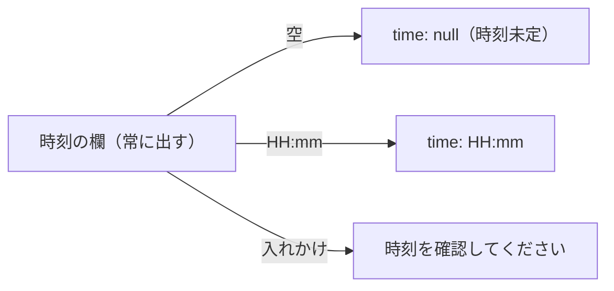
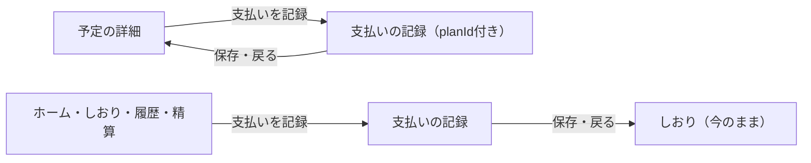

# 設計書: plan-form-clarity（予定の追加と、予定の詳細の操作を分かりやすくする）

- ステータス: approved（#309）
- レベル: L2（予定の追加・編集の時刻の欄の作りと、予定の詳細の操作の見た目・支払いの保存後の戻る先が変わる。APIとDBは変えない）
- 関連: 論点の記録`docs/discussions/plan-form-clarity.md`、#254

## この設計を一言で

初めて使った人のレビュー（#254）の6つの分かりにくさを、論点の記録の答え（2026-10-27）のとおりに直す。

- 時刻未定のチェックをやめ、時刻の欄を常に出す。空のまま保存したら時刻未定にする。
- 種類の見出しを「種類（どれか1つ）」にする。
- メモの欄の下に「場所やURLはメモに書けます」と書く。
- 「日の移動」を「別の日に移す」にする。
- 「取りやめにする」を赤い文字と枠線にし、ほかのボタンから少し離す。
- 予定の詳細から開いた支払いの記録は、保存したあとと戻るリンクを、その予定の詳細にする。

どれもブラウザの画面だけの直しで、APIとDBは変えない。

## 背景

#254で、予定の追加の初期状態の意図が伝わらないこと、予定の詳細から記録した支払いが予定に戻らないこと、日の移動と取りやめの危険度が見た目で分からないことが挙がった。直し方で画面が変わるので、問いにして決めてもらった（論点の記録の6問。5問は回答、1問は仮決定に異議なし）。

## 目的

- 予定を足すとき、時刻を入れる場所が最初から見えるようにする。
- 種類を選ぶ必要があることを、保存を押す前に分かるようにする。
- 場所やURLを書く場所が分かるようにする。
- 日の移動が何をするかを、ボタンの名前だけで分かるようにする。
- 取りやめが、ほかの操作より重いことを押す前に分かるようにする。
- 予定から記録した支払いを、保存したあとすぐその予定で確かめられるようにする。

## 要件

論点の記録の答え（2026-10-27）のとおり。

| 論点             | 決定                                                                                             |
| ---------------- | ------------------------------------------------------------------------------------------------ |
| 時刻の欄         | チェックをやめ、時刻の欄を常に出す。空のまま保存したら時刻未定。欄の下に「空のままなら時刻未定」 |
| 種類の欄         | 未選択のまま。見出しを「種類（どれか1つ）」にする                                                |
| 場所・URL・費用  | 欄は足さない。メモの欄の下に「場所やURLはメモに書けます」                                        |
| 日の移動の名前   | 「別の日に移す」                                                                                 |
| 取りやめのボタン | 文字と枠線を危険を表す赤にし、ほかのボタンとのあいだを空ける。確かめのダイアログは残す           |
| 支払いの保存後   | 予定の詳細から開いたときは、保存したあとと戻るリンクを、その予定の詳細にする                     |

詳細設計（「画面状態と入力操作」）の予定の追加の初期状態「時刻未定」は、「時刻の欄は空（空なら時刻未定）」と読み替える。0時と時刻未定を取り違えない決まりは、空を`time: null`として送ることで守る。

## 対象範囲

| 何を                       | どこで                                                                                                                    | 今                                                                                   | 直したあと                                                                                                                                                                                  |
| -------------------------- | ------------------------------------------------------------------------------------------------------------------------- | ------------------------------------------------------------------------------------ | ------------------------------------------------------------------------------------------------------------------------------------------------------------------------------------------- |
| 時刻の欄                   | `features/plans/ui/plan-form-fields.tsx`、`features/plans/model/plan-form.ts`                                             | 「時刻未定」のチェック。外すと`<input type="time">`が出る。値に`timeUndecided`を持つ | チェックを消し、`<input type="time">`を常に出す。欄の下に補足「空のままなら時刻未定」。値は空文字なら時刻未定。入れた時刻を消すための「消す」ボタンを、時刻が入っているときだけ欄の右に出す |
| 時刻の確かめ               | `plan-form.ts`の検証                                                                                                      | 未定でなく空なら「時刻を入力するか「時刻未定」にしてください」                       | 空はエラーにしない。入れかけの時刻（ブラウザの`validity.badInput`が真）は「時刻を確認してください」                                                                                         |
| 種類の見出し               | `plan-form-fields.tsx`の`Segmented`の`label`                                                                              | 「種類」                                                                             | 「種類（どれか1つ）」                                                                                                                                                                       |
| メモの補足                 | `plan-form-fields.tsx`の`FieldTextarea`                                                                                   | 無し                                                                                 | 欄の下に「場所やURLはメモに書けます」                                                                                                                                                       |
| 日の移動の名前             | `screens/plan-detail/plan-detail-screen.tsx`のボタン、`features/plans/ui/plan-move-sheet.tsx`の見出し、移動のあとの知らせ | 「日の移動」、知らせは「移動しました」                                               | ボタンと見出しは「別の日に移す」、知らせは「別の日に移しました」                                                                                                                            |
| 取りやめのボタン           | `plan-detail-screen.tsx`、`app/globals.css`                                                                               | `btn-outline`                                                                        | `btn-outline btn-outline-danger`。文字と枠線は`--color-danger`。ボタンの上の間を12px空ける                                                                                                  |
| 支払いの保存後と戻るリンク | `screens/payment-form/payment-form-screen.tsx`                                                                            | 常に`/trips/{tripId}/itinerary`                                                      | URLに`planId`があり、その予定を確かめられたときは`/trips/{tripId}/plans/{planId}`。ほかは今のまま                                                                                           |

## 対象外

- 予定の項目（場所・URL・費用の欄）は足さない（論点の記録の3問目）。
- 取りやめの確かめのダイアログは変えない。
- 支払いの記録を、ホーム・しおり・履歴・精算の主ボタンから開いたときの戻る先は変えない。
- APIとDB（時刻未定は今と同じ`time: null`で送る）。

## 現状構成

予定の追加・編集の値は`PlanFormValues`で、`timeUndecided`（真なら時刻を送らず`null`）と`time`（`HH:mm`）を持つ。追加の初期値は`timeUndecided: true`（`screens/plan-form/plan-form-screen.tsx:74`）。編集は、変えた項目だけを送る。支払いの記録は、URLの`planId`を`getPlan`で確かめてから予定を選んだ状態にするが、保存したあとと戻るリンクは常にしおりへ行く（`payment-form-screen.tsx:246`・`:303`）。

## 変更後構成

- `PlanFormValues`から`timeUndecided`を外し、`time`が空文字かどうかで時刻未定を表す。送るときは、空なら`time: null`、そうでなければ`HH:mm`。
- 編集で、時刻のあった予定の欄を空にして保存すると、`time: null`を送る（変えた項目だけを送る今の決まりのまま）。
- 端末に残した保留の書き込み（ADR-0006）は、送る本文（`time`が`null`か`HH:mm`）の形で持っているので、形は変わらない。読み直すときは、`null`を空の時刻の欄に戻す（`plan-form.ts:187`）。

## データフロー

対象外（APIへの要求の形は変えない）。

## API 設計

対象外。

## DB 設計

対象外。

## フロントエンド設計

- 時刻の補足「空のままなら時刻未定」は、欄の下に補足の文字（12px、`--color-text-secondary`）で出し、`aria-describedby`で時刻の欄に結ぶ。
- 「消す」ボタンは、時刻の欄に値があるときだけ出す。押すと欄を空にして、時刻の欄に焦点を戻す。読み上げの名前は「時刻を消す」。
- 種類の見出しの「（どれか1つ）」は見出しの一部として読み上げる。
- メモの補足は、時刻の補足と同じ見た目で、`aria-describedby`でメモの欄に結ぶ。
- 取りやめのボタンは、オフラインのときや送信中に押せなくなる今の扱いを変えない。押せないときは、ほかのボタンと同じ押せない見た目にする（赤くしない）。
- 支払いの記録の戻る先は、URLの`planId`を確かめた結果で決める。確かめに失敗した、または同じ旅行の予定でなかったときは、しおりへ戻す。

## バックエンド設計

対象外。

## エラー処理

- 入れかけの時刻は、保存の前に「時刻を確認してください」と出して送らない（今のエラー文をそのまま使う）。
- ほかの保存のエラーの扱いは変えない。

## ログと監視

対象外。

## セキュリティ

対象外（認可と入力の扱いは変えない。戻る先は、確かめた同じ旅行の予定のIDだけで組み立てる）。

## 性能

対象外。

## テスト方針

- 予定の追加で、時刻の欄が最初から出ていて、空のまま保存すると`time: null`で送ること。時刻を入れると`HH:mm`で送ること。
- 入れかけの時刻では保存せず、「時刻を確認してください」が出ること。
- 編集で、時刻のある予定の欄を「消す」で空にして保存すると、`time: null`を送ること。時刻を変えなければ`time`を送らないこと。
- 端末に残した保留（`time: null`のもの）を読み直すと、時刻の欄が空で出ること。
- 種類の見出しが「種類（どれか1つ）」で、メモの下に「場所やURLはメモに書けます」が出ること。
- 予定の詳細のボタンが「別の日に移す」で、押すと開く画面の見出しも同じこと。移したあとの知らせが「別の日に移しました」なこと。
- 「取りやめにする」が危険を表す見た目（`btn-outline-danger`）を持ち、ほかのボタンは持たないこと。
- 予定の詳細から開いた支払いの記録で、保存したあとと戻るリンクが予定の詳細へ行くこと。ホームから開いたときはしおりへ行くこと。
- E2Eで「時刻未定」や「日の移動」の文字を探している所は、新しい形に直す。

## 移行とリリース

1. この設計の承認（このPRのマージ）。
2. 実装の計画とPR。
3. 結合検証環境に出して、予定の追加・編集と予定の詳細をスマートフォンの幅で見て確かめる。

端末に残す保留の書き込みは送る本文の形のままなので、出したあとも前の版の保留を読み直して送れる。

## リスク

- iPhoneのSafariでは、`<input type="time">`を空に戻す操作が分かりにくい。「消す」ボタンを付けて、どの端末でも空に戻せるようにする。
- 時刻の欄を空にし忘れても時刻未定として保存されるので、時刻を入れたつもりで入っていない予定ができるかもしれない。欄は常に見えているので、保存の前に気づける。

## 決めたこと（問いと答え）

論点の記録`docs/discussions/plan-form-clarity.md`を参照（6問すべて推奨どおり）。

## 未決事項

なし。
