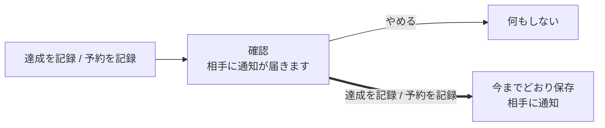

# 設計書: plan-record-buttons（予定の詳細の達成・予約のボタンに説明と押す前の確認を足す）

- ステータス: draft
- レベル: L2（予定の詳細で、保存の前に確認が1回入る。APIとDBは変えない）
- 関連: 論点の記録 `docs/discussions/plan-record-buttons.md`、#252

## この設計を一言で

予定の詳細の「達成を記録」「予約を記録」に、何をするボタンかを書いた一行と、押す前の確認を足す。ボタンの名前は今のまま変えない。説明は画面の中の操作の欄の先頭に、出ているボタンの分だけ並べる。押すと確認が開き、「達成を記録」「予約を記録」を押したときだけ、今までどおり保存する。確認は保存の前に止めるだけで、保存の状態（保存中・結果不明・拒否）の出し方は今のまま変えない。APIとDBは変えない。

## 背景

初めて使った人のレビューで、予定の詳細の「達成を記録」「予約を記録」が何をするのかわかりにくいと指摘された（#252）。説明は予約のボタンの下にしか無い。どちらも押すとすぐに保存され、相手の端末に通知が届く。届いた通知は、記録を取り消しても戻らない。

## 目的

- 達成・予約のボタンが何を記録し、誰に知らせるのかを、押す前に読めるようにする。
- 押し間違えで記録と相手への通知が起きないように、保存の前に1回止める。

## 要件

論点の記録の答え（2026-10-25）のとおり。

- ボタンの名前は「達成を記録」「予約を記録」のまま。種類ごとの言葉にはしない。
- 説明は、画面の中の操作の欄の先頭に、出ているボタンの分だけ一行ずつ並べる。
- 押す前に確認を出す。確認で「やめる」を選べば何も保存しない。

## 対象範囲

| 何を | どこで | 今 | 直したあと |
| --- | --- | --- | --- |
| 達成の説明 | `screens/plan-detail/plan-detail-screen.tsx`の操作の欄の先頭 | 無し | 「達成を記録: 行った・食べた・買ったら押します。相手に通知が届きます。」 |
| 予約の説明 | 同上 | 予約の副ボタンの下に「このアプリの中の記録です。お店の予約は変わりません」 | 「予約を記録: このアプリの中の印です。お店の予約は変わりません。相手に通知が届きます。」 |
| 達成の確認 | 同上（主ボタンを押したとき） | 無し（すぐ保存） | 見出し「{予定名}を達成にしますか？」、本文「相手に通知が届きます。」、ボタン「達成を記録」「やめる」 |
| 予約の確認 | 同上（主ボタンか副ボタンを押したとき） | 無し（すぐ保存） | 見出し「{予定名}の予約を記録しますか？」、本文「このアプリの中の印です。お店の予約は変わりません。相手に通知が届きます。」、ボタン「予約を記録」「やめる」 |

説明は、そのボタンが今出ているときだけ出す。食べ処の予定で達成も予約もまだ無いときは、2行とも出る。達成を付けたあとは予約の1行だけになる。

## 対象外

- ボタン・バッジ・履歴の絞り込み・通知の言葉は変えない（論点の記録「words-and-landing」で決めたとおり）。
- 取り消しの確認と、履歴からの取り消しの流れは変えない。
- 保存のあとの知らせ（「達成を記録しました」）に「取り消す」を付ける案は、選ばなかった（論点の記録の3問目のB）。

## 現状構成

主ボタン（下のタブの上）は、達成を付けられるときは「達成を記録」、達成は付けられず予約は付けられるときは「予約を記録」になる。食べ処のように両方を付けられるときは、予約は操作の欄の副ボタンになる。どのボタンも、押すと`createAchievement.submit`か`createBooking.submit`をすぐ呼ぶ。保存中・結果不明・拒否は、画面の上の状態の欄に出る。

## 変更後構成

ボタンを押すと、`confirming`（`"achievement" | "booking" | null`）の状態だけを立てて確認を開く。確認の「達成を記録」「予約を記録」で確認を閉じ、今までと同じ`submit`を呼ぶ。保存の状態の出し方は今のまま、画面の上の状態の欄で扱う。

確認の中で保存の状態を出す形（取りやめの確認と同じ形）も考えた。ただ、達成・予約の保存の状態（結果不明の確かめ・保留の照合・拒否の文）はすでに画面の上の欄で出していて、確認の中に移すと同じ扱いを2か所に持つことになる。確認は保存の前の関門にとどめ、閉じてから保存する形にした。

## データフロー

対象外（APIへの要求は変えない。確認で「やめる」を選んだときは要求を送らない）。

## API 設計

対象外。

## DB 設計

対象外。

## フロントエンド設計

- 確認は`shared/ui/dialog.tsx`の`Dialog`を使う。取りやめ・取り消しの確認と同じ形で、決定のボタンは危険色にしない（消す操作ではないため）。
- 確認の部品は`features/records/ui/`に`ConfirmRecordDialog`として置く。受け取るのは種類（達成・予約）・予定名・決定と閉じるの処理だけにする。
- 説明の一行は、今の`record-note`の見た目を使い、操作の欄の先頭にまとめて置く。予約の副ボタンの下の今の一行は消す（同じ中身が先頭に移るため）。
- 主ボタンと副ボタンの`aria-describedby`で、それぞれの説明の一行を指す。
- 確認を開いているあいだにオフラインになったら、決定のボタンを押せなくする（今のボタンと同じ条件）。

## バックエンド設計

対象外。

## エラー処理

保存の失敗の扱いは変えない。確認は保存の前に閉じるので、確認の中では保存の失敗を出さない。

## ログと監視

対象外。

## セキュリティ

対象外（認可と入力の扱いは変えない）。

## 性能

対象外。

## テスト方針

- 達成を付けられる予定で、説明の一行が操作の欄の先頭に出て、主ボタンの`aria-describedby`がそれを指す。
- 食べ処の予定で、説明が2行出る。達成を付けたあとは予約の1行だけになる。
- 「達成を記録」を押すと確認が開き、まだ要求を送らない。「やめる」で閉じると要求を送らない。確認の「達成を記録」で要求を1回送り、今までどおり「達成を記録しました」が出る。
- 予約も同じ（主ボタンからと副ボタンからの両方）。
- E2Eで達成を付ける箇所（ホームから達成を付ける流れ）に、確認を押す1手を足して通す。

## 移行とリリース

1. この設計の承認（このPRのマージ）。
2. 実装のPR（1本）。
3. 結合検証環境に出して、確認と説明の出方を見て確かめる。

戻すときは、実装のPRを戻せば今の動きに戻る。保存されたデータには触らない。

## リスク

- 旅行中に何度も達成を付けると、毎回1回押す手間が増える。押し間違えで相手に通知が届くのを防ぐことを優先した（論点の記録の3問目）。使ってみて煩わしければ、確認を出さない形に戻せる。
- 説明の一行が主ボタンから離れる。説明の先頭にボタンの名前を入れて、どのボタンの説明かがわかるようにした。

## 決めたこと（問いと答え）

論点の記録`docs/discussions/plan-record-buttons.md`を参照（3問とも推奨どおりに決定）。

## 未決事項

なし。
