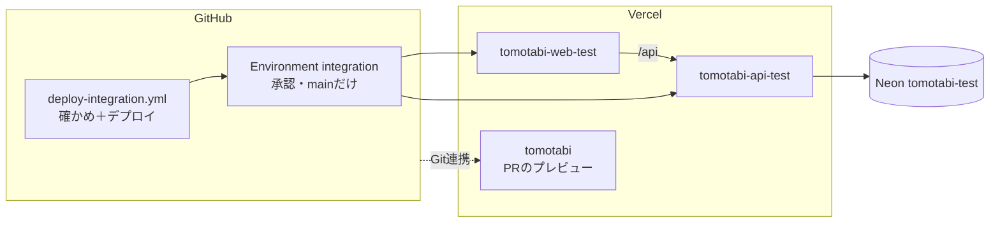
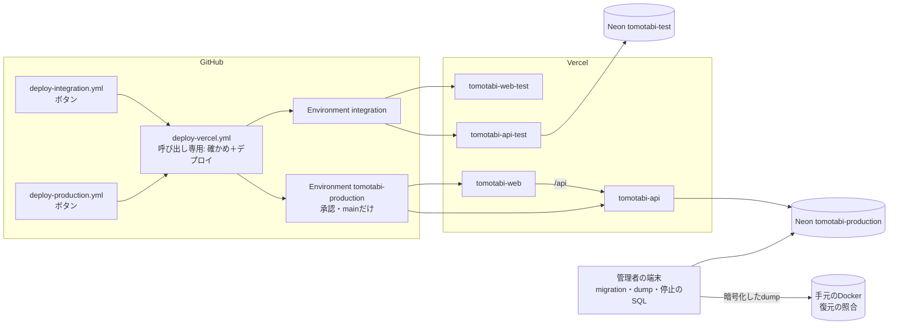
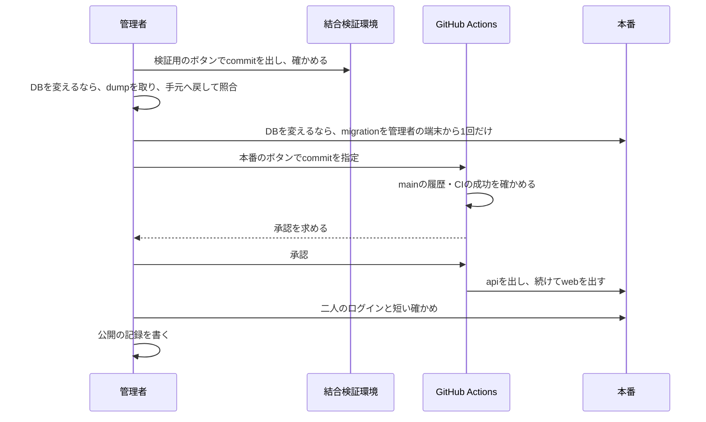
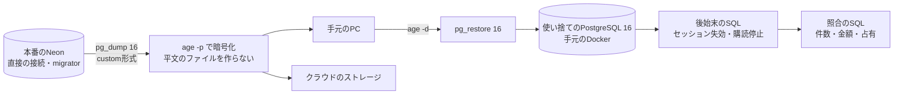
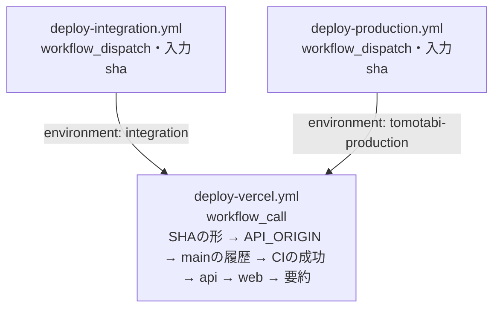

# 設計: 本番の公開（production-launch）

- 変更レベル: L3
- 要件: [docs/requirements/production-launch.md](../requirements/production-launch.md)（PR #316で承認）
- 論点の記録: [docs/discussions/production-launch.md](../discussions/production-launch.md)
- 作成日: 2026-10-29

## この設計を一言で

検証用と同じ形で本番の環境を作り、二人に公開する。アプリのコードは変えない。足すのは、本番用のデプロイのボタン、DBのバックアップ・復元の照合と完全停止のSQL、本番の手順書の3つ。ユーザーは手順書に沿って本番を作り、最初の公開の前にバックアップを手元のDBへ戻して照合し、二人に渡す前に止める・前の版に戻すを一度試す。

## 背景

結合検証環境で、ログイン・旅行と予定・支払いと精算・通知を二人の実機で確かめ、本番の前に済ませる6件の点検も2026-10-29に合格した（docs/tests/integration-env.md）。要件（P-01〜P-12）は、本番の環境を作ること、バックアップと復元を確かめること、公開の順番と記録、公開前の確認（OPS-01〜18）の残りを求めている。

## 目的

- 二人が実際の旅行で使える本番を、検証用と同じ手順で作る。
- 支払いと精算の記録を失っても戻せることを、初回の公開の前と、DBを変えるたびに確かめる。
- 本番を止める・前の版に戻す手順を、使う前に一度試しておく。

## 要件

[docs/requirements/production-launch.md](../requirements/production-launch.md)のP-01〜P-12と「確かめること（P-12）」。P-01（結合検証環境の残りの点検）は2026-10-29に済んだ。

## 対象範囲

- デプロイのワークフローの組み直し: 確かめとデプロイの手順を呼び出し専用のワークフローに移し、検証用と本番用の2つのボタンから呼ぶ。
- 管理用のSQL（`apps/api/db/admin/`）: 完全停止と再開、復元したDBの後始末（セッションの失効・購読の停止）、復元したDBの照合。
- 手順書: 本番を作る・公開する・戻す・止める・日常の運用（`docs/runbooks/production.md`）と、バックアップと復元（`docs/runbooks/backup-and-restore.md`）。
- 公開の記録の置き場（`docs/releases/`）とテンプレート。
- 設計資料「運用設定と公開チェック」の表のうち、今のコードと食い違うところの直し。
- 試験: ワークフローの静的な試験、SQLの実DBの試験、公開前の確認（OPS）の記録。

## 対象外

- アプリのコード（API・画面・DBのmigration）の変更。設計資料の環境変数のうち、`PUSH_ENABLED`・`RELEASE_SHA`・`APP_MAINTENANCE_MODE`は作らない（論点の記録で仮決定）。
- 一般への公開、商用の利用、有料のプラン、独自ドメイン、利用規約とプライバシーポリシーのページ。
- 自動の定期バックアップ（Cron）、外部の監視、ログの転送。
- 本番での同時操作の確かめ（OPS-09）。
- 結合検証環境のデータを本番に移すこと。

## 現状構成

## 変更後構成

PRのプレビューに使っている`tomotabi`のプロジェクトは今のまま残す（本番の設定を置かない）。

## データフロー

### 公開

### バックアップと復元の照合

## API 設計

変更なし。

## DB 設計

スキーマとmigrationは変更なし。本番のNeonは検証用と同じ手順で作る（PostgreSQL 16、AWS Singapore、ロールは`migrator`と`app_runtime`、`create-roles.sql`と`grant-database.sql`のあとmigrationを管理者の端末から1回だけ）。

足すのは`apps/api/db/admin/`の管理用のSQLだけ。どれも手作業で`psql`から流す。アプリ・ワークフロー・migrationからは呼ばない。

| ファイル                  | 何をするか                                                                                                                                                                                                                                   | 流すロール                                   |
| ------------------------- | -------------------------------------------------------------------------------------------------------------------------------------------------------------------------------------------------------------------------------------------- | -------------------------------------------- |
| `stop-runtime.sql`        | `ALTER ROLE app_runtime NOLOGIN`のあと、`app_runtime`の接続を`pg_terminate_backend`で切る。最後に残った接続の数を出す                                                                                                                        | 管理者（Neonのプロジェクトの所有者のロール） |
| `resume-runtime.sql`      | `ALTER ROLE app_runtime LOGIN`。ログインできる状態を出す                                                                                                                                                                                     | 同上                                         |
| `neutralize-restored.sql` | 復元したDBで、全部のセッションを消し、通知の購読を止める。復元したDBにだけ流す（本番に流すと二人がログアウトされ、通知が止まる）                                                                                                             | 復元したDBの所有者                           |
| `verify-restore.sql`      | 照合に使う数字を1つの表で出す。migrationの番号、二人のIDとslot、表ごとの件数（ログインのセッション・認証の一時データ・通知の購読の表は除く）、支払いの金額と負担の合計、精算の合計、`settlement.active_claims`と履歴から組み直した占有の一致 | 同上（本番でも読むだけなので流せる）         |

照合の基準の数字は、本番で`verify-restore.sql`をdumpの直前と直後に1回ずつ流して取る。2回の結果が同じなら、あいだに書き込みが無かったので、その数字を基準にして、復元したDBで流した結果と比べる。違えば、dumpのあいだに二人が書き込んだので、dumpを取り直す。書き込みを止めずに済み、二人の規模では取り直しはまれ。ログインのセッション（`identity.sessions`）・認証の一時データ（`identity.verifications`）・通知の購読（`notification`の表）は照合の数字に入れない。これらは二人が画面を開くだけで変わり、`neutralize-restored.sql`でも消すため、入れると正しいdumpでも合わなくなる。照合は、支払い・精算・予定など作り直せない記録だけで行う。

## フロントエンド設計

変更なし。完全停止のあいだ、画面は今のエラーの表示になる（下の「エラー処理」）。

## バックエンド設計

### デプロイのワークフロー

- `deploy-vercel.yml`（新規、`on: workflow_call`）: 入力は`environment`と`sha`。今の`deploy-integration.yml`の手順をそのまま移す。ジョブに`environment: ${{ inputs.environment }}`を付け、Environmentの変数（`VERCEL_ORG_ID`・`VERCEL_PROJECT_ID_API`・`VERCEL_PROJECT_ID_WEB`・`API_ORIGIN`）と秘密（`VERCEL_TOKEN`）を読む。要約の見出しに環境の名前を入れる。
- 同時実行の制御は呼び出す側に置く。`concurrency.group`は`deploy-integration`と`deploy-production`に分け、どちらも`queue: max`・`cancel-in-progress: false`（今のまま）。検証用と本番は並んで動いてよい。
- 呼び出す側は、入力の`sha`を渡し、`secrets: inherit`にする。権限は`contents: read`・`actions: read`（今のまま）。
- 本番のEnvironmentの名前は`tomotabi-production`にする。GitHubのEnvironmentの名前は大文字と小文字を区別せず、`Production`はVercelのGit連携（`tomotabi`のプロジェクト）が自動で作って使っているため、`production`にすると同じEnvironmentになる。要件P-07の「production」はこの名前で満たす。
- `tomotabi-production`の保護: 承認者はユーザー、動かせるブランチはmainだけ。保護を付けてからトークンを置く（検証用の手順書の7章と同じ順番）。

### 完全停止

止める: 管理者が`stop-runtime.sql`を流す。どのデプロイのAPIも`app_runtime`でDBにつなぐので、新しい接続はログインで断られ、残っている接続は切られる。Poolerの裏の接続も切られ、つなぎ直しで断られる。管理者の`migrator`と所有者のロールは止まらないので、止めたまま復旧の作業ができる。

処理中の要求: 切られた接続のトランザクションは巻き戻る。業務の書き込みは1つのトランザクションなので、途中まで書かれた記録は残らない。結果が分からなかった操作は、再開のあとに画面で確かめる（詳細設計08の8節の7）。

再開: `resume-runtime.sql`を流す。二人は画面を開き直す。

### バックアップと復元

- 取る: 管理者の端末で、`migrator`の直接の接続（pooledでないもの）から、PostgreSQL 16の`pg_dump`でcustom形式のdumpを取る。端末の`pg_dump`は18なので、`postgres:16-alpine`のコンテナの中の`pg_dump`を使う（版を合わせると、復元の先が16でも余計な設定の行が入らない）。出力はそのまま`age -p`に渡し、暗号化したファイルだけをディスクに書く。
- 置く: 手元のPCの決めたフォルダと、普段使っているクラウドのストレージのフォルダの2か所。ファイル名は`tomotabi-production-<日時>-<きっかけ>.dump.age`（きっかけは`weekly`・`before-trip`・`after-trip`・`before-change`）。直近4回と、最後の`before-change`の1回を残し、それより古いものは手で消す。パスフレーズはパスワード管理ソフトに置く。
- 戻して照合する: 名前つきの使い捨てのコンテナ（`postgres:16-alpine`、`127.0.0.1`の空いたポート、volumeなし）を立て、`create-roles.sql`と`grant-database.sql`でロールを作り直してから、`age -d`の出力を`pg_restore`に渡す。続けて`neutralize-restored.sql`、`verify-restore.sql`の順に流し、本番で取った数字と比べる。終わったらコンテナを消す（実データを手元のDBに残さない）。
- 時期: 利用中は週1回、旅行の前、旅行の終わったあと、DBを変える前。DBを変える前は、戻して照合が合ってからmigrationを流す（要件P-11）。
- 本当の障害で本番に戻す手順（Neonの新しいブランチかプロジェクトへ戻し、照合してから接続先を替える）は、手順書の「障害のとき」に書く。初回の公開の前には試さない。

### 手順書

| 手順書                                | 中身                                                                                                                                                                                                                                                                                                                                |
| ------------------------------------- | ----------------------------------------------------------------------------------------------------------------------------------------------------------------------------------------------------------------------------------------------------------------------------------------------------------------------------------- |
| `docs/runbooks/production.md`         | 本番を作る（Neon・ロールとmigration・Vercelの2プロジェクト・Googleの2クライアント・VAPID・環境変数・GitHubのEnvironment・二人の初期登録）、公開の順番（検証用 → バックアップ → DB → api → web → 確かめ → 記録）、前の版に戻す、完全停止と再開、日常の運用（使用量、トークンの期限、バックアップの時期）、障害のときに最初に残すこと |
| `docs/runbooks/backup-and-restore.md` | 道具の準備（`age`、Docker）、dumpを取る、2か所に置く、手元へ戻して照合する、古いものを消す、本当の障害で戻す                                                                                                                                                                                                                        |

検証用の手順書と同じ作業は、本番の手順書にも手順を書く（本番を作るときに2つの手順書を行き来しない）。値・名前・Environmentの名前だけが違う。

## エラー処理

外部のI/O（Neon、Vercel、GitHub）を含むので、5つの項目を決める。

- (a) 再試行: ワークフローは自動で再試行しない（今のまま）。dump・復元・停止のSQLも自動で再試行せず、失敗したら手順書の確かめに戻って管理者がやり直す。
- (b) 時間切れ: ワークフローは全体で20分（今のまま）。`stop-runtime.sql`は`lock_timeout`を短く（5秒）して、ロールの変更が長く待たないようにする。dumpと復元は二人の規模（33MB）なので、時間切れを置かない。
- (c) 冪等性: ワークフローは同じcommitを何度出しても同じものになる。停止と再開のSQLは、何度流しても同じ状態になる。dumpはファイル名に日時を入れ、上書きしない。
- (d) 部分失敗: apiだけ出てwebで止まったら、同じcommitでもう一度押す（今のまま）。照合が合わなければmigrationを流さず、本番は今のまま使う。停止のSQLが途中で止まったら、もう一度流す（ロールの変更が先なので、切れなかった接続も次のつなぎ直しで断られる）。
- (e) 縮退: 完全停止のあいだ、APIはDBにつなげない。接続を切られた要求は今の対応で500か503になり、画面は今のエラーの表示になる。読むだけの操作も止まる（論点の記録で決定）。

## ログと監視

- 変更なし。Vercelの関数のログとNeonのMonitoringを、手順書の「日常の運用」で見る。
- Vercelの無料枠はチーム全体で共有で、検証用・本番・PRのプレビューが同じ枠を使う。2026-10-29の時点で、どれも5%未満だった（IE-14）。日常の運用で、9割に近づいたら検証用とPRのプレビューを止める（要件E-06）。

## セキュリティ

- 本番の秘密（Neonの接続、`BETTER_AUTH_SECRET`、Googleのシークレット、VAPIDの秘密鍵、Vercelのトークン）は検証用と共有せず、ユーザーが作って登録する。Claude Code・Devinは値を見ない。
- 本番の`VERCEL_TOKEN`は期限つきで、`tomotabi-production`にだけ置く。承認とmainだけの制限で、DevinやCodexが書き換えたブランチからは動かない。呼び出し専用のワークフローは、呼ぶ側のEnvironmentの秘密しか読めない。
- Vercel Hobbyのトークンはアカウント全体に効くので、検証用の`VERCEL_TOKEN`でも本番のプロジェクトを操作できる。検証用と本番でVercelのアカウントは分けない（2026-10-30 ユーザーの判断）。守りは、2つのEnvironmentの承認とmainだけの制限の2つ。検証用の承認も、本番と同じ注意で行う（出すcommitと、ワークフローの変更でプロジェクトのIDが替わっていないかを見る）。
- dumpは実データと認証・通知の情報を含む。平文のファイルを作らず、`age`で暗号化したものだけを置く。Git・設計資料・Actionsの成果物には入れない（`.gitignore`に`*.dump`と`*.dump.age`を足す）。
- 復元したDBは手元のDockerにだけ作り、APIをつながない。後始末のSQLでセッションと購読を消すので、手元の画面からつないでも、本番の二人として操作できず、通知も送れない。
- 停止と再開のSQLは、Neonの所有者のロールで流す。そのロールの接続文字列は、パスワード管理ソフトにだけ置く。

## 性能

対象外（アプリは変えない）。休止のあとの最初の操作は検証用と同じく数秒かかる（IE-13）。

## テスト方針

| 層                   | 確かめること                                                                                                                                                                                                                                                                                                                                   |
| -------------------- | ---------------------------------------------------------------------------------------------------------------------------------------------------------------------------------------------------------------------------------------------------------------------------------------------------------------------------------------------- |
| ワークフロー（静的） | `.claude/tests/deploy-integration-workflow.test.mjs`を、呼び出し専用と2つのボタンに合わせて直す。ボタンは`workflow_dispatch`だけで、それぞれ正しいEnvironmentの名前を渡す。呼び出し専用は`workflow_call`だけで、mainの履歴・CIの成功を確かめ、`--prebuilt`で出し、秘密を`--token`で渡し、`set -x`が無い。本番の`concurrency.group`が検証用と別 |
| 実DB                 | `stop-runtime.sql`のあと`app_runtime`で新しくつなげず、つないでいた接続が切られる。`resume-runtime.sql`のあとつなげる。`neutralize-restored.sql`でセッションが0、購読が止まる。`verify-restore.sql`の結果が、同じデータを入れたDBとそのdumpを戻したDBで一致する（Testcontainers、`npm run test:api-db`）                                       |
| 結合検証環境         | 組み直したワークフローで検証用に出して、今と同じに動く。停止と再開のSQLを検証用のNeonで試し、画面とAPIの表示を記録する（Neonの所有者のロールが接続を切れるかもここで確かめる）                                                                                                                                                                 |
| 本番                 | 要件の「確かめること（P-12）」。OPS-13（dumpと復元）は最初の公開の前に、OPS-14（前の版に戻す）とOPS-15（完全停止）は二人に渡す前に、本番で一度試す                                                                                                                                                                                             |

## 移行とリリース

順番:

1. ワークフローの組み直し・管理用のSQL・手順書をマージする。
2. 組み直したワークフローで検証用に出し、今と同じに動くことと、停止と再開を検証用で確かめる。
3. ユーザーが手順書に沿って本番を作る（Neon、ロールとmigration、Vercel、Google、VAPID、環境変数、Environment、二人の初期登録）。
4. 最初の公開の前に、本番のDB（migrationと二人の初期登録が済んだ状態）のバックアップを取り、手元へ戻して照合する（OPS-13、要件P-11）。照合が合わなければ、ここで止めて直す。
5. 本番のボタンで最初の公開をする。
6. 二人に渡す前に、本番で公開前の確認をする。前の版に戻してから最新に戻す（OPS-14）。止めて再開する（OPS-15）。
7. 公開の記録を書き、二人が使い始める。

### 前の版に戻す

アプリの不具合だけなら、本番のボタンに戻したい前のcommitのSHAを入れて出し直す。そのcommitもmainの履歴とCIの成功の確かめを通る。DBは戻さない。migrationは後方互換の追加だけにしているので、前の版のアプリは今のスキーマで動く（詳細設計08の8節）。OPS-14では、最初の公開のcommitの1つ前の公開できるcommitに戻し、二人のログインとホームの表示を確かめてから、最新に戻す。

## リスク

| リスク                                                                                            | 対策                                                                                                                                                  |
| ------------------------------------------------------------------------------------------------- | ----------------------------------------------------------------------------------------------------------------------------------------------------- |
| Neonの所有者のロールが、`app_runtime`の接続を`pg_terminate_backend`で切れない                     | 検証用で先に試す。切れなければ、Neonの管理画面でcomputeを再起動して接続を切る手順に替える（ロールのログインを止めたあとなので、つなぎ直しは断られる） |
| 接続を切られた要求やログインを断られた要求が500になり、画面の表示が「時間をおいて試す」にならない | 検証用で表示を確かめて記録する。二人に伝える言葉を手順書に書く。表示を直すかは、確かめた結果を見て別に決める                                          |
| 呼び出し専用のワークフローで、Environmentの変数や秘密が読めない                                   | 検証用で最初に試す（移行とリリースの2）。読めなければ、呼び出す側のジョブでEnvironmentを付ける形に替える                                              |
| `tomotabi-web`・`tomotabi-api`の名前が取られている                                                | 作るときに末尾を足し、手順書と環境変数の表に書く                                                                                                      |
| PRのプレビューの`tomotabi`のプロジェクトが、mainへのマージのたびに自分の本番のURLへ出ている       | 本番の設定（秘密）を置いていないことを、OPS-01・02で確かめる。二人には本番の`tomotabi-web`のURLだけを渡す                                             |
| `age`のパスフレーズを無くす                                                                       | パスワード管理ソフトに置き、手順書の準備で、置いたことを確かめてから最初のdumpを取る                                                                  |
| Vercelの無料枠を検証用・本番・PRのプレビューで分け合う                                            | 日常の運用で使用量を見る。9割に近づいたら検証用とPRのプレビューを止める                                                                               |

## 決めたこと（問いと答え）

[docs/discussions/production-launch.md](../discussions/production-launch.md)

## 未決事項

[docs/discussions/production-launch.md](../discussions/production-launch.md)の「仮決定」が3件（設計資料の環境変数のうちまだ無い3つを作らない、本番のURLの名前、検証用で先に確かめたかを手順書で扱う）。この設計書のPRのマージまでに異議が無ければ「決定」にする。
