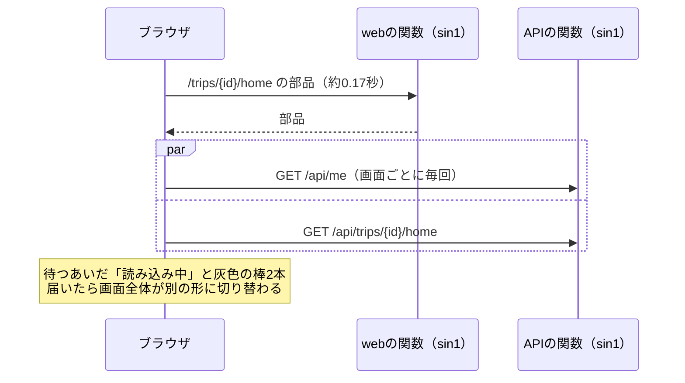
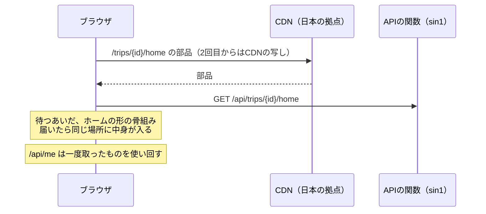
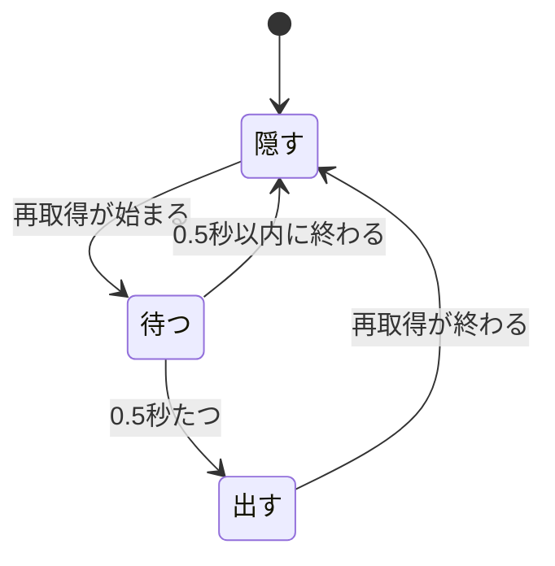

# 設計書: screen-speed（画面の速さと読み込み中の表示）

- ステータス: draft
- レベル: L2
- 関連: 論点の記録 docs/discussions/screen-speed.md / 詳細設計「画面状態と入力操作」 / docs/designs/m2-trips-and-plans.md（取得の既定） / docs/designs/integration-env.md

## この設計を一言で

読み込み中は実際の画面の形をなぞった骨組みを出し、「更新中」は中身を押し下げずに長いときだけ出し、画面を開くまでの往復を2つ減らす。

## 背景

結合検証環境で、ユーザーから3つの指摘があった。読み込み中に画面がチラついて、読み込んでいるのか分かりにくい。読み込むたびに画面の形が変わる。全体にもっさりする。日本からシンガポールの関数まで1往復0.15〜0.17秒かかるので、手元では一瞬だった読み込みが目に見えるようになった（調べた事実は論点の記録の「前提」）。

## 目的

- 読み込み中から読み込み後に変わるとき、よく開く4画面（ホーム・しおり・記録・精算）の形がほとんど動かない。
- 再取得のたびに画面の中身が上下しない。短い再取得では何も出ず、長いときだけ「更新中」と分かる。
- 画面を移るときの往復を、今の「画面の部品＋ログイン中の人の情報＋画面のデータ」から「画面のデータ」だけにする。

## 要件

| ID | 内容 |
| --- | --- |
| SS-01 | ホーム・しおり・記録・精算の4画面は、初めて開いて取得を待つあいだ、その画面の見出し・カード・一覧の行と同じ位置と高さの灰色の骨組みを出す |
| SS-02 | ほかの画面は、取得を待つあいだ共通の骨組み（見出し1本とカード2枚）を出す |
| SS-03 | 再取得中の「更新中」は、画面の中身の配置を変えない（中身の上に重ねる）。再取得が0.5秒を超えたときだけ出し、終わったら消す |
| SS-04 | 再取得の失敗の「更新できていません · 時刻」と「再試行」は、今のまま中身の上に出す（失敗は読み落とされると困るので、重ねずに残す） |
| SS-05 | ログイン中の人の情報（`GET /api/me`）は、画面を移るたびに取り直さない。ログイン・ログアウトのとき、と、401を受けたときに取り直す |
| SS-06 | 旅行の下の画面（`/trips/[tripId]/…`）の部品は、要求ごとに関数で組み立てず、一度組み立てたものをCDNから配る |
| SS-07 | 画面を開くたび・アプリに戻るたびに業務のデータを取り直す決まり（`staleTime: 0`・`refetchOnWindowFocus: true`）は変えない |

## 対象範囲

- `apps/web/src/shared/ui/state/`（骨組みの部品、「更新中」の部品）
- `apps/web/src/screens/{home,itinerary,records,settlement}/`（4画面の骨組み）
- `Loading`・`Refetching`を使っているほかの画面（共通の骨組みと新しい「更新中」に置き換える）
- `apps/web/src/features/auth/model/use-me.ts`（取得の仕組みに載せる）
- `apps/web/src/app/trips/[tripId]/**/page.tsx`（CDNから配る形にする）
- `apps/web/src/app/globals.css`

## 対象外

- 本番の関数とDBを置く地域（論点の記録の「後の工程へ」。結合検証環境の時間の内訳を測ってから決める）
- 業務のデータの取り直しの決まり（SS-07。仮決定）
- API・DBの変更
- サインインの画面と通知の設定の画面のルート（どちらもURLの問い合わせ文字列を読むので、要求ごとに組み立てる。画面を移る途中では開かない）

## 現状構成

再取得のたびに、画面の一番上に「更新中」の1行が足されて消える。

## 変更後構成

## データフロー

- 画面の部品: 旅行の下のルートに`generateStaticParams`（空の配列を返す）を足す。ただし、10のルートのうち6つ（しおり・記録・精算・予定の追加・予定の詳細・支払いの記録）は、URLの問い合わせ（`?date=`・`?type=`・`?settlementId=`など）をサーバー側で読んで画面に渡している。問い合わせは要求ごとに変わるので、サーバーで読む限り毎回組み立てになる（PR #234でDevin Reviewが指摘）。そこで、この6つは問い合わせをブラウザで読む形に変える（下の「ルートの部品」）。Next.js 16は、そのURLに最初の要求が来たときに部品を組み立て、以後はCDNの写しを配る（試しに組み立てて、ホームのルートが「動的」から「静的（`generateStaticParams`を使う）」に変わることを確かめた）。部品には利用者ごとのデータが入らない（データはブラウザがAPIから取る）ので、誰に配っても同じ。旅行のIDの形が正しくないURLは、今と同じく見つからない（404）にする。
- ログイン中の人の情報: `useMe`を、ほかのデータと同じ取得の仕組み（TanStack Query、キー`["me"]`）に載せる。この情報だけ`staleTime: Infinity`にして、画面を移っても取り直さない。ログイン・ログアウトのときと、どこかの取得で401を受けたときに、キャッシュを消して取り直す。`useMe`が返す形（`MeState`と`reload`・`clear`）は変えないので、使っている14か所は直さない。
- 業務のデータ: 今のまま（SS-07）。

## API 設計

変更なし。

## DB 設計

変更なし。

## フロントエンド設計

### 骨組み（SS-01・SS-02）

- 共通の部品`Skeleton`（灰色の角丸の棒。色は`--color-surface-locked`）と、並べ方の部品`SkeletonCard`を`shared/ui/state/`に置く。
- 4画面は、それぞれの画面のフォルダに骨組み（例: `HomeSkeleton`）を置く。実際の画面と同じ外側の要素（`main`のクラス名・カードのクラス名）を使い、行の高さを本物と合わせる。こうすると、読み込み後に同じ場所へ中身が入る。

| 画面 | 骨組みの中身 |
| --- | --- |
| ホーム | ヘッダー（旅行名・期間）、今日の予定のカード（3行）、精算のカード、最近の記録のカード（3行） |
| しおり | 日付の帯、その日の予定の行（4行） |
| 記録 | 絞り込みの帯、記録の行（5行） |
| 精算 | 精算額のカード、主ボタンの場所、履歴の見出し |
| ほか | 見出し1本とカード2枚（`Loading`を置き換える） |

- 骨組みは`role="status"`と見えない文字「読み込み中」を持つ（画面の読み上げで、読み込み中だと分かるように。今の試験の「読み込み中」の確かめもそのまま通る）。
- 動きは付けない（ゆっくり明るさが変わる動きも付けない）。動くものはチラつきの原因になるため。
- ダークモードの色は、PR #233で入れた仮の値を使う。

### 「更新中」（SS-03・SS-04）

- `Refetching`を、画面の上に重ねる小さな札にする。位置は画面の上端から（状態バーの高さ＋8px）、横は中央、`position: fixed`。中身の配置には入らないので、出ても消えても中身は動かない。
- 出す条件は「再取得中の状態が0.5秒続いたとき」。0.5秒以内に終われば出さない。出したあとは、再取得が終わったらすぐ消す。札の中身は今と同じ（回る矢印と「更新中」）。
- `RefetchFailed`は今のまま中身の上に出す（SS-04）。

### ルートの部品（SS-06）

- `apps/web/src/app/trips/[tripId]/`の下の10のルートの`page.tsx`に、`generateStaticParams`（空の配列）を足す。旅行のIDの形の確かめと`notFound()`は変えない。
- 問い合わせを読む6つのルートは、`page.tsx`で`searchParams`を読まないようにする。代わりに、ルートごとに小さなブラウザ側の部品（例: `ItineraryRoute`）を置き、`useSearchParams()`で問い合わせを読んで、今と同じ値を画面に渡す。
  - 問い合わせの読み解き（実在する日付だけ通す、記録の種類の許可リスト、形の違うIDを捨てる、など）は、今`page.tsx`に書いてある処理を、そのまま純粋な関数に移す。動きは変えない。
  - `useSearchParams()`を使う部品は、`Suspense`で包む（Next.jsは、包まないとページ全体をブラウザでの組み立てに切り替える）。待つあいだの表示は、その画面の骨組み。
- 組み立ての出力で、10のルートが「静的（●）」になることを確かめる。

## バックエンド設計

変更なし。

## エラー処理

- ログイン中の人の情報を取り直さなくなるので、ログインの期限が切れたことは、業務のデータの取得の401で気づく。今も401のときは「ログインし直してください」の画面（C-1）を出しているので、動きは変わらない。401を受けたら`["me"]`のキャッシュも消す。
- 骨組みのあいだに取得が失敗したときは、今と同じく「取得できませんでした」と「再試行」を出す。

## ログと監視

変更なし。

## セキュリティ

- CDNから配る部品に、利用者ごとのデータ・Cookie・ログインの状態は入らない（ルートの部品は旅行のIDの形を確かめて画面の部品を返すだけ）。業務のデータは今と同じく、ブラウザがAPIからCookieつきで取り、APIの応答は`Cache-Control: private, no-store`のまま。
- ログイン中の人の情報は、ブラウザのメモリにだけ置く（今と同じ。保存しない）。ログアウトのときに消す。

## 性能

| 場面 | 今 | 変更後（見込み） |
| --- | --- | --- |
| 旅行の下の画面を移る（続けて使っているとき） | 部品の往復（約0.17秒）＋データの往復（約0.15秒＋DB） | 部品はCDNの写し（日本の拠点から数十ミリ秒の見込み）＋データの往復 |
| webの関数が休んでいたあと | webの関数の起動待ちが加わる | 2回目からのURLは起動を待たない |
| ログイン中の人の情報 | 画面を移るたびに1往復 | 最初の1回だけ |

数字は推測を含む。直したあと、結合検証環境の時間の内訳の点検（IE-13）で測る。

## テスト方針

| ID | 種類 | 確かめること |
| --- | --- | --- |
| SS-T01 | 単体 | 4画面の骨組みが`role="status"`と「読み込み中」を持ち、実際の画面と同じ外側のクラス名を使う |
| SS-T02 | 単体 | 共通の骨組みがほかの画面で出る（`Loading`を使っていた画面の試験がそのまま通る） |
| SS-T03 | 単体 | 「更新中」は再取得が0.5秒続くまで出ず、0.5秒たつと出て、終わると消える（時間を進める偽の時計で） |
| SS-T04 | 単体 | 「更新中」の札は、画面の中身の要素の外（重ねる要素）に出る |
| SS-T05 | 単体 | `useMe`を使う2つの画面を続けて開いても、`/api/me`は1回しか取らない。ログアウトのあとは取り直す。401を受けたら取り直す |
| SS-T06 | 組み立て | `npm run build -w @tomotabi/web`の出力で、旅行の下の10のルートが「静的（●）」。問い合わせを読む6つのルートを含む |
| SS-T06b | 単体 | 問い合わせの読み解きの純粋な関数が、今の`page.tsx`と同じ結果を返す（日付・記録の種類・ID・精算のID。形が違う値・空・複数指定を含む） |
| SS-T07 | 結合 | 既存のE2E（16件）が通る |
| SS-T08 | 実機 | 結合検証環境で、ユーザーが4画面を行き来して、形が動かずチラつかないことを確かめる。時間の内訳を測る（IE-13） |

## 移行とリリース

- 1つのPRで出す（骨組み・「更新中」・ログイン中の人の情報・ルートの部品）。データやAPIの移行は無い。
- マージのあと、結合検証環境に出し直してユーザーが確かめる。

## リスク

| リスク | 対策 |
| --- | --- |
| 骨組みと実際の画面の高さがずれて、少し動く | 外側のクラス名を共通にし、行の高さを本物の値に合わせる。実機で確かめる |
| 画面を直したときに骨組みを直し忘れる | 4画面だけに絞る。骨組みは画面と同じフォルダに置く |
| CDNの写しに古い部品が残る | Vercelは出し直しのたびに写しを作り直す。部品にデータは入らないので、古くても誤った内容は出ない |
| 問い合わせをブラウザで読むようにしたとき、読み解きの動きが変わる | 今の処理をそのまま純粋な関数に移し、同じ入力で同じ結果になる試験（SS-T06b）を足す |
| ログイン中の人の情報が古いまま残る（表示名を変えた場合など） | 表示名は初期登録のときに決まり、アプリの中では変えられない。ログイン・ログアウト・401で取り直す |

## 決めたこと（問いと答え）

[docs/discussions/screen-speed.md](../discussions/screen-speed.md)

## 未決事項

- 仮決定1件（画面を移るたびに必ず取り直す決まりは変えない）。この設計の承認までに異議がなければ決定にする。
- 後の工程へ1件（本番の関数とDBを置く地域）。
