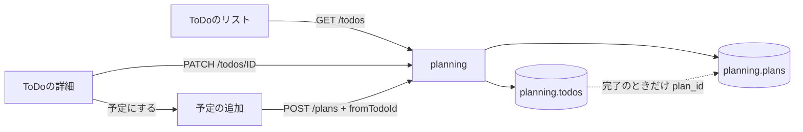
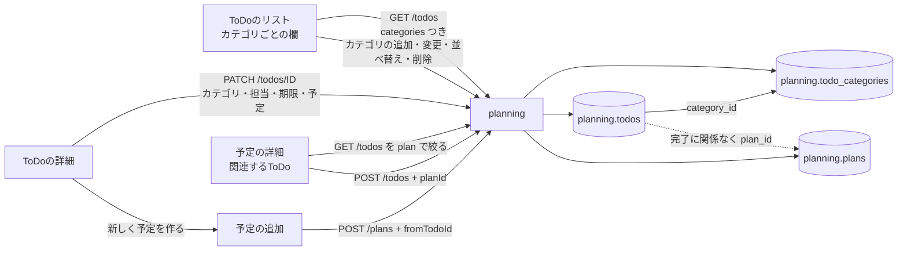
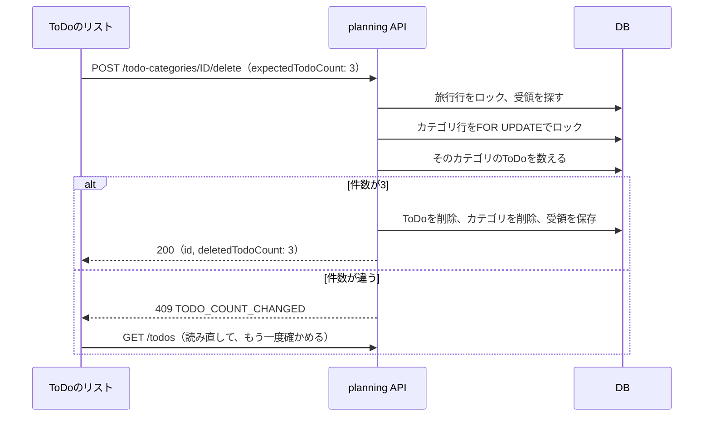
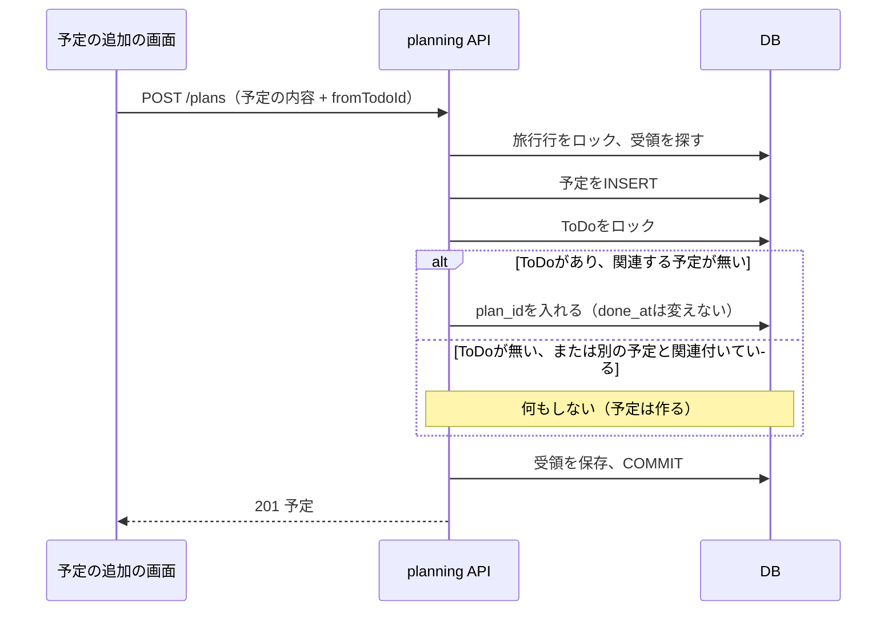

# 設計書: todo-organize（ToDoのカテゴリ分けと予定との関連付け）

- ステータス: draft
- レベル: L3
- 関連: docs/requirements/todo-organize.md（PR #350で承認）、docs/designs/trip-todo.md（元の設計）、ADR-0003（DBのロールとmigration）、ADR-0006（結果不明の要求を端末に残す）、論点の記録 docs/discussions/todo-organize.md
- 画面の見本: https://claude.ai/artifact/LRsVh7g3KmuPN4bfVNtXrE

## この設計を一言で

planningモジュールにカテゴリの表を足し、ToDoの表にカテゴリ・担当・期限の列を足す。ToDoと予定の関連付けを完了から切り離し、未完了のままでも予定と結べるようにする。画面は、ToDoのリストをカテゴリごとの欄に変え、ToDoの詳細に選ぶ欄を4つ、予定の詳細に「関連するToDo」の欄を足す。

## 背景

要件定義のとおり。今のToDoは名前とメモだけを持ち、予定と結べるのは「予定にする」で完了にしたときだけ（`todo_plan_requires_done`の制約）。書き込みの共通の流れ（旅行行のロック・受領・版・エラー形式）と、端末に残す仕組み（ADR-0006）はToDoで作ってあるので、それに載せる。

## 目的

- カテゴリの読み書きを、ToDoと同じ書き込みの流れ（同じ要求の再送で二重に作られない、相手が先に変えたら競合）で作る。
- 関連付けを完了と別の状態として持ち、完了の付け外しで変わらないようにする。
- カテゴリの削除で、確かめた件数と違うToDoが消えないようにする（要件E-05）。

## 要件

`docs/requirements/todo-organize.md`のF-01〜F-23、E-01〜E-11、B-01〜B-09。

## 対象範囲

- DB: `planning.todo_categories`を足す。`planning.todos`に3列を足し、制約を1つ外す。受領の記録（`command_receipts`）の種類を3つ足す。
- 契約: `packages/contracts/openapi/planning.json`にカテゴリの操作を足し、ToDoの型と入力を広げる。`packages/contracts/src/plan.ts`の型を直す。生成物（orval）を作り直す。
- api: planningモジュールにカテゴリのDomain・UseCase・Repository・Controllerを足す。ToDoの追加・編集・未完了に戻す・一覧と、予定の追加のUseCaseを直す。
- web: `features/todos`、`screens/todos`、`screens/todo-detail`、`screens/plan-detail`、`screens/plan-form`、端末に残す仕組みの許可リスト（`shared/browser/pending-requests.ts`）。
- 文書: `docs/requirements/trip-todo.md`・`docs/designs/trip-todo.md`の変わる決まりに案内を足す。`docs/glossary.md`を直す。

## 対象外

要件定義の「対象外」のとおり（通知、ホームの欄、ToDoの並べ替え、複数の予定との関連付け、カテゴリの色やアイコン、旅行をまたいだカテゴリ、カテゴリだけ消してToDoを残す操作）。

## 現状構成



## 変更後構成



## データフロー

カテゴリの削除。確かめの画面で見た件数を送り、保存のときの件数と違えば止める。



ToDoから予定を作る流れ。予定の保存と関連付けは一つのトランザクションで決まる。ToDoは完了にしない。



## API 設計

経路はどれも`/api/trips/{tripId}`の下。書き込みは今と同じく`Idempotency-Key`が必須で、同じキーの再送は保存した応答を返す。

| 操作                         | 経路                                        | 入力                                                                                      | 応答                                                   | 主なエラー                                                           |
| ---------------------------- | ------------------------------------------- | ----------------------------------------------------------------------------------------- | ------------------------------------------------------ | -------------------------------------------------------------------- |
| 一覧（広げる）               | `GET /todos`                                | なし                                                                                      | 200 `TodoList`（`categories`を足す）                   | 今のまま                                                             |
| ToDoの追加（広げる）         | `POST /todos`                               | `name`、`categoryId?`、`planId?`                                                          | 201 `Todo`                                             | 422 `TODO_CATEGORY_NOT_FOUND`、422 `TODO_PLAN_NOT_AVAILABLE`         |
| ToDoの編集（広げる）         | `PATCH /todos/{todoId}`                     | `name?`、`memo?`、`categoryId?`、`assigneeId?`、`dueOn?`、`planId?`。`X-Expected-Version` | 200 `Todo`                                             | 上の2つ、422 `TODO_ASSIGNEE_NOT_PARTICIPANT`、409 `VERSION_CONFLICT` |
| 未完了に戻す（動きを変える） | `POST /todos/{todoId}/reopen`               | なし                                                                                      | 200 `Todo`（`plan`を残す）                             | 今のまま                                                             |
| 予定の追加（動きを変える）   | `POST /plans`                               | 今のまま                                                                                  | 201 `Plan`                                             | 今のまま                                                             |
| カテゴリの追加               | `POST /todo-categories`                     | `name`                                                                                    | 201 `TodoCategory`                                     | 422（名前）、422 `TODO_CATEGORY_LIMIT_REACHED`                       |
| カテゴリの名前の変更         | `PATCH /todo-categories/{categoryId}`       | `name`。`X-Expected-Version`                                                              | 200 `TodoCategory`                                     | 404 `TODO_CATEGORY_NOT_FOUND`、409 `VERSION_CONFLICT`                |
| カテゴリの並べ替え           | `PUT /todo-categories/order`                | `from`（見ていた順のID）、`to`（新しい順のID）                                            | 200 `TodoCategoryOrder`（`categories`）                | 409 `TODO_CATEGORY_ORDER_CHANGED`                                    |
| カテゴリの削除               | `POST /todo-categories/{categoryId}/delete` | `expectedTodoCount`                                                                       | 200 `TodoCategoryDeletion`（`id`、`deletedTodoCount`） | 409 `TODO_COUNT_CHANGED`                                             |

型の変更（`packages/contracts/src/plan.ts`）。

```ts
export type TodoCategory = {
  id: string;
  tripId: string;
  name: string;
  /** 編集の`X-Expected-Version`にそのまま送る版番号。 */
  version: string;
};

export type TodoPlan = {
  id: string;
  /** 予定の名前。行の「10/12 新幹線で京都へ」に使う。 */
  name: string;
  date: string;
  cancelled: boolean;
};

export type Todo = {
  // 今の欄はそのまま
  /** 入っているカテゴリ。未分類はnull。 */
  categoryId: string | null;
  /** 担当。旅行の参加者のID。未定はnull。 */
  assigneeId: string | null;
  /** 期限（`YYYY-MM-DD`）。無ければnull。 */
  dueOn: string | null;
  /** 関連する予定。完了かどうかに関係なく持つ。 */
  plan: TodoPlan | null;
};

/** categoriesは二人が決めた順。itemsは追加した順（欄への振り分けと未完了・完了の並べ替えは画面でする）。 */
export type TodoList = {
  categories: TodoCategory[];
  items: Todo[];
};
```

- `PATCH /todos`の4つの欄は、今の`memo`と同じく、送らなければ変えず、`null`で消す。
- `planId`を新しく付けるときは、同じ旅行の、取りやめていない予定だけを受け付ける（要件F-16・E-06）。すでに付いている予定が取りやめになっていても、ほかの欄の編集は通す。
- 並べ替えは、`from`が今の順と同じときだけ保存する。相手が先に順を変えた・カテゴリを足した・消したときは409で、画面は読み直す（要件E-03・E-04）。`to`は`from`と同じIDの並べ替えでなければ422。
- 削除の再送は、ToDoの削除と同じく、行が無くても保存した応答を返す。
- 一覧の`items`の順を「追加した順」に変える。今は未完了 → 完了の順で返しているが、欄の中の並べ替えは画面でする（カテゴリごとに分けるため）。

## DB 設計

`planning.todo_categories`（新しい表）。

| 列                                      | 型           | 決まり                                                                                |
| --------------------------------------- | ------------ | ------------------------------------------------------------------------------------- |
| `id`                                    | uuid         | 主キー                                                                                |
| `trip_id`                               | uuid         | `planning.trips(id)`への外部キー。`(trip_id, id)`に一意の制約（ToDoからの外部キー用） |
| `name`                                  | varchar(30)  | 必須。前後の空白を除いて1字以上（check）                                              |
| `position`                              | integer      | 必須。0以上。旅行の中の順。同じ値を許し、`(position, created_at, id)`で並べる         |
| `created_by`                            | uuid         | `(trip_id, created_by)`を参加者への外部キーにする                                     |
| `version` / `created_at` / `updated_at` | 今の共通の列 | ToDoと同じ                                                                            |

索引は`(trip_id, position, created_at, id)`。

`planning.todos`に足す列。

| 列            | 型   | 決まり                                                                                                                                           |
| ------------- | ---- | ------------------------------------------------------------------------------------------------------------------------------------------------ |
| `category_id` | uuid | null可。`(trip_id, category_id)`を`todo_categories(trip_id, id)`への外部キーにする。`ON DELETE`は付けず、カテゴリの削除のUseCaseがToDoを先に消す |
| `assignee_id` | uuid | null可。`(trip_id, assignee_id)`を参加者への外部キーにする                                                                                       |
| `due_on`      | date | null可                                                                                                                                           |

- `todo_plan_requires_done`の制約を外す。`done_at`と`done_by`が対である制約は残す。
- 今ある行は、3列ともnullになる。データの書き換えは無い。
- `infra.command_receipts`の`resource_type`の制約に、`todo_category`・`todo_category_deletion`・`todo_category_order`を足す。
- migrationは、表と列（0013）と、アプリのロールへの権限（0014）の2本に分ける。今の0011・0012と同じ分け方（ADR-0003）。

## フロントエンド設計

- ToDoのリスト（`screens/todos`）: 上に「4件済み · 残り6件」と進み具合の棒、その下に絞り込み（すべて・自分の担当・期限が近い）。カテゴリごとの欄を二人が決めた順に出し、最後に未分類の欄を出す。欄の見出しは名前・「1 / 3 件済み」・メニュー（名前を変更・上へ移動・下へ移動・削除）で、押すとたためる。行は完了の印・名前・印（期限・担当・関連する予定）。追加の欄は画面の下に置き、入れるカテゴリを選べる。カテゴリが0個のときは見出しを出さない（要件B-01）。
- たたんだ欄と、追加の欄で最後に選んだカテゴリは、端末の`localStorage`に旅行ごとに覚える。絞り込みは覚えない。
- カテゴリの追加・名前の変更・削除の確かめは、今の画面と同じシートで出す。削除の確かめには名前と「ToDo 3件も削除されます」を出す。
- ToDoの詳細（`screens/todo-detail`）: 内容の下に、カテゴリ・担当・期限の行と「関連する予定」の欄を足す。この4つは選んだらすぐ保存する。内容とメモは今のまま「変更を保存」。主ボタン「新しく予定を作る」は、未完了で関連する予定が無いときだけ出す。
- 予定を選ぶシート（`screens/todo-detail`の中の部品）: 旅行の期間の予定を日付ごとに並べ、1つ選んで「決定」。予定は今あるしおりの取得（日付ごとの`getItinerary`）を旅行の全部の日で読む。取りやめた予定は出さない。
- 予定の詳細（`screens/plan-detail`）: メモの下に「関連するToDo」の欄を足す。ToDoの一覧（`useTodos`）を`plan.id`で絞って出す。完了の印の付け外しと、一行の追加（`POST /todos`に`planId`）ができる。取りやめた予定では、追加の欄を出さない。
- 予定の追加（`screens/plan-form`）: ToDoから開いたときの文を「ToDoの「…」から作ります。保存すると、このToDoと関連付けられます。」に変える。
- 期限の印: 「今日」は日本の日付で決める（`shared/lib/local-date`）。3日以内は「あと3日」「あと1日」「今日まで」、過ぎたら「期限切れ」。
- 端末に残す仕組みの許可リストに、カテゴリの4つの経路を足す。
- オフライン: 絞り込みとたたむ操作はできる。保存する操作は今と同じく押せない見た目にする（要件E-11）。

## バックエンド設計

- Domain: `domain/todo-category.ts`（`rename`）。`domain/todo.ts`の`update`にカテゴリ・担当・期限・予定を足し、`complete`から`planId`の引数を外し、`reopen`が`planId`を消さないようにする。予定と結ぶ`linkPlan(todo, planId, at)`を足す。
- Repository: `adapter/outbound/todo-category.repository.ts`と`infrastructure/drizzle-todo-category.repository.ts`。`listByTrip`・`lockAllForUpdate(tripId)`・`lockForUpdate(tripId, id)`・`insert`・`update`・`updatePositions`・`delete`。`TodoRepository`に`countByCategory`・`deleteByCategory`を足す。`PlanningWorkContext`に`todoCategories`を足す。
- UseCase: カテゴリの追加・名前の変更・並べ替え・削除の4つ。流れはToDoの`runTodoUpdate`と同じ（旅行行 → 受領 → 行のロック → 版 → Domain → 保存と受領）。
- 追加と並べ替えは、旅行のカテゴリを全部`FOR UPDATE`でロックしてから数える・順を比べる。二人が同時に足しても20個を超えず、同時に並べ替えても片方が409になる。
- ToDoの編集で`categoryId`・`planId`・`assigneeId`を付けるときは、同じトランザクションで相手の行を確かめる。カテゴリと予定は`FOR SHARE`で読み、無ければ（予定は取りやめなら）422。担当は旅行の参加者か確かめる。
- ロックの順は、旅行 → 予定 → カテゴリ → ToDo。今の順（旅行 → 予定 → ToDo）のあいだにカテゴリを入れる。
- 予定の追加（`CreatePlanUseCase`）: `completeSourceTodo`を、ToDoに関連する予定が無いときだけ`linkPlan`する形に変える。
- 一覧（`PlanningReadPort.listTodos`）: カテゴリの一覧を足し、ToDoは追加した順で返す。予定の名前も`LEFT JOIN`で取る。
- 通知のイベントは出さない（要件F-14）。

## エラー処理

外部のサービスは呼ばない。DBだけ。

- 冪等性: 書き込みはどれも`Idempotency-Key`と受領で、同じ要求の再送は同じ応答を返す。受領の要約は入力全体から作るので、中身の違う再送は断る。
- 部分失敗: カテゴリの削除は、ToDoの削除・カテゴリの削除・受領が一つのトランザクション。予定の追加と関連付けも同じ。
- 結果不明: 画面は今と同じく、端末に残した同じ内容とキーで送り直す。
- リトライ・タイムアウト・フォールバック: 今のAPIの共通の作りのまま。足さない。

## ログと監視

今の書き込みのログ（`WriteLog`）に、カテゴリの4つの操作を足す。記録するのは操作・旅行のID・対象のID・結果・エラーの種類・かかった時間。カテゴリの名前は入れない。

## セキュリティ

- すべての操作で、旅行の参加者かを旅行行のロックと一緒に確かめる（今の`lockForShare(tripId, userId)`）。参加していなければ403 `TRIP_NOT_ACCESSIBLE`。
- 別の旅行のカテゴリ・予定・人をToDoに付けられない。UseCaseが同じ旅行の中だけで探し、DBの外部キー（`(trip_id, …)`の組）でも止める。
- 別の旅行のカテゴリのIDは、無いときと同じ404にする。
- カテゴリの名前は画面でテキストとして出す（HTMLとして解釈しない）。
- 実装のあと`security-reviewer`を起動する（L3で、権限の確かめとDBの変更がある）。

## 性能

1つの旅行でToDoは最大200件、カテゴリは最大20個。一覧は、カテゴリを1回、ToDoを1回の問い合わせで読む。応答は200件で約60KB以内（推測。今の約40KBに3つの欄と予定の名前を足した分）。予定を選ぶシートは、旅行の日数ぶんのしおりを読む。しおりは今の画面でも日ごとに読んでいて、読んだ分は端末に残っている。

## テスト方針

- Domain: `Todo`の`update`・`reopen`・`linkPlan`、`TodoCategory.rename`。
- UseCase（DBつき）: カテゴリの上限（E-02）、名前の変更の競合（E-03）、並べ替えの競合と同時の実行、削除で中のToDoだけが消えること、件数が違うと止まること（E-05）、消えたカテゴリへの操作（E-04）、取りやめた予定との関連付け（E-06）、ToDoから予定を作っても完了にならないこと（F-19・E-07・E-08）、完了を外しても関連付けが残ること（F-18）、別の旅行のカテゴリ・予定・人（E-10）、同じキーの再送（E-09）。
- 契約: 生成物と手書きの型が合うこと（今の試験の形）。
- web: カテゴリごとの振り分けと並び、未分類、絞り込み、期限の印の境界（B-05・B-06）、0個のときの見た目（B-01）、予定の詳細の「関連するToDo」、許可リスト。
- E2E: カテゴリを作る → ToDoを予定と関連付ける → 予定の詳細で完了にする。
- 今の試験のうち、「予定にすると完了になる」「未完了に戻すとつながりが消える」を確かめているものは、新しい決まりに書き直す。

## 移行とリリース

3つのPRに分ける（論点の記録「今のToDoの動きが変わる部分を、どの順で出すか」）。

1. DB・契約・API。カテゴリと3つの欄を足す。今の動き（予定にすると完了、未完了に戻すとつながりが消える）は変えない。古い画面は増えた欄を読まないので、表示は変わらない。
2. ToDoのリストと詳細（カテゴリ・担当・期限・絞り込み）。
3. 予定との関連付け。APIの動きの変更（F-18・F-19・未完了での関連付け）と、ToDoの詳細の「関連する予定」、予定の詳細の「関連するToDo」、予定の追加の画面の文を同じPRで出す。

migrationは1のPRで流す。結合検証環境と本番のどちらも、今の手順（デプロイの前にmigrationを流す）のまま。戻すときは、画面 → API → DBの順。列と表は残しても古いAPIは動く。

## リスク

- 「予定にすると完了になる」に慣れた使い方が変わる。予定の追加の画面の文と、行の「10/13 の予定」で伝える。
- カテゴリの削除は、最大200件のToDoを一度に消す。確かめの件数の一致（E-05）で、見ていないToDoが消えるのを防ぐ。
- ToDoのリストの画面は、欄の組み方が大きく変わる。今の試験の書き直しが多い。
- 一覧の`items`の順を変えるので、2のPRが出るまでの古い画面は、自分で未完了・完了に分けているかを実装の前に確かめる（今の画面は`doneAt`で分けているので影響しない見込み。`apps/web/src/screens/todos/todos-screen.tsx`）。

## 決めたこと（問いと答え）

`docs/discussions/todo-organize.md`

## 未決事項

論点の記録で、仮決定が4件。カテゴリの変更・並べ替え・削除は欄の見出しのメニューから行う、ToDoの詳細の選ぶ欄はすぐ保存する、カテゴリはToDoの一覧と同じ応答で返す、3つのPRに分けて出す。設計の承認までに異議がなければ決定にする。
