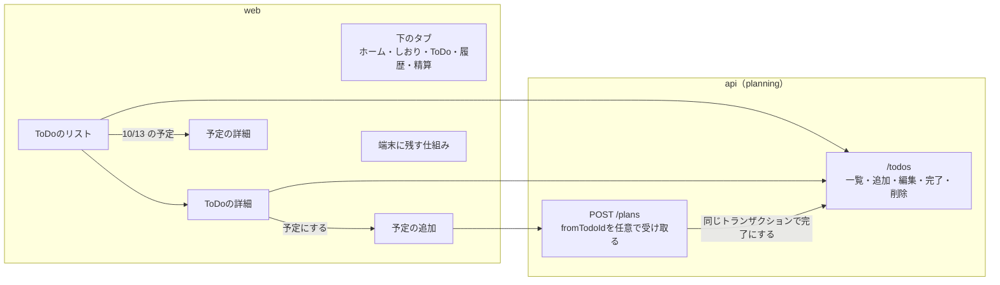
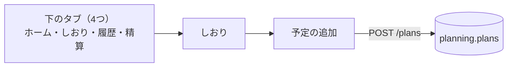
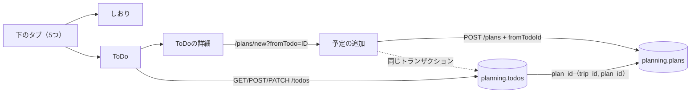
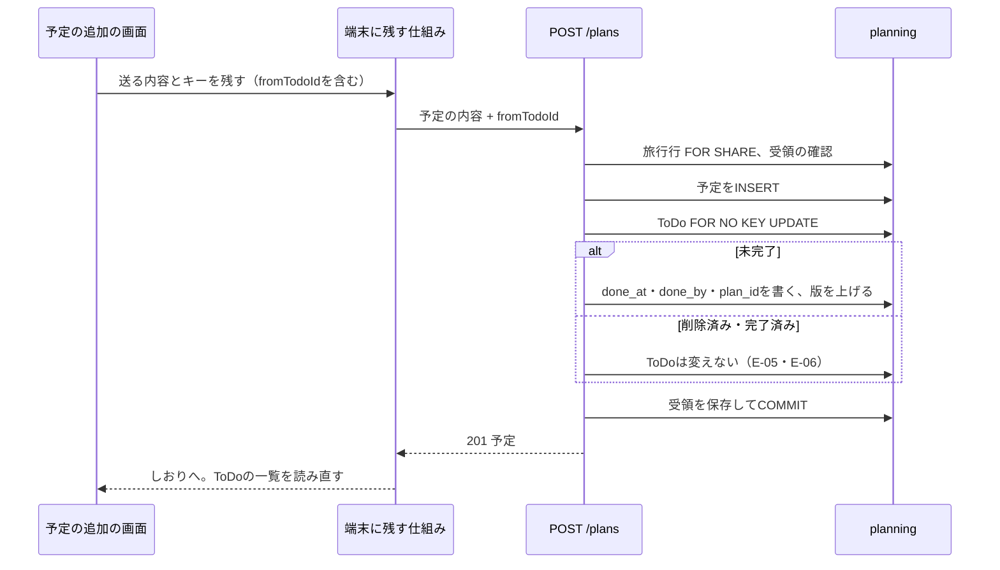

# 設計書: trip-todo（旅行のToDoリスト）

- ステータス: draft（承認待ち）
- レベル: L3
- 関連: docs/requirements/trip-todo.md（PR #325で承認。2026-11-08に予定とのリンクを足した）、ADR-0003（DBのロールとmigration）、ADR-0004（webの取得状態とAPIの入力検証）、ADR-0006（結果不明の要求を端末に残す）、論点の記録 docs/discussions/trip-todo.md
- 画面の見本: Claude Design https://claude.ai/artifact/RCFNdjitDHJKeFaqU59yJc

## この設計を一言で

ToDoの表を予定と同じplanningモジュールに足し、一覧・追加・編集・完了の付け外し・削除のAPIを作る。予定の追加のAPIは元のToDoのIDを任意で受け取り、予定の保存と同じトランザクションでToDoを完了にして予定とつなぐ。画面は下のタブを5つにし、ToDoのリストと詳細を足す。



## 背景

要件定義のとおり。予定は日付が必須で、日付の決まらない「ToDo」を置く場所が無い。書き込みの共通の流れ（旅行行のロック・受領・版・エラー形式）と、端末に残す仕組み（ADR-0006）は予定・支払いで作ってあるので、それに載せる。

## 目的

- ToDoの読み書きを、予定と同じ書き込みの流れ（同じ要求の再送で二重に作られない、相手が先に変えたら競合）で作る。
- 「予定にする」の保存で、予定だけができてToDoが未完了で残る状態を作らない（要件F-10）。
- 追記（todo-organize）: F-03・F-07・F-10・F-12の決まりは`docs/requirements/todo-organize.md`で変わった。予定をToDoから作っても完了にせず関連付けるだけにする。予定とのつながりは完了の印では変わらず、あとから付け外しできる。
- 下のタブを5つにしても、ほかの画面の行き先と主ボタンの場所を変えない。

## 要件

`docs/requirements/trip-todo.md`のF-01〜F-16、E-01〜E-09、B-01〜B-06。B-06（旅行が終わったあとの編集）は、この設計で「予定と同じく止めない」とした（論点の記録「旅行が終わったあともリストを編集できるか」）。

## 対象範囲

- DB: `planning.todos`の表と、実行用のロールへの権限。受領の表（`infra.command_receipts`）が記録できる種類に、ToDoの2つを足す。
- 契約: `packages/contracts/openapi/planning.json`にToDoの操作を足し、予定の追加の入力に`fromTodoId`を足す。`packages/contracts/src/`に型を足す。生成物（orval）を作り直す。
- api: planningモジュールにToDoのDomain・UseCase・Repository・Controllerを足す。予定の追加のUseCaseを広げる。
- web: `features/todos`、`screens/todos`・`screens/todo-detail`、ルート`/trips/[tripId]/todos`と`/trips/[tripId]/todos/[todoId]`、下のタブ、予定の追加の画面、端末に残す仕組みの許可リスト（`pending-requests.ts`）。
- 試験: Domain・UseCase（DBつき）・Controller・画面の単体試験、E2Eに1本。

## 対象外

要件定義の「対象外」のとおり（通知、並べ替え・期日・担当者・種類、旅行をまたいだリスト、予定の取りやめで未完了に戻すこと、予定の詳細から元のToDoへのリンク、持ち物、ホームの欄）。

追記（todo-organize）: カテゴリ・担当・期限・予定との関連付け・予定の詳細の「関連するToDo」は`docs/requirements/todo-organize.md`で扱う。

## 現状構成



## 変更後構成



## データフロー

「予定にする」の流れ。予定の保存と完了は一つのトランザクションで決まる。



電波が切れて結果が分からないときは、端末に残した同じ内容とキーで送り直す。受領があれば同じ予定を返すので、予定は二重にできない（E-07）。

## API 設計

すべて`/api/trips/{tripId}`の下。書き込みは`Idempotency-Key`が必須（今ある書き込みと同じ）。参加していない旅行は、今の`tripNotAccessible`と同じ403 `TRIP_NOT_ACCESSIBLE`で断る（E-08。旅行が無いときも同じ403で、旅行があるかは分からない）。書き込みはどれもPOST・PATCHで本文つきの200か201を返し、今の受領と端末に残す仕組みにそのまま載せる（DELETEと204は使わない）。

| 操作                 | メソッドとパス                  | 入力                                     | 成功                                                 | 主な失敗                                                     |
| -------------------- | ------------------------------- | ---------------------------------------- | ---------------------------------------------------- | ------------------------------------------------------------ |
| 一覧                 | `GET /todos`                    | なし                                     | 200 `TodoList`（`Cache-Control: private, no-store`） | 403 `TRIP_NOT_ACCESSIBLE`                                    |
| 追加                 | `POST /todos`                   | `{ name }`                               | 201 `Todo`                                           | 422 `TODO_LIMIT_REACHED`（E-02）、400/422 名前（E-01）       |
| 編集                 | `PATCH /todos/{todoId}`         | `{ name?, memo? }`、`X-Expected-Version` | 200 `Todo`                                           | 409 `VERSION_CONFLICT`（E-03）、404 `TODO_NOT_FOUND`（E-04） |
| 完了にする           | `POST /todos/{todoId}/complete` | なし                                     | 200 `Todo`                                           | 404 `TODO_NOT_FOUND`                                         |
| 未完了に戻す         | `POST /todos/{todoId}/reopen`   | なし                                     | 200 `Todo`                                           | 404 `TODO_NOT_FOUND`                                         |
| 削除                 | `POST /todos/{todoId}/delete`   | なし                                     | 200 `{ id }`（消したToDoのID）                       | 404 `TODO_NOT_FOUND`（E-04）                                 |
| 予定の追加（広げる） | `POST /plans`                   | 今の入力 + `fromTodoId?`                 | 201 `Plan`（形は今のまま）                           | 今のまま。`fromTodoId`が見つからなくても予定は作る           |

```ts
type Todo = {
  id: string;
  tripId: string;
  name: string;
  memo: string | null;
  createdBy: string;
  /** ISO 8601の日時。 */
  createdAt: string;
  /** 完了した日時と人。doneAtとdoneByは必ず対。 */
  doneAt: string | null;
  doneBy: string | null;
  /** 「予定にする」でつないだ予定。完了の印を外すとnullに戻る。 */
  plan: { id: string; date: string; cancelled: boolean } | null;
  /** 10進の正整数の文字列。編集の`X-Expected-Version`に送る。 */
  version: string;
};
type TodoList = { items: Todo[] }; // 未完了 → 完了、それぞれ追加した順
```

決めたこと:

- 完了の付け外しは、名前・メモの編集と分けて版を要らない操作にする。二人が同時に別の項目を触る使い方で、相手が名前を直しただけで完了の印が競合にならないようにする。「完了にする」は何度送っても完了のまま（完了にした人と時刻は最初のまま）、「未完了に戻す」も何度送っても未完了のまま。
- 削除も版を要らない。消す前の確かめは画面で行い、相手が先に消していたら404（E-04）。削除は受領に`{ id }`を残すので、電波が切れて同じキーで送り直したときは、行がもう無くても同じ200が返り、消せたと確かめられる。
- 予定の応答（`Plan`）は変えない。予定の詳細から元のToDoへのリンクは作らないため（論点の記録「予定にしたToDoと、その予定をどうつなぐか」）。

## DB 設計

`planning.todos`（migration `0011_planning_todos.sql`と`0012_planning_todos_grants.sql`）。あわせて`infra.command_receipts`の`resource_type`のcheckを置き換え、`todo`と`todo_deletion`を足す（今は`plan`や`payment`などしか記録できない）。`CommandReceipt`の`resourceType`の型にも同じ2つを足す。

| 列                                      | 型                 | 決まり                                                                                                                                                       |
| --------------------------------------- | ------------------ | ------------------------------------------------------------------------------------------------------------------------------------------------------------ |
| `id`                                    | uuid               | 主キー                                                                                                                                                       |
| `trip_id`                               | uuid               | `planning.trips(id)`への外部キー                                                                                                                             |
| `name`                                  | varchar(100)       | 必須。前後の空白を除いて1字以上（`plan_name_nonempty`と同じ形のcheck）                                                                                       |
| `memo`                                  | varchar(2000)      | 空はnull                                                                                                                                                     |
| `created_by`                            | uuid               | 追加した人                                                                                                                                                   |
| `done_at` / `done_by`                   | timestamptz / uuid | 両方nullか両方値あり（check）                                                                                                                                |
| `plan_id`                               | uuid               | null可。`(trip_id, plan_id)`を`planning.plans(trip_id, id)`への外部キーにし、別の旅行の予定を指せないようにする。`plan_id`があるなら`done_at`もある（check） |
| `version` / `created_at` / `updated_at` | 今の共通の列       | 予定と同じ                                                                                                                                                   |

- 索引: `(trip_id, created_at, id)`。一覧はこの順に読み、未完了・完了の分け方は読むときに並べ替える。
- 権限: 実行用のロールに`SELECT, INSERT, DELETE`と、変えてよい列（`name`・`memo`・`done_at`・`done_by`・`plan_id`・`version`・`updated_at`）だけの`UPDATE`。業務の記録の表で行を消せるのはこの表だけ（ToDoは消しても精算や履歴に響かない。要件F-08）。
- 予定は消さずに取りやめるだけなので、`plan_id`の先が無くなることは無い。外部キーは`ON DELETE`を付けない。
- 件数の上限（200件）は、追加のときに旅行行をFOR SHAREにして数える。追加どうしは互いを待たないので、同時に送った本数だけ200件を超えうる。上限はリストの長さを抑えるためのもので、超えてもほかの旅行や精算には響かないので、ロックを強めない。

## フロントエンド設計

見本はClaude Designの6枚（https://claude.ai/artifact/RCFNdjitDHJKeFaqU59yJc ）。見た目は今の`globals.css`の部品とトークンを使う。

- 下のタブ: `TripTab`に`"todos"`を足し、`TABS`をホーム・しおり・ToDo・履歴・精算の順にする（論点の記録「下のタブで、ToDoをどこに置き、何と呼ぶか」）。`.tabbar-inner`の列を`repeat(5, 1fr)`にする。アイコンは`@phosphor-icons/react`の`ListChecks`。
- ToDoのリスト（`/trips/[tripId]/todos`、`screens/todos`）: 上に旅行名・見出し「ToDo」・一行の説明、その下に一行の入力欄と「追加する」。「まだ · N件」「済んだ · N件」の2つの欄。行は丸い完了の印・名前・誰が追加したか（完了の行は誰が完了にしたか）。予定につないだ行は「10/13 の予定 ›」のリンクで予定の詳細を開き、取りやめた予定なら「取りやめた予定 ›」。0件・全件完了の表示は要件B-01・B-05。主ボタンは「支払いを記録」のまま（論点の記録「ToDoの画面の主ボタンを何にするか」）。2026-11-09のユーザーの判断で、ToDoのリストには主ボタンを出さない形に変えた。
- ToDoの詳細（`/trips/[tripId]/todos/[todoId]`、`screens/todo-detail`）: 名前とメモの入力欄、「変更を保存」（論点の記録「ToDoの詳細で、名前とメモをどう保存するか」）、「完了にする / 未完了に戻す」、「削除する」（確認のシートを挟む）。未完了なら主ボタンを「予定にする」に差し替える（予定の詳細の「達成を記録」と同じしくみ）。完了なら主ボタンは「支払いを記録」に戻す（2026-11-09から、完了なら主ボタンを出さない）。
- 予定の追加（今の`screens/plan-form`）: `?fromTodo=<id>`を`route-query.ts`で読み、ToDoの名前とメモを入れて開く（論点の記録「「予定にする」でメモも予定に写すか」）。画面の上に「ToDoの「…」から作ります。保存すると、ToDoは完了になります。」を出し、保存の要求に`fromTodoId`を足す。保存のあとはしおりへ進み、ToDoの一覧の取得を古いものとして扱う。
- 取得と保存: `features/todos`に一覧の取得と5つの書き込みを置く。書き込みは今の`mutation-request`（端末に残す仕組み）に載せる。`pending-requests.ts`の送り直せる経路の許可リストに、`/todos`・`/todos/{UUID}`・`/todos/{UUID}/complete`・`/reopen`・`/delete`の5つを足す（足さないと、画面を開き直したときに残した要求が消され、結果を確かめられない）。メソッドはPOST・PATCHだけなので、許可するメソッドは変えない。完了の付け外しはすぐ画面に反映し、失敗したら戻す。相手の変更は、画面を開いたとき・戻ったときの取り直しで見える（今のほかの画面と同じ）。
- オフライン: 今の画面と同じく、追加する・完了・保存・削除・予定にするを押せない見た目にする（E-09）。

## バックエンド設計

planningモジュールの中に置く（論点の記録「ToDoの表をどのモジュールに置くか」）。

- Domain: `domain/todo.ts`。`Todo.update(todo, patch, at)`（名前・メモ）・`complete(todo, by, at, planId)`・`reopen(todo, at)`。作るのはRepositoryの`insert`。名前・メモの決まりは予定の`parsePlanName`・`parsePlanMemo`と同じ値型を使う。
- Repository: `adapter/outbound/todo.repository.ts`と`infrastructure/drizzle-todo.repository.ts`。`countByTrip`・`insert`・`lockForUpdate(tripId, todoId)`（FOR NO KEY UPDATE）・`update`・`delete`。`PlanningWorkContext`に`todos`を足す。一覧の読み取りは予定と同じく`PlanningReadPort.listTodos`で、プールから直接読む。
- UseCase: `list-todos`・`create-todo`・`update-todo`・`complete-todo`・`reopen-todo`・`delete-todo`。書き込みの流れは`plan-write-flow.ts`と同じ（旅行行FOR SHARE → 受領 → ToDoの行のロック → 版の確認（編集だけ） → Domain → 更新と受領を同じトランザクションで保存）。
- 予定の追加: `CreatePlanUseCase`の入力に`fromTodoId: string | null`を足す。予定をINSERTしたあと、同じトランザクションでToDoをロックし、未完了なら`complete(userId, now, plan.id)`。無い・完了済みなら何もしない。ロックの順は旅行 → 予定 → ToDoで、ほかの書き込みと逆にならない。受領の要求の要約（`computeRequestHash`）は入力全体から作るので、`fromTodoId`の違う再送は別の要求として断られる。
- 旅行の状態は見ない。旅行が終わったあとも予定と同じく書ける（B-06）。
- 通知のイベントは出さない（F-15）。予定の追加の`plan_added`は今のまま出す。

## エラー処理

外部のサービスを呼ばない。DBの書き込みは今の書き込みと同じく、一つのトランザクションで受領と一緒に保存する。

- 冪等性: すべての書き込みで`Idempotency-Key`と受領を使う。同じキーで違う内容なら今と同じ`IDEMPOTENCY_KEY_REUSED`。
- 部分失敗: 「予定にする」は予定の保存と完了が一つのトランザクションなので、片方だけ残らない（F-10）。
- リトライ・タイムアウト・フォールバックは今の`mutation-request`のまま。新しい外部の呼び出しは無い。

## ログと監視

今の要求ログ（`Server-Timing`と構造化ログ）に乗る。新しい指標は足さない。

## セキュリティ

- 旅行の参加者かを、すべての操作で旅行行のロックと一緒に確かめる（今の`lockForShare(tripId, userId)`）。参加していなければ、旅行が無いときと同じ403 `TRIP_NOT_ACCESSIBLE`（今の旅行・予定のAPIと同じ）。
- ToDoのIDが別の旅行のものなら`TODO_NOT_FOUND`（`(trip_id, id)`で探す）。
- `fromTodoId`も同じ旅行の中だけで探す。別の旅行のIDを渡しても、何もしない（予定は作る）。
- 名前・メモはReactの通常の表示で出し、HTMLとして解釈しない。
- 要件どおり認証・認可のしくみは変えないが、新しいAPIと権限を足すので、実装のあとに`security-reviewer`を起動する。

## 性能

一つの旅行で最大200件。一覧は`(trip_id, created_at, id)`の索引で1回読み、予定の日付と取りやめは`LEFT JOIN planning.plans`で同じ問い合わせで取る。応答は200件で約40KB以内。

## テスト方針

- Domain: 名前・メモの境界（B-02・B-03）、完了・戻すの冪等性、`plan_id`は完了のときだけ。
- UseCase（DBつき、`vitest.db.config.ts`）: 追加の上限（E-02）、編集の競合（E-03）、削除済み（E-04）、予定の追加と完了が一つのトランザクションになること（F-10）、削除済み・完了済みのToDoからの予定の追加（E-05・E-06）、同じキーの再送（E-07）、ほかの旅行の参加者（E-08、403）、ほかの旅行の`fromTodoId`、削除の同じキーでの送り直し（行が無くても200）、受領に`todo`・`todo_deletion`を記録できること。
- Controller: 入力の形と応答の形、`X-Expected-Version`の有無。
- web: 下のタブが5つ、リストの並びと0件・全件完了、予定へのリンクと取りやめた予定、予定の追加の画面に名前とメモが入ること、残した要求の許可リストがToDoの5つの経路を受け付け、ほかの経路は今までどおり消すこと。
- E2E: 追加する → 予定にする → しおりに予定ができる → ToDoで完了になり「の予定」から予定の詳細が開く。
- 試験の観点の詳細は`docs/tests/trip-todo.md`（設計の承認のあとに書く）。

## 移行とリリース

- migrationは表と権限を足し、受領の表のcheckを、今の種類に`todo`と`todo_deletion`を足したものに置き換える。今ある行はどれも新しいcheckを満たすので、データは移さない。結合検証環境に先に当て、`npm run db:check`で生成物とmigrationが合っていることを確かめる。
- 契約は`fromTodoId`を任意で足すだけなので、古い画面からの予定の追加はそのまま通る。apiを先に、webをあとに出しても壊れない。

## リスク

- 下のタブが5つになり、タブ1つの幅が約72pxに狭まる。結合検証環境で、スマートフォンの幅で名前が切れないかを手で確かめる。
- 予定の追加のUseCaseにToDoの書き込みが入るので、予定の追加の今の試験が落ちないかを確かめる。

## 決めたこと（問いと答え）

`docs/discussions/trip-todo.md`

## 未決事項

論点の記録で仮決定が4件（旅行が終わったあとの編集・表を置くモジュール・メモを予定に写すか・詳細の保存のしかた）。この設計のPRのマージまでに異議がなければ決定にする。
