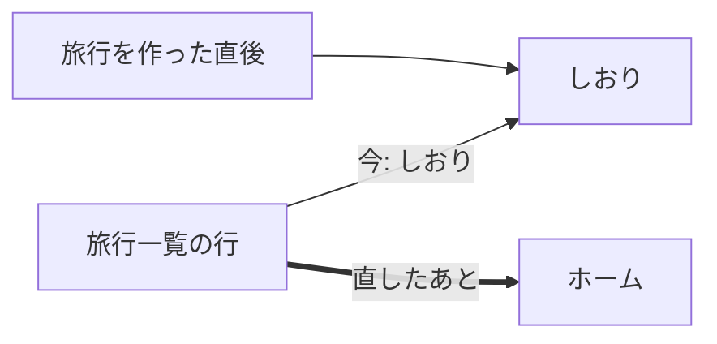

# 設計書: words-and-landing（画面の言葉をそろえ、旅行を開いたときの画面と精算の主ボタンを直す）

- ステータス: draft
- レベル: L2（旅行を開いたときの画面の流れが変わる。APIとDBは変えない）
- 関連: 論点の記録 `docs/discussions/words-and-landing.md`、#249（言葉と開いたときの画面）、#248（受け渡しの確認のボタン）

## この設計を一言で

画面の言葉と旅行を開いたときの画面を、答えてもらった問いのとおりに直す。旅行一覧から旅行を開くとホームが出るようにし、旅行を作った直後だけはしおりを出す。予約のボタンは「予約を記録」、下のタブの「記録」は「履歴」にする。精算の主ボタンは「受け渡しの内容を確かめる」にして、押しても精算にならないことをそばの一行に書く。直すのは画面の文言とリンク先だけで、APIとDBは変えない。

## 背景

初めて使った人のレビューで、同じものを画面ごとに別の言葉で呼んでいると指摘された（#249）。予定の詳細のボタンは「予約済みを記録」なのに、記録の絞り込みは「予約」になっている。下のタブの「記録」は、「達成を記録」「支払いを記録」のようなボタンの「記録」とぶつかる。旅行一覧から旅行を開くと、予定がほとんど無いしおりが出る。精算の主ボタン「受け渡しを確認する」については、押すと何が起きて戻せるのかがわからないという指摘があった（#248）。

## 目的

- 同じものを、ボタン・バッジ・絞り込み・通知で同じ言葉で呼ぶ。
- 旅行を2回目以降に開いたとき、今日の予定と精算の額がすぐ見えるようにする。
- 精算の主ボタンを押しても精算にならず、送金もしないことを、押す前に読めるようにする。

## 要件

論点の記録の答え（2026-10-24）のとおり。

- 旅行一覧の行はホームを開く。旅行を作った直後はしおりを開く。
- 予定の詳細のボタンは「予約を記録」にする。バッジと記録の絞り込みは「予約」「達成」のまま。
- 下のタブの「記録」は「履歴」にする。「しおり」は変えない（仮決定）。
- 精算の主ボタンは「受け渡しの内容を確かめる」にし、そばに一行の説明を置く。押す前の確認は出さない（仮決定）。

## 対象範囲

| 何を | どこで | 今 | 直したあと |
| --- | --- | --- | --- |
| 旅行一覧の行のリンク先 | `features/trips/ui/trip-row.tsx` | `/trips/{id}/itinerary` | `/trips/{id}/home` |
| 予約のボタン（主ボタンと副ボタン） | `screens/plan-detail/plan-detail-screen.tsx` | 予約済みを記録 | 予約を記録 |
| 相手が予約を付けたときの通知 | `shared/push/notification-content.ts` | 予約済みを記録しました | 予約を記録しました |
| 下のタブ | `features/trips/ui/trip-tab-bar.tsx` | 記録 | 履歴 |
| 履歴の画面の見出し | `screens/records/records-screen.tsx` | 記録 | 履歴 |
| ホームの欄の見出しとリンク | `screens/home/home-records-card.tsx` | 最近の記録 / 記録一覧へ | 最近の履歴 / 履歴へ |
| 精算の主ボタン（受け渡しがあるとき） | `screens/settlement/settlement-screen.tsx` | 受け渡しを確認する | 受け渡しの内容を確かめる |
| 精算の主ボタン（受け渡しが要らないとき） | 同上 | 受け渡し不要の対象を確認する | 受け渡し不要の内容を確かめる |
| 精算の主ボタンの下の一行 | 同上 | 無し | 下の「精算の主ボタンの説明」 |

画面の上の言葉が変わる箇所の試験（単体とE2E）も、同じ言葉に直す。

### 精算の主ボタンの説明

受け渡しがあるときは「金額を決めて確認の画面を開きます。まだ精算にはなりません。送金もしません。」にする。受け渡しが要らないときは、金額の受け渡しが無いので「対象を決めて確認の画面を開きます。まだ精算にはなりません。」にする。後者は問いに出していないが、前者の答えと同じ形にそろえた。

## 対象外

- URLの`/plans`・`/records`は変えない。画面の上に「プラン」は出していない。
- 予約の行の「予約済み」の表示（v3の09）、取り消しの詳細の見出し「記録」（`plan-event-sheet.tsx`・`payment-detail-screen.tsx`の小さな見出し）は変えない。「記録」は、ここでは1件の記録そのものを指しているので、タブの名前とはぶつからない。
- 予約・達成のボタンの下の説明と押す前の確認は、#252で直す。
- 支払いを保存した直後にしおりへ戻る動き（`payment-form-screen.tsx:246`）は、旅行を開く操作ではないので変えない。

## 現状構成

旅行を開く入口は、旅行一覧の行、旅行を作った直後、支払いを保存した直後の3か所で、どれもしおりを開く。下のタブはホーム・しおり・記録・精算の順に並ぶ（`trip-tab-bar.tsx`）。

## 変更後構成

旅行一覧の行だけがホームを開く。ほかの2か所は変えない。タブの並びは変えず、3つめの名前だけ「履歴」にする。

## データフロー

対象外（APIへの要求は変えない）。

## API 設計

対象外。

## DB 設計

対象外。

## フロントエンド設計

文言とリンク先の置き換えだけで、部品の作りは変えない。精算の主ボタンの説明は、受け渡しのカード（`TransferCard`）の中で、ボタンのすぐ下に補足の文として置く。文字の大きさは、カードの中の「まだ精算していない明細 N 件」と同じにする。ボタンの`aria-describedby`でこの文を指し、読み上げでもボタンと一緒に読まれるようにする。

## バックエンド設計

対象外。通知の文はwebの`notification-content.ts`で組み立てているので、APIは変えない。

## エラー処理

対象外（新しい外部呼び出しは無い）。

## ログと監視

対象外。

## セキュリティ

対象外（認可と入力の扱いは変えない）。

## 性能

対象外。

## テスト方針

- 旅行一覧の行が`/trips/{id}/home`を指す。旅行を作った直後は今どおりしおりへ進む。
- 予定の詳細に「予約を記録」が出て、「予約済みを記録」が出ない。
- 下のタブに「履歴」が出る。履歴の画面の見出しが「履歴」になる。
- 精算の主ボタンの名前と説明が、受け渡しがあるときと要らないときで出し分けられる。説明がボタンの`aria-describedby`で結ばれている。
- E2Eで文言を探している箇所を新しい言葉に直し、通ることを確かめる。

## 移行とリリース

1. この設計の承認（このPRのマージ）。
2. 実装のPR（1本）。
3. 結合検証環境に出して、旅行一覧からホームが開くこと、精算の説明が出ることを見て確かめる。

戻すときは、実装のPRを戻せば今の言葉とリンク先に戻る。保存されたデータには触らない。

## リスク

- 「最近の記録」を「最近の履歴」に変えるのは、タブの名前に合わせた私の判断で、問いには出していない。異議があれば、設計の承認のときに戻せる。
- 旅行一覧からホームを開くと、予定を足したい人はタブを1回押すことになる。旅行を作った直後はしおりを開くので、いちばん予定を足したい場面には影響しない。

## 決めたこと（問いと答え）

論点の記録`docs/discussions/words-and-landing.md`を参照（4問は推奨どおりに決定、2問は仮決定）。

## 未決事項

なし。
