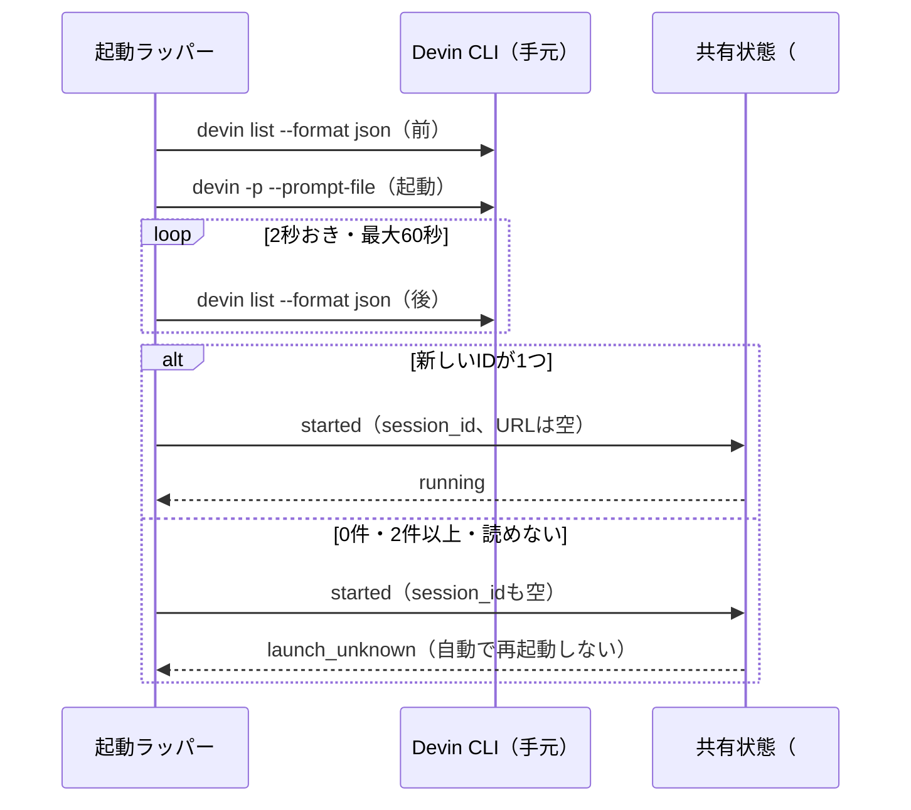

# 論点の記録: 手元のDevinのセッションをIDで確定する

- 機能名: devin-local-session
- 確認のページ: https://claude.ai/artifact/Myoc1p2Ba81hXFMeCiTWjV
- 進み具合: docs/discussions/devin-local-session.progress.json

## 背景

Devinへの委譲は、起動を止める2つの設定（`migration_complete: false`、`cli_launch_verified: false`）で止めている。2026-10-24に手元のDevin CLI（3000.11.3）を読み取りで調べると、手元のセッションには`app.devin.ai`のURLが無かった。起動ラッパーと共有状態の決まりは、起動の確定にIDとURLの両方を求めるので、今のままでは手元の起動が必ず「起動結果不明（`launch_unknown`）」で終わる。この設計で、手元のセッションをIDだけで確定する方法と、それを確かめる起動のやり方を決める。

## 前提

- 委譲の既定は手元のSWE-2（2026-10-12 ユーザーの指示）。クラウドはユーザーが指示したときだけ使う。
- 手元の`devin list --format json`は、セッションごとに`id`・`short_id`・`working_directory`・`last_activity_at`・`title`を返す。URLは無い。IDは`boiled-truffle`のような単語の組で、今の形の検査（英数字・`_`・`-`、128字まで）に合う。
- 起動ラッパー（`delegation-launch.mjs`）は、起動のあとにセッションのIDとURLを受け取らない（いつも`null`）。
- 担当の確保（claim）のときに、タスクへ`runner`（`local`か`cloud`）が記録される。
- 起動結果が分からないとき（見つからない・複数見つかる・一覧を読めない）は、今どおり`launch_unknown`にし、自動で再起動しない。
- 進行中の委譲は無い（開いているPRは0件、専用クローンに書きかけの変更は無い、#267は空から始まった）。専用クローンは前の委譲のブランチ（`devin/deploy-integration-219`）のまま。
- 手順書（`review-devin-pr`、`docs/devin-setup.md`）は「実機の確認をstubの試験で代用しない」と「本物のDevinを起動する試験はしない」の両方を書いている。

## 論点

### 手元のセッションのIDの取り方を、起動の前後に一覧を読み比べて決める方法にするか

<!-- id: id-source -->

- 工程: 設計
- 種類: 設計
- 優先度: 高
- 状態: 決定
- なぜ今: IDの取り方が決まらないと、起動ラッパーの作りを書けない。
- 根拠: `devin -p --prompt-file`は対話しない実行で、起動の出力にセッションのIDを出すかは確かめていない。`devin list --format json`は作業フォルダの中のセッションを、IDつきで返す。
- 選択肢:
  - A) 起動の前と後に、専用クローンで`devin list --format json`を読み、新しく出たIDが1つだけならそれにする
    - 利点: 読み取りだけのコマンドで、出力の形も確かめてある
    - 欠点: 同じフォルダで別のセッションが同時に始まると見分けられない（その場合は2つ見つかるので`launch_unknown`にする）
  - B) 起動の出力（ログ）からIDを読み取る
    - 利点: 一覧を読み直さなくてよい
    - 欠点: 出力の形を確かめておらず、版が変わると読めなくなる。今のラッパーも「出力から推測しない」と決めている
- 推奨: A（確かめてある読み取りのコマンドだけで決められ、見分けられないときは不明として止まる）
- 決定: A
- 推奨と同じか: 同じ
- 理由:
- 選ばなかった理由: B（出力の形を確かめておらず、版が変わると読めなくなるため。今のラッパーも「出力から推測しない」と決めている）
- 反映先: docs/designs/devin-local-session.md「要件」「変更後構成」
- 決めた日: 2026-10-24

### 確かめのための起動を、どうするか

<!-- id: verify-launch -->

- 工程: 設計
- 種類: 設計
- 優先度: 高
- 状態: 決定
- なぜ今: 起動のあと何秒で一覧にセッションが出るかは、実際に起動しないと分からない。これが分からないと、待つ時間を決められず、`cli_launch_verified`を外せない。
- 根拠: 手順書は「実機の確認をstubの試験で代用しない」と「本物のDevinを起動する試験はしない」の両方を書いている。2つを同時には守れない。
- 選択肢:
  - A) 害の無い依頼で、手元のDevinを1回だけ起動する。専用クローンとは別の空の一時フォルダで、「このフォルダにファイルを1つ作って終わる」だけを頼む。リポジトリ・ブランチ・PRには触らせない。一覧に出るまでの秒数とIDの形を記録し、手順書の「起動する試験はしない」に、この1回を例外として書き足す
    - 利点: 本物の委譲を出す前に、一覧の読み比べが働くかを確かめられる。失敗しても委譲の記録は汚れない
    - 欠点: SWE-2の利用が1回分かかる
  - B) 確かめの起動はせず、第1波の最初の委譲（#251）を確かめも兼ねて出す
    - 利点: 余分な起動が要らない
    - 欠点: 一覧の読み比べが働かなかったとき、本物の委譲が`launch_unknown`になり、照合の手間が増える
  - C) 起動せず、試験（stub）だけで`cli_launch_verified`を外す
    - 利点: 手間が無い
    - 欠点: 手順書の「stubで代用しない」に反し、本当に一覧に出るかが分からないまま外すことになる
- 推奨: A（本物の委譲の前に、委譲の記録に触れずに確かめられる）
- 決定: A
- 推奨と同じか: 同じ
- 理由:
- 選ばなかった理由: B（一覧の読み比べが働かなかったとき、本物の委譲がlaunch_unknownになり照合の手間が増えるため）。C（手順書の「stubで代用しない」に反し、本当に一覧に出るか分からないまま外すことになるため）
- 反映先: docs/designs/devin-local-session.md「確かめの起動」
- 決めた日: 2026-10-24

### 起動のあと、一覧を何秒まで待つか

<!-- id: wait-time -->

- 工程: 設計
- 種類: 設計
- 優先度: 中
- 状態: 決定
- なぜ今: 待つ時間が短すぎると、出る前に諦めて`launch_unknown`になる。
- 根拠: 起動の初期化にかかる時間は確かめていない。確かめの起動（上の問い）で測れる。
- 選択肢:
  - A) 2秒おきに読み、最大60秒待つ。確かめの起動で測った秒数が長ければ見直す
    - 利点: 初期化が遅くても取りこぼしにくい
    - 欠点: 見つからないとき、起動ラッパーが1分止まる
  - B) 2秒おきに最大15秒
    - 利点: 早く終わる
    - 欠点: 初期化が遅いと取りこぼす
- 推奨: A（取りこぼすと照合の手間が増える。1分止まっても困らない）
- 決定: A
- 推奨と同じか: 同じ
- 理由:
- 選ばなかった理由: B（初期化が遅いと取りこぼし、照合の手間が増えるため）
- 反映先: docs/designs/devin-local-session.md「要件」
- 決めた日: 2026-10-24

### クラウドの起動を、どう止めておくか

<!-- id: cloud-scope -->

- 工程: 設計
- 種類: 設計
- 優先度: 中
- 状態: 決定
- なぜ今: `cli_launch_verified`は1つの設定で、外すとクラウドの起動も許してしまう。クラウドの内部の再送は確かめていない。
- 根拠: クラウドは`--cloud`でWebSocketを使い、内部で起動の要求を送り直すかは読み取りで分からなかった。クラウドはユーザーが指示したときだけ使う（2026-10-12）。
- 選択肢:
  - A) `cli_launch_verified`を手元の確認の印にし、クラウドは新しい設定`cloud_launch_verified: false`で止める。クラウドは今どおりURLを必須にする
    - 利点: 手元だけを先に動かせ、確かめていないクラウドは止まったまま
    - 欠点: 設定が1つ増える
  - B) `cli_launch_verified`を外すと、手元もクラウドも許す
    - 利点: 設定が増えない
    - 欠点: 確かめていないクラウドの起動まで許してしまう
- 推奨: A（確かめたものだけを許す）
- 決定: A
- 推奨と同じか: 同じ
- 理由:
- 選ばなかった理由: B（確かめていないクラウドの起動まで許してしまうため）
- 反映先: docs/designs/devin-local-session.md「クラウドを止める設定」
- 決めた日: 2026-10-24

### 移行の完了（`migration_complete`）を、いつ外すか

<!-- id: migration -->

- 工程: 設計
- 種類: 設計
- 優先度: 中
- 状態: 決定
- なぜ今: `migration_complete`が`false`のままだと、委譲の登録（register）ができない。
- 根拠: 進行中の委譲が無く、取り込むものが無いことを2026-10-24に確かめた（前提）。元の設計は、決まった担当者が移行の結果を確かめてから設定のPRで外すとしている。
- 選択肢:
  - A) 確かめの起動のあと、`cli_launch_verified`と同じ設定のPRで外す
    - 利点: 1つのPRで、登録から起動までがそろって動き出す
    - 欠点: 確かめの起動が済むまで登録もできない
  - B) 先に別のPRで外し、登録とIssueの起票だけを先に始める
    - 利点: Issueの用意を先に進められる
    - 欠点: 登録できても起動できない状態が続き、どこまで進んだかが分かりにくい
- 推奨: A（登録から起動までを同時に動かせ、途中で止まったタスクを作らない）
- 決定: A
- 推奨と同じか: 同じ
- 理由:
- 選ばなかった理由: B（登録できても起動できない状態が続き、どこまで進んだかが分かりにくいため）
- 反映先: docs/designs/devin-local-session.md「移行とリリース」
- 決めた日: 2026-10-24
