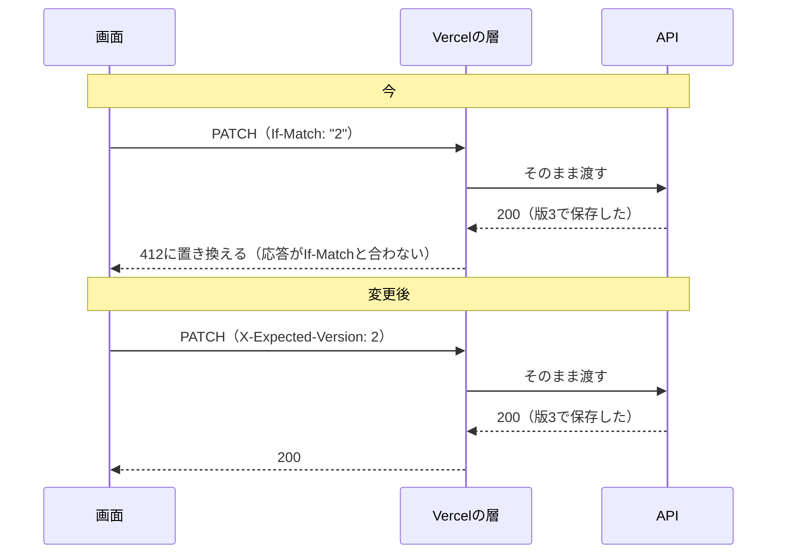

# 論点の記録: 版の確認を独自のヘッダーで送る

- 機能名: expected-version-header
- 確認のページ: https://claude.ai/artifact/D5jiKyWEF9h2hX38JmyFNz
- 進み具合: docs/discussions/expected-version-header.progress.json

## 背景

結合検証環境で予定や旅行を保存すると、サーバーでは保存できているのに、画面に失敗と出る。2026-10-23に内蔵のブラウザで確かめると、If-Matchの付いた要求の成功の応答を、Vercelが自分の412（`PRECONDITION_FAILED`）に置き換えていた。応答にETagが無くても、If-Matchが`*`でなければ412になる。保存すると版は必ず進むので、If-Matchを付けた書き込みはVercelの上では必ず失敗と出る。#240と#255で書き込みの応答からETagを外したが、これでは直らなかった。この設計で、版の確認（古い版を見て上書きしないための仕組み）の送り方を変える。

## 前提

- 版の確認を使う書き込みは7つ。予定の編集・日の移動・取りやめと、旅行の名前の変更・期間の変更・開始・終了。
- 版の確認の決まりは変えない。無ければ428、今の版と違えば409 `VERSION_CONFLICT`、同じ`Idempotency-Key`の再送は版の確認より先に元の結果を返す。
- 要求の同一性（`request_hash`）には、今と同じく版の数字を入れる。
- アプリはまだ公開していない。APIを使うのは自分たちの画面だけ。
- 端末に残した送信中の要求（ADR-0006）には、今は`ifMatch`（`"3"`の形）が入っている。

## 論点

### 版の確認を、If-Matchの代わりに何で送るか

<!-- id: send-method -->

- 工程: 設計
- 種類: API
- 優先度: 高
- 状態: 決定
- なぜ今: 決めないと、結合検証環境で7つの書き込みが失敗と出たままになる。
- 根拠: 2026-10-23の確かめ。予定のGETにIf-Match `"999"`を付けると412、`/api/me`（ETagなし）に`"x"`を付けても412、If-Matchなしと`*`は200。APIのプロジェクトの`/api/health`と画面のサインインでも同じ。
- 選択肢:
  - A) 独自のヘッダー（`X-Expected-Version`）で送る
    - 利点: Vercelは知らないヘッダーを評価しない。決まりと本文の形はそのままで、変えるのはヘッダーの名前と値だけ
    - 欠点: HTTPの標準の仕組みではなくなる
  - B) 要求の本文に`expectedVersion`の欄を足す
    - 利点: ヘッダーを経由しないので、途中の層の影響を受けない
    - 欠点: 7つの本文の形がすべて変わり、取りやめや開始のように本文の無い操作にも本文が要る
  - C) Vercelの設定でIf-Matchの評価を止める
    - 利点: アプリを変えずに済む
    - 欠点: 止める設定があるかを確かめていない。あっても、ホスティングの動きに頼ることになる
- 推奨: A（本文の形を変えずに、Vercelの評価を避けられる）
- 決定: A
- 推奨と同じか: 同じ
- 理由:
- 選ばなかった理由: B（7つの本文の形が変わり、本文の無い操作にも本文が要るため）。C（止める設定があるか確かめておらず、ホスティングの動きに頼ることになるため）
- 反映先: docs/designs/expected-version-header.md「API設計」
- 決めた日: 2026-10-23

### ヘッダーの値を、数字だけにするか引用符付きにするか

<!-- id: header-value -->

- 工程: 設計
- 種類: API
- 優先度: 中
- 状態: 仮決定
- なぜ今: 契約と、APIが受け付ける形の検査が決まらない。
- 根拠: 今のIf-Matchは引用符付き（`"3"`）だけを受け付ける（`apps/api/src/common/http/etag.ts`）。引用符はETagの書き方の決まりで、独自のヘッダーには要らない。
- 選択肢:
  - A) 数字だけ（`X-Expected-Version: 3`）
    - 利点: 本文の`version`と同じ書き方になり、画面は本文の値をそのまま送れる
    - 欠点: 今の検査の形を書き換える
  - B) 引用符付き（`X-Expected-Version: "3"`）
    - 利点: 今の検査をそのまま使える
    - 欠点: ETagではないのに、ETagの書き方が残る
- 推奨: A（本文の`version`と同じ書き方で、画面が組み立て直さずに済む）

### 読む応答（予定と旅行のGET）のETagを残すか

<!-- id: read-etag -->

- 工程: 設計
- 種類: API
- 優先度: 中
- 状態: 仮決定
- なぜ今: 画面が次に送る版を、ETagと本文のどちらから取るかが決まらない。
- 根拠: 予定と旅行のGETは、ETagと本文の`version`の両方を返す（`plans.controller.ts:148`、`trips.controller.ts:150`）。画面は「ETagが無ければ本文の`version`から作る」としている（`plan-save.ts:110`、`trip-save.ts:111`）。
- 選択肢:
  - A) 外す。版は本文の`version`だけから取る
    - 利点: 版の出どころが1つになり、ETagと版の行き違いを考えなくてよい
    - 欠点: 契約からETagの記述を消す手間がある
  - B) 残す
    - 利点: 読む応答は変えずに済む
    - 欠点: 誰も使わないヘッダーが残り、If-Matchで送るものと誤解されやすい
- 推奨: A（使い道が無くなり、版の出どころを1つにできる）

### 版の確認が無いときのエラーの名前を変えるか

<!-- id: error-code -->

- 工程: 設計
- 種類: API
- 優先度: 中
- 状態: 仮決定
- なぜ今: 契約のエラーの一覧と、画面のエラーの型が決まらない。
- 根拠: 今は428 `IF_MATCH_REQUIRED`、文言は「If-Match header is required」（`apps/api/src/common/http/api-error.filter.ts:48`）。画面は状態コードの428で見分けていて、名前では見分けていない（`plan-form-screen.tsx:57`ほか）。
- 選択肢:
  - A) `EXPECTED_VERSION_REQUIRED`に変える
    - 利点: 名前と文言が、実際に要るヘッダーと合う
    - 欠点: 契約と画面のエラーの一覧を書き換える
  - B) `IF_MATCH_REQUIRED`のまま
    - 利点: 変える場所が少ない
    - 欠点: 使っていないヘッダーの名前がエラーに残る
- 推奨: A（公開前で使うのは自分たちの画面だけなので、今なら名前を合わせられる）

### 端末に残った、If-Matchの形の送信中の要求をどう扱うか

<!-- id: pending-old -->

- 工程: 設計
- 種類: 設計
- 優先度: 中
- 状態: 仮決定
- なぜ今: 新しい版を出した直後に、古い形で残った要求を送り直すと428になる。
- 根拠: 結果が分からなかった要求は、同じキー・本文・版で確かめ直すため端末に残す（ADR-0006、`apps/web/src/shared/browser/pending-requests.ts`）。今の記録は`ifMatch: "3"`の形。
- 選択肢:
  - A) 読むときに`"3"`を`3`に直して、新しいヘッダーで送り直す
    - 利点: 結果を確かめ直す流れが、版を出した前後で途切れない
    - 欠点: 古い形を読む処理が残る
  - B) 古い形の記録は捨てる
    - 利点: 読む処理が簡単になる
    - 欠点: 保存できたか分からないままの要求を、確かめられなくなる
- 推奨: A（保存できたか分からない要求を、確かめずに捨てない）
