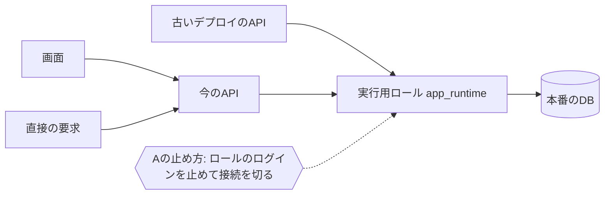

# 論点の記録: 本番の公開

- 機能名: production-launch
- 確認のページ: https://claude.ai/artifact/LdADyPVj5oRQs5L17Ma3Rp
- 進み具合: docs/discussions/production-launch.progress.json

## 背景

二人が実際の旅行で使う本番の環境（Vercelのweb・api、Neonのproduction）を作り、公開する。結合検証環境では、ログイン・旅行と予定・支払いと精算・通知を二人の実機で確かめ、主な点検は合格した（docs/tests/integration-env.md）。設計資料（詳細設計08と「運用設定と公開チェック」）は、本番を作る前のバックアップと復元の確かめ、公開の順番、公開前の確認（OPS-01〜18）を「未実施」として残している。2026-10-28に、ユーザーが二人で使う本番を作ると決めた（一般への公開や商用にはしない）。

## 前提

- 二人の個人利用のまま。Vercel Hobby（個人の非商用のプラン）とNeon Freeで、独自ドメインと有料の追加は使わない（詳細設計08の1節）。
- 利用規約とプライバシーポリシーのページは作らない（#245を2026-10-28に閉じた）。
- 本番の秘密情報（DBの接続・Googleのシークレット・Better Authの乱数・VAPIDの秘密鍵）は、検証用の環境と共有しない（「運用設定と公開チェック」1節）。
- 結合検証環境は残し、公開後の変更は本番の前にそこで確かめる（論点の記録「結合検証環境」で決定）。
- 本番のデータは二人の実データで、最初は空から始める。結合検証環境の架空のデータは移さない。
- DBのmigrationは管理者の端末から行い、アプリの起動やビルドでは行わない（詳細設計08の7節）。

## 論点

### 本番を作る前に、結合検証環境の残りの点検を済ませるか

<!-- id: finish-integration-checks -->

- 工程: 要件
- 種類: 設計
- 優先度: 高
- 状態: 決定
- なぜ今: 本番の作業の始まりと、要件の完了の条件が変わる。
- 根拠: docs/tests/integration-env.md の記録の表で、APIへの直接の要求と別の旅行への要求（IE-05）、使わない接続が手放されるか（IE-07）、main以外のブランチから出せないか（IE-15）が一部だけ、接続の設定（IE-06）、実行用ロールの制限（IE-09）、使用量（IE-14）がまだ。どれも本番でも同じ手順で作るもの。
- 選択肢:
  - A) 先に結合検証環境で6件を済ませ、そのあと本番を作る
    - 利点: 実行用ロールの制限や接続の設定に問題があっても、架空のデータの環境で直せる
    - 欠点: 本番を作り始めるのが、点検の分だけ遅れる
  - B) 6件は本番を作ってから、本番の公開前の確認で確かめる
    - 利点: すぐ本番を作り始められる
    - 欠点: 問題が見つかったとき、本番のDBで直すことになる
- 推奨: A（6件はどれも本番と同じ手順で作るので、先に検証用で確かめておけば、本番で同じ問題を踏まない）
- 決定: A
- 推奨と同じか: 同じ
- 理由:
- 選ばなかった理由: B（推奨の理由: 6件はどれも本番と同じ手順で作るので、先に検証用で確かめておけば、本番で同じ問題を踏まない）
- 反映先: docs/requirements/production-launch.md「機能要件」P-01
- 決めた日: 2026-10-29

### 本番の地域をシンガポールにするか

<!-- id: production-region -->

- 工程: 要件
- 種類: 設計
- 優先度: 高
- 状態: 決定
- なぜ今: Neonのプロジェクトは作るときに地域を決め、あとから変えられない。結合検証環境の要件は、時間の内訳を測ってから本番の地域を決めるとしていた（PERF-01）。
- 根拠: docs/tests/integration-env.md のIE-13。2026-10-20に、ホームを開く・予定を足す・支払いを記録するが、Neonの休止のあとの1回目も含めて全体で3秒以内だった（ユーザーの報告）。2026-10-16の測定では、関数が休んでいた直後の最初の要求が全体3.2秒（そのうち関数の起動が2.4秒）、続けての要求は全体0.2〜0.4秒。遅れの大半は関数の起動で、距離ではない。Neonの地域に東京は無い。
- 選択肢:
  - A) 検証用と同じく、Vercelの関数をsin1、NeonをAWS Singaporeにする
    - 利点: 検証用で確かめた構成のまま出せ、設計資料の初期案どおり
    - 欠点: 休止のあとの最初の操作は、今と同じく数秒待つ
  - B) 東京の地域があるPostgreSQLのサービスへの変更を、ADRで検討してから決める
    - 利点: 距離の分だけ、続けての操作がさらに速くなる見込みがある
    - 欠点: DBのサービスを変える設計の見直しが先に入り、遅れの大半である関数の起動は直らない
- 推奨: A（続けての操作は0.4秒以内で、遅れの大半は距離ではなく関数の起動なので、DBを変えても待ち時間はほとんど縮まない）
- 決定: A
- 推奨と同じか: 同じ
- 理由:
- 選ばなかった理由: B（推奨の理由: 続けての操作は0.4秒以内で、遅れの大半は距離ではなく関数の起動なので、DBを変えても待ち時間はほとんど縮まない）
- 反映先: docs/requirements/production-launch.md「機能要件」P-02
- 決めた日: 2026-10-29

### 本番へのデプロイを、検証用と同じGitHub Actionsのボタンで行うか

<!-- id: production-deploy-tool -->

- 工程: 要件
- 種類: 設計
- 優先度: 高
- 状態: 決定
- なぜ今: 本番の手順書の中身と、GitHubに置く秘密情報が変わる。
- 根拠: 結合検証環境では、ActionsのEnvironment「integration」に期限つきのVercelのトークンを置き、承認を必須にし、mainだけから動かすボタン（.github/workflows/deploy-integration.yml）にした（論点の記録「結合検証環境」の手動のデプロイの論点）。詳細設計08の7節は、本番を「管理者がCI成功commitを指定して本番リリースする方式」とし、mainへのpushだけで本番が切り替わらないようにするとしている。
- 選択肢:
  - A) 同じ形のボタンを本番用に作る。Environmentは「production」を新しく作り、本番用のトークンを置き、承認とmainだけの制限を付ける
    - 利点: 検証用で練習した手順のまま出せ、何をいつ出したかがActionsの記録に残る
    - 欠点: 本番を操作できるトークンを、GitHubのEnvironmentの秘密情報に置く
  - B) あなたの端末から、Vercelのコマンドで出す
    - 利点: 本番のトークンをGitHubに置かずに済む
    - 欠点: 検証用と手順が変わり、出すたびに手元で対象のcommitに切り替える
- 推奨: A（検証用と同じ手順で、承認とmainだけの制限が本番にも効き、出した記録も残る）
- 決定: A
- 推奨と同じか: 同じ
- 理由:
- 選ばなかった理由: B（推奨の理由: 検証用と同じ手順で、承認とmainだけの制限が本番にも効き、出した記録も残る）
- 反映先: docs/requirements/production-launch.md「機能要件」P-07
- 決めた日: 2026-10-29

### 本番のDBのバックアップ（暗号化したdump）を、どこに保管するか

<!-- id: backup-storage -->

- 工程: 要件
- 種類: 設計
- 優先度: 高
- 状態: 決定
- なぜ今: 設計資料は、初回の公開の前にdumpを取り、隔離したDBへ戻して照合するとしている（OPS-13）。保管する場所が決まらないと、その手順を書けない。
- 根拠: 詳細設計08の8節。dumpは暗号化して管理者の保管領域に置き、直近4回と変更の前の1回を残す。同じPCが壊れたときに備えるなら、利用者がすでに持つ別の媒体へ暗号化したコピーを置く。Git・設計資料・Actionsの成果物には入れない。保管先と暗号の鍵は、AIが決めたことにしない。
- 選択肢:
  - A) 手元のPCに暗号化して置き、普段使っているクラウドのストレージにも暗号化したコピーを置く
    - 利点: PCが壊れたり無くしたりしても戻せる
    - 欠点: 暗号の鍵（パスフレーズ）を、PCとは別のところ（パスワード管理ソフトなど）に控える必要がある
  - B) 手元のPCと、外付けのディスクに暗号化して置く
    - 利点: クラウドに出さずに済む
    - 欠点: 外付けのディスクをつなぐ手間が毎回あり、PCと一緒に無くすと戻せない
  - C) 手元のPCだけに暗号化して置く
    - 利点: いちばん手間が少ない
    - 欠点: PCが壊れると、Neonの短い復元の期間（最大6時間）より前には戻せない
- 推奨: A（二人の支払いと精算の記録は作り直せないので、PCとは別の場所にも残したい。暗号化してあれば、クラウドに置いても中身は読めない）
- 決定: A
- 推奨と同じか: 同じ
- 理由:
- 選ばなかった理由: B・C（推奨の理由: 二人の支払いと精算の記録は作り直せないので、PCとは別の場所にも残したい）
- 反映先: docs/requirements/production-launch.md「機能要件」P-09
- 決めた日: 2026-10-29

### 公開前の確認（OPS-01〜18）を、本番でどこまで確かめるか

<!-- id: production-ops-scope -->

- 工程: 要件
- 種類: アプリの決まり
- 優先度: 中
- 状態: 決定
- なぜ今: 本番の公開の完了の条件が決まる。
- 根拠: 結合検証環境では、環境で初めて確かめられるもの（OPS-03〜11・17・18）を確かめ、残り（OPS-01・02・12〜16）を公開準備に回した（論点の記録「結合検証環境」の公開前の確認の範囲）。
- 選択肢:
  - A) 公開準備に回したOPS-01・02・12〜16を本番で確かめる。検証用で確かめたOPS-03〜11・17・18は、本番では短い確かめ（二人のログイン、`/api`への転送とCookie、キャッシュのヘッダー、実行用ロールの制限、通知1件）だけにする
    - 利点: 検証用と同じ確かめを本番で繰り返さず、本番に関わる確かめに時間を使える
    - 欠点: 本番だけの設定の誤りは、短い確かめで見つからなければ残る
  - B) OPS-01〜18を全部、本番でもう一度確かめる
    - 利点: 本番の設定の誤りを、いちばん見つけやすい
    - 欠点: 二人の実機での確かめを、検証用と同じだけもう一度行う
- 推奨: A（検証用と本番は同じ手順で作るので、違いが出やすい設定の値だけを短く確かめれば足りる）
- 決定: A
- 推奨と同じか: 同じ
- 理由:
- 選ばなかった理由: B（推奨の理由: 検証用と本番は同じ手順で作るので、違いが出やすい設定の値だけを短く確かめれば足りる）
- 反映先: docs/requirements/production-launch.md「確かめること（P-12）」
- 決めた日: 2026-10-29（要件の承認のPR #316まで異議が無かったため、仮決定から移した）

### 本番のGoogleのログインの同意の画面を、「テスト」の状態のままにするか

<!-- id: google-consent-status -->

- 工程: 要件
- 種類: 設計
- 優先度: 中
- 状態: 決定
- なぜ今: 本番のGoogle Cloudの設定の手順が変わる。
- 根拠: 結合検証環境の手順書（docs/runbooks/integration-env.md の4章）は、同意の画面を「テスト」のままにし、テストユーザーに二人を足した。アプリは、登録した二人以外のGoogleアカウントを断る（IE-05で確かめた）。
- 選択肢:
  - A) 「テスト」のままにし、テストユーザーに二人だけを足す
    - 利点: Googleの側でも二人以外がログインできず、アプリの許可リストと二重に守れる。検証用と同じ手順
    - 欠点: ログインのときの画面が、検証用と同じ「確認されていないアプリ」の表示になる
  - B) 「本番」に上げる
    - 利点: Googleの表示が普通のアプリと同じになる
    - 欠点: 二人以外もGoogleの画面までは進め、断るのはアプリの許可リストだけになる
- 推奨: A（二人だけで使うので、Googleの側でも二人に絞っておけば、許可リストに誤りがあっても他の人は入れない）
- 決定: A
- 推奨と同じか: 同じ
- 理由:
- 選ばなかった理由: B（推奨の理由: 二人だけで使うので、Googleの側でも二人に絞っておけば、許可リストに誤りがあっても他の人は入れない）
- 反映先: docs/requirements/production-launch.md「機能要件」P-05
- 決めた日: 2026-10-29（要件の承認のPR #316まで異議が無かったため、仮決定から移した）

### 本番の通知の運用者の連絡先（VAPIDのsubject）に何を設定するか

<!-- id: production-vapid-subject -->

- 工程: 要件
- 種類: 設計
- 優先度: 中
- 状態: 決定
- なぜ今: 本番の環境変数の表に要る。設計資料は、検証用の仮の値を本番に使わないとしている。
- 根拠: 「運用設定と公開チェック」1節のVAPID_SUBJECT。結合検証環境では、このリポジトリのGitHubのURLにした（論点の記録「結合検証環境」）。
- 選択肢:
  - A) 検証用と同じく、このリポジトリのGitHubのURLにする
    - 利点: 個人のメールを配信サービスに渡さずに済み、検証用で通知が届くことを確かめた値
    - 欠点: 配信サービスから連絡を受け取る手段にはならない
  - B) あなたのメールアドレス（`mailto:`）にする
    - 利点: 配信サービスから連絡があれば気づける
    - 欠点: 普段のメールアドレスを配信サービスに渡す
- 推奨: A（設計資料が避けているのは資料の中の仮の値で、検証用で決めたGitHubのURLは実在する値。二人の規模で配信サービスから連絡が来ることはまず無い）
- 決定: A
- 推奨と同じか: 同じ
- 理由:
- 選ばなかった理由: B（推奨の理由: 設計資料が避けているのは資料の中の仮の値で、検証用で決めたGitHubのURLは実在する値。二人の規模で配信サービスから連絡が来ることはまず無い）
- 反映先: docs/requirements/production-launch.md「機能要件」P-03
- 決めた日: 2026-10-29（要件の承認のPR #316まで異議が無かったため、仮決定から移した）

### バックアップを取る時期をどうするか

<!-- id: backup-schedule -->

- 工程: 運用
- 種類: 設計
- 優先度: 中
- 状態: 決定
- なぜ今: 手順書の「日常の運用」の節に書く。
- 根拠: 詳細設計08の8節。利用中は週1回、旅行の前・旅行の終わったあと・DBを変える前に、手動でdumpを取る。自動の定期実行（Cron）はこの段階で入れない（9節）。
- 選択肢:
  - A) 設計資料どおり、週1回と、旅行の前後とDBの変更の前に手動で取る
    - 利点: 設計資料のとおりで、無料枠の転送量もほとんど使わない
    - 欠点: 取り忘れると、最後に取った時点までしか戻せない
  - B) 旅行の前後とDBの変更の前だけに取る（週1回はやめる）
    - 利点: 手間が減る
    - 欠点: 旅行の途中に記録した支払いが、次のバックアップまで守られない
- 推奨: A（旅行のあいだにも支払いの記録が増えるので、週1回の分も残す）
- 決定: A
- 推奨と同じか: 同じ
- 理由:
- 選ばなかった理由: B（推奨の理由: 旅行のあいだにも支払いの記録が増えるので、週1回の分も残す）
- 反映先: docs/requirements/production-launch.md「機能要件」P-10
- 決めた日: 2026-10-29（要件の承認のPR #316まで異議が無かったため、仮決定から移した）

### 本番を止めるとき（完全停止）、どうやって書き込みを止めるか

<!-- id: full-stop-procedure -->

- 工程: 設計
- 種類: 設計
- 優先度: 高
- 状態: 決定
- なぜ今: 完全停止（OPS-15）の手順と、アプリに停止の作りを足すかが決まる。足すなら実装の範囲が増える。
- 根拠: 「運用設定と公開チェック」1節は、`APP_MAINTENANCE_MODE`（環境変数での停止）を「DB管理による停止の代替ではない」とし、古いデプロイには環境変数がすぐ届かないとしている。詳細設計08の8節の復旧の手順1は、古いデプロイや直接のAPIも止まるよう、DBの実行用ロールや接続を管理者が止めるとしている。今のコードに`APP_MAINTENANCE_MODE`は無い。

- 選択肢:
  - A) DBだけで止める。管理者が実行用ロールのログインを止め（`ALTER ROLE app_runtime NOLOGIN`）、残っている接続を切る。再開はログインを戻すだけ。アプリのコードは変えない
    - 利点: どのデプロイのAPIも同じロールでDBにつなぐので、古いデプロイや直接の要求も1回の操作で止まる
    - 欠点: 画面は「現在利用できません」の表示だけになり、読むだけの操作も止まる
  - B) Aに加えて、アプリに更新停止の設定（`APP_MAINTENANCE_MODE`）を作り、書き込みだけ止めて閲覧とログアウトは残せるようにする
    - 利点: DBを変える短い作業のあいだも、旅行の予定を見られる
    - 欠点: API・画面・試験の作りが増える。古いデプロイには効かないので、完全停止にはAも要る
  - C) Neonの管理画面でcomputeを止める
    - 利点: 管理画面のボタンだけで済む
    - 欠点: 管理者のmigrationやバックアップの接続も止まり、復旧の作業ができない
- 推奨: A（二人の規模では止める時間が短く、閲覧を残す作りを足すほどの場面が無い。古いデプロイまで確実に止まるのはDBの側だけ）
- 決定: A
- 推奨と同じか: 同じ
- 理由:
- 選ばなかった理由: B・C（推奨の理由: 二人の規模では止める時間が短く、閲覧を残す作りを足すほどの場面が無い。古いデプロイまで確実に止まるのはDBの側だけ）
- 反映先: docs/designs/production-launch.md「バックエンド設計」完全停止
- 決めた日: 2026-10-29

### アプリの不具合で前の版に戻すとき（コードの巻き戻し）、どうやって戻すか

<!-- id: code-rollback-method -->

- 工程: 設計
- 種類: 設計
- 優先度: 高
- 状態: 決定
- なぜ今: コードの巻き戻し（OPS-14）の手順と、本番のデプロイのワークフローに要る入力が決まる。
- 根拠: 詳細設計08の8節（アプリの不具合だけなら以前のweb・apiへ戻し、DBは巻き戻さない）。検証用のワークフロー（`.github/workflows/deploy-integration.yml`）は、commitのSHAを入力に取り、mainの履歴に入っていてCIが通ったcommitだけを出す。
- 選択肢:
  - A) 本番のデプロイのボタンに、戻したい前のcommitのSHAを入れて出し直す
    - 利点: 公開と同じ手順・同じ確かめ（mainの履歴、CIの成功、承認）で戻せて、どの版にも戻せる
    - 欠点: ビルドからやり直すので、戻るまで数分かかる
  - B) Vercelの管理画面のInstant Rollbackで、web・apiをそれぞれ1つ前の本番のデプロイに戻す
    - 利点: ビルドが無く、すぐ戻る
    - 欠点: Hobbyでは直前の版にしか戻れない。戻したあと次の公開でVercel側の切り替えの設定を戻す手順が要り、web・apiを別々に操作する
- 推奨: A（戻す頻度は低く、数分の差より、公開と同じ確かめを通るほうが取り違えが少ない）
- 決定: A
- 推奨と同じか: 同じ
- 理由:
- 選ばなかった理由: B（推奨の理由: 戻す頻度は低く、数分の差より、公開と同じ確かめを通るほうが取り違えが少ない）
- 反映先: docs/designs/production-launch.md「移行とリリース」前の版に戻す
- 決めた日: 2026-10-29

### 本番のデプロイのワークフローを、検証用とどう分けるか

<!-- id: production-workflow-shape -->

- 工程: 設計
- 種類: 設計
- 優先度: 高
- 状態: 決定
- なぜ今: 本番のデプロイ（P-07）の作りと、検証用のワークフローを変えるかが決まる。
- 根拠: 要件P-07（検証用と同じ形のボタン。Environment「production」で承認とmainだけの制限）。検証用の`deploy-integration.yml`は、SHAの形・mainの履歴・CIの成功を確かめる手順を持つ。
- 選択肢:
  - A) 本番用のファイル（`deploy-production.yml`）を、検証用を写して別に作る
    - 利点: 本番のファイルだけを読めば分かり、検証用には手を入れない
    - 欠点: 確かめの手順が2か所になり、片方だけ直す食い違いが起きうる
  - B) 確かめとデプロイの手順を共通のワークフロー（呼び出し専用）に移し、検証用と本番用の2つのボタンから呼ぶ
    - 利点: 確かめの手順が1か所で、ボタンは環境ごとに分かれる
    - 欠点: 検証用のワークフローも作り直すので、検証用でもう一度デプロイを試す
  - C) 1つのワークフローに「どの環境に出すか」の入力を足す
    - 利点: ファイルが1つで済む
    - 欠点: 押す人が環境を選び間違えうる（本番は承認で止まるが、承認の画面で気づく必要がある）
- 推奨: B（確かめの手順は公開の安全に関わるので1か所にしたい。ボタンが分かれていれば選び間違いも無い）
- 決定: B
- 推奨と同じか: 同じ
- 理由:
- 選ばなかった理由: A・C（推奨の理由: 確かめの手順は公開の安全に関わるので1か所にしたい。ボタンが分かれていれば選び間違いも無い）
- 反映先: docs/designs/production-launch.md「バックエンド設計」デプロイのワークフロー
- 決めた日: 2026-10-29

### 本番のバックアップ（dump）を、どの道具で暗号化するか

<!-- id: backup-encryption-tool -->

- 工程: 設計
- 種類: 設計
- 優先度: 高
- 状態: 決定
- なぜ今: バックアップと復元の手順（P-09・P-11）のコマンドが決まる。あなたのPCに入れる道具も変わる。
- 根拠: 要件P-09（暗号化して手元のPCとクラウドのストレージに置く。パスフレーズはPCとは別に控える）。あなたのPCには`age`・`gpg`は入っておらず、`openssl`はmacOSに最初から入っている。
- 選択肢:
  - A) `age`（`brew install age`）のパスフレーズの暗号化を使う
    - 利点: コマンドが短く、改ざんされたファイルは復号の時点で失敗する
    - 欠点: 道具を1つ入れる
  - B) GnuPG（`brew install gnupg`）の共通鍵の暗号化を使う
    - 利点: 広く使われていて、ほかの道具でも開ける
    - 欠点: 設定とコマンドの選択肢が多く、入れる量も多い
  - C) 最初から入っている`openssl enc`を使う
    - 利点: 何も入れずに済む
    - 欠点: 改ざんを見分ける仕組みが無く、オプションを誤ると弱い暗号になる
- 推奨: A（パスフレーズ1つで暗号化と復号ができ、壊れたファイルにも復号の時点で気づける）
- 決定: A
- 推奨と同じか: 同じ
- 理由:
- 選ばなかった理由: B・C（推奨の理由: パスフレーズ1つで暗号化と復号ができ、壊れたファイルにも復号の時点で気づける）
- 反映先: docs/designs/production-launch.md「バックエンド設計」バックアップと復元
- 決めた日: 2026-10-29

### バックアップを戻して照合する「隔離したDB」を、どこに作るか

<!-- id: restore-target -->

- 工程: 設計
- 種類: 設計
- 優先度: 高
- 状態: 決定
- なぜ今: 復元の確かめ（P-11・OPS-13）の手順と、照合のSQLをどこで動かすかが決まる。
- 根拠: 詳細設計08の8節（まず隔離したDBへ復元し、元の本番へ即上書きしない。復元したDBのセッションを失効し、購読を無効化する）。手元では`docker compose`でPostgreSQL 16が動く（README）。Neon Freeは転送量が月5GBで、超えるとcomputeが止まる。
- 選択肢:
  - A) 手元のDocker（PostgreSQL 16）に戻す
    - 利点: Neonの転送量を使わず、APIや通知の仕組みから切り離されているので、復元したコピーから通知が出ない
    - 欠点: 本当の障害でNeonに戻すときの手順は、別に書く
  - B) Neonの本番のプロジェクトに、空のブランチを作って戻す
    - 利点: 本当の障害のときと同じ場所で確かめられる
    - 欠点: 本番の容量と計算量を使い、本番のDBのすぐ隣に復元したコピーができる
  - C) Neonの検証用のプロジェクトに、別のDBを作って戻す
    - 利点: 本番から離れたNeonで確かめられる
    - 欠点: 本番の実データが検証用の環境に入り、検証用のAPIからつながりうる
- 推奨: A（実データを本番と手元以外に置かず、通知が出る経路も無い。本当の障害で戻す先は、障害のときの手順として別に書く）
- 決定: A
- 推奨と同じか: 同じ
- 理由:
- 選ばなかった理由: B・C（推奨の理由: 実データを本番と手元以外に置かず、通知が出る経路も無い。本当の障害で戻す先は、障害のときの手順として別に書く）
- 反映先: docs/designs/production-launch.md「バックエンド設計」バックアップと復元
- 決めた日: 2026-10-29

### 設計資料の環境変数のうち、まだ無い3つ（通知の停止・公開のcommit・更新停止）を作るか

<!-- id: missing-env-vars -->

- 工程: 設計
- 種類: 設計
- 優先度: 中
- 状態: 決定
- なぜ今: 本番の環境変数の表と、実装の範囲が決まる。
- 根拠: 「運用設定と公開チェック」1節は`PUSH_ENABLED`・`RELEASE_SHA`・`APP_MAINTENANCE_MODE`を挙げるが、今のコードにはどれも無い。
- 選択肢:
  - A) 作らない。通知は、復元したDBにAPIをつながないことで止める。公開のcommitは、ワークフローの記録と公開の記録に残す。更新停止は完全停止の問いの答えに従う
    - 利点: コードを変えずに本番を作れる
    - 欠点: 関数のログの1行から、どの版が出したログかは分からない
  - B) 3つとも作る
    - 利点: 設計資料の表のとおりになる
    - 欠点: 二人の規模では使う場面が少ない作りが増える
- 推奨: A（3つとも、ほかの手段で同じ目的を果たせる。必要になったときに足す）
- 決定: A
- 推奨と同じか: 同じ
- 理由:
- 選ばなかった理由: B（推奨の理由: 3つとも、ほかの手段で同じ目的を果たせる。必要になったときに足す）
- 反映先: docs/designs/production-launch.md「対象外」
- 決めた日: 2026-10-29（設計の承認のPR #318まで異議が無かったため、仮決定から移した）

### 本番の画面とAPIのURL（vercel.appの名前）をどうするか

<!-- id: production-url-name -->

- 工程: 設計
- 種類: 設計
- 優先度: 中
- 状態: 決定
- なぜ今: Googleのログインの戻り先と、環境変数の値に要る。
- 根拠: 詳細設計08の1節（独自ドメインは使わない）。検証用は`tomotabi-web-test`・`tomotabi-api-test`。Vercelには、PRのプレビューに使っている`tomotabi`のプロジェクトもある。
- 選択肢:
  - A) `tomotabi-web`・`tomotabi-api`にする。名前が取られていたら、作るときに末尾を足して手順書に書く
    - 利点: 検証用の名前から`-test`を外しただけで、取り違えにくい
    - 欠点: vercel.appの名前は早い者勝ちで、使えるかは作るまで分からない
  - B) PRのプレビューに使っている`tomotabi`のプロジェクトを、本番の画面に使い直す
    - 利点: `tomotabi.vercel.app`の短いURLになる
    - 欠点: PRのプレビューと本番が同じプロジェクトになり、本番の設定がPRから見える場所に入る
- 推奨: A（本番とPRのプレビューを別のプロジェクトに分けておく）
- 決定: A
- 推奨と同じか: 同じ
- 理由:
- 選ばなかった理由: B（推奨の理由: 本番とPRのプレビューを別のプロジェクトに分けておく）
- 反映先: docs/designs/production-launch.md「変更後構成」
- 決めた日: 2026-10-29（設計の承認のPR #318まで異議が無かったため、仮決定から移した）

### 本番に出すcommitが、先に検証用で確かめたものかを、ワークフローで確かめるか

<!-- id: integration-before-production -->

- 工程: 設計
- 種類: 設計
- 優先度: 中
- 状態: 決定
- なぜ今: 本番のデプロイのワークフローの確かめの手順が決まる。
- 根拠: 要件の前提（公開後の変更は本番の前に結合検証環境で確かめる）。検証用のワークフローは、出したcommitをActionsの実行の記録（Summary）に残している。
- 選択肢:
  - A) ワークフローでは確かめず、手順書の公開の順番に「検証用で確かめてから」と書き、公開の記録に検証用で確かめた日を残す
    - 利点: ワークフローが単純なまま
    - 欠点: 確かめを飛ばしても止まらない
  - B) 本番のワークフローで、同じcommitが検証用に出て成功しているかをGitHubの記録から確かめ、無ければ止める
    - 利点: 飛ばしたときに止まる
    - 欠点: 検証用の実行の記録からcommitを読む作りが要り、記録の形が変わると止まる
- 推奨: A（公開するのは管理者1人で、承認の画面でも止まる。記録を読む作りの壊れやすさのほうが気になる）
- 決定: A
- 推奨と同じか: 同じ
- 理由:
- 選ばなかった理由: B（推奨の理由: 公開するのは管理者1人で、承認の画面でも止まる。記録を読む作りの壊れやすさのほうが気になる）
- 反映先: docs/designs/production-launch.md「データフロー」公開
- 決めた日: 2026-10-29（設計の承認のPR #318まで異議が無かったため、仮決定から移した）
