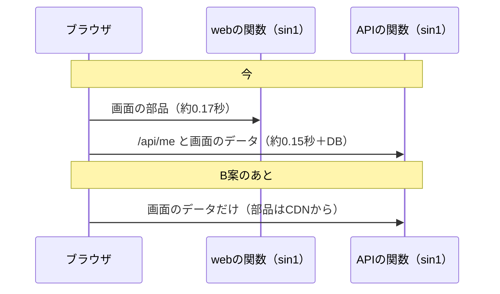

# 論点の記録: 画面の速さと読み込み中の表示

- 機能名: screen-speed
- 確認のページ: https://claude.ai/artifact/EPpUMXVPh9neRVAuqZQpHX
- 進み具合: docs/discussions/screen-speed.progress.json
- v3の版: 9db5634a

## 背景

結合検証環境（Vercel・Neonの検証用の環境）で使ってみたところ、ユーザーから3つの指摘があった。読み込み中に画面がチラついて、読み込んでいるのか分かりにくい。読み込むたびに画面の形が変わる。全体にもっさりする。手元では一瞬で終わっていた読み込みが、シンガポールの関数まで1往復0.15〜0.17秒かかるので、目に見えるようになった。この機能で、読み込み中の見え方と、画面を開くまでの往復の数を直す。

## 前提

- 調べた事実（2026-10-18）: 初めて開く画面は、取得が終わるまで画面全体を「読み込み中」と灰色の棒2本（`apps/web/src/shared/ui/state/loading.tsx`）に置き換えている。棒は実際の画面と形も高さも違う。
- 調べた事実: 再取得のたびに、画面の一番上へ「更新中」の1行（`apps/web/src/shared/ui/state/refetch-failed.tsx`の`Refetching`）が足され、終わると消える。下の内容が1行分上下する。
- 調べた事実: 取得の設定は`staleTime: 0`・`refetchOnWindowFocus: true`（`apps/web/src/shared/api/query-client.ts`）。詳細設計「画面状態と入力操作」の「表示へ戻ったときに再取得する」と、M2の設計書の決定による。
- 調べた事実: 画面を1つ開くと、(1) 画面の部品をwebの関数から取る（約0.17秒）、(2) APIからデータを取る（約0.15秒＋DB）が順に起きる。ログイン中の人の情報（`/api/me`）は、`useMe`がキャッシュせずに画面ごとに取り直している（`apps/web/src/features/auth/model/use-me.ts`）。
- 調べた事実: 関数やNeonが休んでいたあとの最初の要求は、関数の起動だけで約2.4秒かかる。
- 済んだこと: ダークモードで未定だった7色（PR #233）と、スマホでの拡大縮小（PR #232）は、この機能とは別に直した。
- 詳細設計「画面状態と入力操作」は、再取得中は「前回の表示と『更新中』」を出し、再取得の失敗は「前回の表示に『更新できていません』と取得時刻」を出すと決めている。この決まりは変えない。

## 論点

### 初めて開く画面の「読み込み中」を、どんな形で出すか

<!-- id: loading-shape -->

- 工程: 設計
- 種類: 画面
- 優先度: 高
- 状態: 回答待ち
- 画面: v3 03, v3 03a
- なぜ今: 形が決まらないと、読み込み中から読み込み後に変わるときに画面の形がどれだけ動くかが決まらず、部品を作れない。
- 根拠: `apps/web/src/shared/ui/state/loading.tsx`（灰色の棒2本だけ）。v3の画面一式に読み込み中の画面は無い。
- 選択肢:
  - A) 画面ごとに、実際の形（見出し・カード・一覧の行）をなぞった灰色の骨組みを出す
    - 利点: 読み込み後に形がほとんど動かず、何が出てくるかも先に分かる
    - 欠点: 画面ごとに骨組みを作るので手間が増え、画面を直すたびに骨組みも直す
  - B) 主な4つの画面（ホーム・しおり・記録・精算）はAの骨組み、ほかの画面は共通の骨組み（見出し1本とカード2枚）にする
    - 利点: よく開く画面は形が動かず、作る手間は4画面分で済む
    - 欠点: ほかの画面（予定の詳細・支払いの詳細など）は、少し形が動く
  - C) 今の灰色の棒を、画面の中央の回る印に替える
    - 利点: 作る手間がいちばん少ない
    - 欠点: 読み込み後に画面全体が現れるので、形が変わる問題は直らない
- 推奨: B（指摘の多いよく開く画面の形の動きを止め、作る手間を4画面分に抑えられる）

### 再取得中の「更新中」を、どう出すか

<!-- id: refetch-indicator -->

- 工程: 設計
- 種類: 画面
- 優先度: 高
- 状態: 回答待ち
- 画面: v3 03
- なぜ今: 出し方で、部品の置き場所と、画面の中身を押し下げるかどうかが決まる。チラつきの直接の原因。
- 根拠: `apps/web/src/screens/home/home-screen.tsx`の`{home.isRefetching && <Refetching />}`。詳細設計「画面状態と入力操作」の再取得中の表示。
- 選択肢:
  - A) 中身を押し下げない小さな表示（画面の上に重ねる細い帯か、ヘッダーの横の小さな印）にし、再取得が0.5秒を超えたときだけ出す
    - 利点: 短い再取得ではチラつかず、長いときだけ「取り直している」と分かる
    - 欠点: 0.5秒より短い再取得は、利用者から見えない
  - B) 中身を押し下げない小さな表示にし、再取得のたびに必ず出す
    - 利点: 取り直していることが毎回分かる
    - 欠点: 一瞬で終わる再取得のたびに印が点滅する
  - C) 今のまま（中身の上に1行足す）
    - 利点: 作り直さずに済む
    - 欠点: チラつきと形の動きが残る
- 推奨: A（設計資料の「更新中」を出す決まりを守ったまま、短い再取得のチラつきを無くせる）

### 画面を開くまでの往復を、どこまで減らすか

<!-- id: fewer-roundtrips -->

- 工程: 設計
- 種類: 設計
- 優先度: 高
- 状態: 回答待ち
- なぜ今: 減らし方で、変えるファイルの範囲（画面のルートの作りか、ログイン中の人の情報の取り方か）と、確かめ方が決まる。
- 根拠: `apps/web/src/app/trips/[tripId]/home/page.tsx`は要求ごとに関数で組み立てている。`apps/web/src/features/auth/model/use-me.ts`は画面ごとに`/api/me`を取り直している。
- 選択肢:
  - A) ログイン中の人の情報を、画面ごとに取り直さず、一度取ったものを使い回す（他のデータと同じ取得の仕組みに載せる）
    - 利点: 変更が小さく、画面を移るたびの要求が1つ減る
    - 欠点: 画面の部品を関数から取る往復は残る
  - B) Aに加えて、画面の部品を関数で組み立てず、CDNから配る形にする（画面の中身はもともとブラウザで取っているので、部品は誰に対しても同じ）
    - 利点: 画面を移るたびの往復が1つ減り、webの関数の起動待ちも無くなる
    - 欠点: 画面のルートの作りを変えるので、変更の範囲が広がる。Next.jsの組み立てで本当にそうなるかを、確かめながら進める必要がある
  - C) 今は何もせず、本番の実行場所を決めるとき（時間の内訳を測ったあと）にまとめて考える
    - 利点: 今の作業が増えない
    - 欠点: もっさりした感じは、実行場所を決めるまで残る
- 推奨: B（往復を2つ減らせ、実行場所をどこにしても効く。範囲は広いが、画面の中身の作りは変えない）

### 画面を移るたびに必ず取り直す決まりを、変えるか

<!-- id: refetch-timing -->

- 工程: 設計
- 種類: アプリの決まり
- 優先度: 中
- 状態: 仮決定
- なぜ今: 取り直す回数が減れば待ちも減るが、二人のうち相手の操作がいつ見えるかに関わる。
- 根拠: 詳細設計「画面状態と入力操作」「表示へ戻ったときに再取得する」、`docs/designs/m2-trips-and-plans.md`の`staleTime: 0`の決定。
- 選択肢:
  - A) 変えない（画面を開くたび・アプリに戻るたびに取り直す）
    - 利点: 相手の操作がすぐ見える。設計資料のとおり
    - 欠点: 取り直しの回数は減らない
  - B) 30秒以内に取ったものは、取り直さずに使う
    - 利点: 画面を行き来するときの要求が減る
    - 欠点: 相手の操作が最大30秒見えないことがある
- 推奨: A（チラつきは「更新中」の出し方で直せるので、相手の操作がすぐ見える決まりは残す）

### 本番の関数とDBを、どの地域に置くか

<!-- id: production-region -->

- 工程: 運用
- 優先度: 中
- 状態: 後の工程へ
- なぜ今: 往復の時間の大半は、日本からシンガポールまでの距離による。ただし、結合検証環境の「時間の内訳を測る」点検（IE-13）で決めることになっているので、測ったあとに問う。
- 根拠: `docs/requirements/integration-env.md`のPERF-01。
