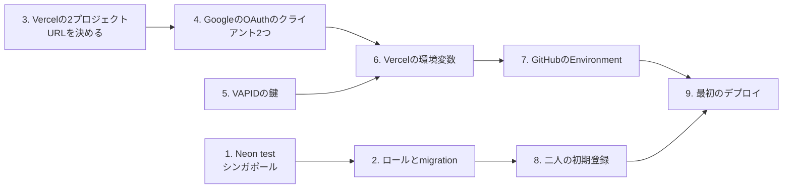

# 手順書: 結合検証環境を作る

- 対象: 結合検証環境（Vercelのapi-test・web-test、Neonのtest）
- 要件・設計: [docs/requirements/integration-env.md](../requirements/integration-env.md)、[docs/designs/integration-env.md](../designs/integration-env.md)
- 確かめること: [docs/tests/integration-env.md](../tests/integration-env.md)
- 作業する人: ユーザー（管理画面の操作と秘密情報の登録）。Claude Codeは秘密情報の値を見ないので、値をチャットに貼らない

## この手順で作るもの



Googleの戻り先にVercelの画面のURLが要るので、Vercelのプロジェクトを先に作ってURLを決める。

## 0. 手元に用意するもの

- `psql`（PostgreSQLのクライアント）。Homebrewの`libpq`は、入れただけではコマンドが見つからないので、PATHに足す。

  ```bash
  brew install libpq
  echo 'export PATH="/opt/homebrew/opt/libpq/bin:$PATH"' >> ~/.zshrc && source ~/.zshrc
  ```
- このリポジトリの最新のmainと`npm ci`
- 秘密情報を一時的に書いておく場所（パスワード管理ソフトなど）。リポジトリの中や`.env`には書かない

この手順のコマンドは、リポジトリのルートで動かす。接続文字列やシークレットはコマンドに直接書かず、`read -rs`で端末の変数に入れてから使う。直接書くと、シェルの履歴に残るため。変数は、作業を終えたら端末を閉じれば消える。

```bash
read -rs "ADMIN_URL?管理者の接続: "; echo
```

`read -rs`は入力を画面に出さず、履歴にも残さない（上はzshの書き方）。以下、`<...>`の代わりに変数を使う。

## 1. Neonに検証用のプロジェクトを作る

1. Neonの管理画面で新しいプロジェクトを作る。名前は`tomotabi-test`、PostgreSQLの版は16（手元とCIと同じ）、地域は**AWS Asia Pacific (Singapore)**。作ったあとは地域を変えられない。
2. プロジェクトの接続の画面で、所有者のロール（作成時にできるもの）の**直接の接続**（pooledでないもの）の接続文字列を控える。以下、これを「管理者の接続」と呼ぶ。管理者の端末だけで使い、VercelにもGitHubにも置かない。

## 2. ロールを作り、migrationを適用する

管理者の端末で行う。パスワードは2つとも新しく作り、パスワード管理ソフトに控える。接続文字列にそのまま入れられるよう、英数字だけのものにする（`openssl rand -hex 32`）。`base64`は`/`や`+`を含み、接続文字列が壊れるので使わない。

```bash
MIGRATOR_PASSWORD="$(openssl rand -hex 32)"
APP_RUNTIME_PASSWORD="$(openssl rand -hex 32)"
psql "$ADMIN_URL" -v ON_ERROR_STOP=1 -v migrator_password="$MIGRATOR_PASSWORD" -v app_runtime_password="$APP_RUNTIME_PASSWORD" -f apps/api/db/admin/create-roles.sql
psql "$ADMIN_URL" -v ON_ERROR_STOP=1 -f apps/api/db/admin/grant-database.sql
```

2つのパスワードは、`echo "$MIGRATOR_PASSWORD"`のように表示してパスワード管理ソフトへ写す。

続けて、migratorのロールでmigrationを適用する。接続文字列は、管理者の接続のユーザー名とパスワードを`migrator`のものに替えた**直接の接続**。手で書き換えると間違えやすいので、同じ端末のタブで、次のコマンドで作る。

```bash
export MIGRATION_DATABASE_URL="$(ADMIN_URL="$ADMIN_URL" PW="$MIGRATOR_PASSWORD" python3 -c 'import os,urllib.parse as u; p=u.urlsplit(os.environ["ADMIN_URL"]); host=p.hostname+(":%d" % p.port if p.port else ""); print(u.urlunsplit(p._replace(netloc="migrator:%s@%s" % (os.environ["PW"], host))))')"
psql "$MIGRATION_DATABASE_URL" -c 'select current_user'
npm run db:migrate -w @tomotabi/api
```

`select current_user`で`migrator`と出れば、接続文字列は正しい。

最後に、実行用の接続文字列を作る。Neonの**pooled**の接続は、直接の接続のホスト名の最初の部分に`-pooler`が付いたもの。次のコマンドで、ユーザー名とパスワードも`app_runtime`のものに替えて作る。

```bash
DATABASE_URL="$(ADMIN_URL="$ADMIN_URL" PW="$APP_RUNTIME_PASSWORD" python3 -c 'import os,urllib.parse as u; p=u.urlsplit(os.environ["ADMIN_URL"]); first,rest=p.hostname.split(".",1); first=first if first.endswith("-pooler") else first+"-pooler"; host=first+"."+rest+(":%d" % p.port if p.port else ""); print(u.urlunsplit(p._replace(netloc="app_runtime:%s@%s" % (os.environ["PW"], host))))')"
psql "$DATABASE_URL" -c 'select current_user'
printf %s "$DATABASE_URL" | sed -E 's#://([^:]+):[^@]*@#://\1:****@#'
```

`app_runtime`と出て、表示したホスト名に`-pooler`があり、末尾に`sslmode=require`があれば正しい。これが6章の`DATABASE_URL`になる。Vercelに貼るときは`printf %s "$DATABASE_URL" | pbcopy`でクリップボードへ写し、登録のあと`pbcopy < /dev/null`で空にする。

**パスワードが合わないとき**（`password authentication failed`）は、端末のタブを閉じてパスワードの変数が消えたか、写し間違えた。管理者の接続で付け直し、上の手順で接続文字列を作り直す。

```bash
MIGRATOR_PASSWORD="$(openssl rand -hex 32)"
echo "ALTER ROLE migrator PASSWORD :'pw';" | psql "$ADMIN_URL" -v ON_ERROR_STOP=1 -v pw="$MIGRATOR_PASSWORD"
```

`app_runtime`も同じ形で付け直せる（`APP_RUNTIME_PASSWORD`と`ALTER ROLE app_runtime`）。付け直したら、パスワード管理ソフトの値も替える。

## 3. Vercelに2つのプロジェクトを作る

1. Vercelの管理画面で、このリポジトリから2つのプロジェクトを作る。
   - `tomotabi-api-test`: Root Directoryを`apps/api`
   - `tomotabi-web-test`: Root Directoryを`apps/web`
2. どちらも、Settings > Generalで次を確かめる。
   - Node.jsの版: 24.x
   - 「Include source files outside of the Root Directory」を有効にする（npm workspacesと`packages/contracts`のため）
3. どちらも、Settings > GitでGit連携を切る（Disconnect）。mainへのpushで検証用の環境が変わらないようにするため。デプロイは9章のボタンで行う。
4. どちらも、Settings > Deployment Protectionで、Production（固定のURL）にVercelのログインを求めない設定にする。パートナーにVercelのアカウントを求めないため。
5. どちらも、Settings > Functionsで、関数の地域（Function Region）を**Singapore (sin1)**にする。デプロイのワークフローはリポジトリのルートから出すので、`apps/*/vercel.json`の`regions`が送られない。地域はプロジェクトの設定で決める。api-testは、同じ画面で関数の時間の上限（Max Duration）を**60秒**にする。
6. それぞれの固定のURL（`https://<プロジェクト名>.vercel.app`）を控える。以下、画面のURLを「webのURL」、APIのURLを「apiのURL」と呼ぶ。末尾にスラッシュを付けない。

## 4. GoogleのOAuthのクライアントを2つ作る

Google Cloudの管理画面で、検証用のプロジェクト（無ければ作る）に作る。

1. OAuthの同意の画面: 公開の状態は「テスト」のままにし、テストユーザーに二人の普段のGoogleアカウントを足す。
2. ログイン用のクライアント（種類: ウェブアプリケーション）
   - 承認済みのリダイレクトURI: `<webのURL>/api/auth/callback/google`（完全一致）
   - クライアントIDとシークレットを控える（6章の`GOOGLE_CLIENT_ID`・`GOOGLE_CLIENT_SECRET`）
3. 初期登録用のクライアント（種類: デスクトップアプリ。ADR-0002）
   - クライアントIDとシークレットを控える（8章の`ENROLL_GOOGLE_CLIENT_ID`・`ENROLL_GOOGLE_CLIENT_SECRET`）。管理者の端末だけで使い、VercelにもGitHubにも置かない

## 5. VAPIDの鍵を作る

```bash
npm run cli:generate-vapid-key -w @tomotabi/api -- "$HOME/tomotabi-vapid-test.json"
```

出力先はリポジトリの外にする（npmは`apps/api`で動かすので、相対パスだとリポジトリの中にできる）。同じ名前のファイルがあると上書きせずに止まる。書き出されたファイル（権限は0600）の中身は、鍵の束の1要素。6章で`VAPID_KEYS`に`[<その1要素>]`として入れる。ファイルは登録が済んだら消す。

## 6. Vercelの環境変数を登録する

Settings > Environment Variablesで、Environmentは**Production**、秘密情報は種類を**Sensitive**にして登録する。

| プロジェクト | 名前 | 値 | Sensitive |
| --- | --- | --- | --- |
| api-test | `DATABASE_URL` | 2章の実行用（app_runtime・pooled）の接続文字列 | する |
| api-test | `PUBLIC_APP_ORIGIN` | webのURL | しない |
| api-test | `BETTER_AUTH_SECRET` | 新しく作った乱数（例: `openssl rand -base64 32`） | する |
| api-test | `GOOGLE_CLIENT_ID` | 4章のログイン用のクライアントID | しない |
| api-test | `GOOGLE_CLIENT_SECRET` | 4章のログイン用のシークレット | する |
| api-test | `VAPID_KEYS` | `[<5章の1要素>]` | する |
| api-test | `VAPID_SUBJECT` | `https://github.com/oze-xxbumpxx/Tomotabi` | しない |

登録したら、一覧に7つそろっているかを数える。値の前後に`http://`や`/`が付いていないかも見る（貼るときにURLと見なされて付くことがある）。環境変数を変えたら、9章のボタンで出し直すまで反映されない。Vercelの画面の「Redeploy」は、このワークフローで出したデプロイでは使えない。

web-testには登録しない。画面の`/api`の転送先（`API_ORIGIN`）は、デプロイのワークフローが7章のGitHubの変数からビルドに渡す。

## 7. GitHubのEnvironmentを作る

**順番を守る。** Environmentを作って保護を付けてから、トークンを登録する。保護の無いうちにワークフローを動かすと、GitHubが保護なしの`integration`を自動で作り、承認とmainだけの制限が効かない。トークンをリポジトリの秘密情報（Repository secrets）に入れると、mainでないブランチからも使えてしまうので、必ずEnvironmentの秘密情報に入れる。

1. GitHubのリポジトリのSettings > Environmentsで、`integration`を作り、保護を付けて保存する。
   - Required reviewers: 自分
   - Deployment branches and tags: Selected branchesで`main`だけ
2. Environment variablesに次を足す。
   - `VERCEL_ORG_ID`: VercelのチームまたはアカウントのID
   - `VERCEL_PROJECT_ID_API`・`VERCEL_PROJECT_ID_WEB`: それぞれのプロジェクトのSettings > Generalにある
   - `API_ORIGIN`: apiのURL（`https://`で始まり、末尾にスラッシュを付けない）。変えたら画面を出し直す
3. Vercelの管理画面のAccount Settings > Tokensで、トークンを作る。名前は`tomotabi-deploy-integration`、期限は90日。
4. 作ったトークンを、1のEnvironmentの**Environment secrets**に`VERCEL_TOKEN`として登録する。
5. トークンの期限が来たら、作り直して`VERCEL_TOKEN`を入れ替える。

## 8. 二人を初期登録する

管理者の端末で、slot 0と1に一人ずつ登録する。ブラウザでGoogleのログインが開くので、登録する人のアカウントで許可する。

```bash
read -rs "ENROLL_GOOGLE_CLIENT_ID?初期登録用のクライアントID: "; echo
read -rs "ENROLL_GOOGLE_CLIENT_SECRET?初期登録用のシークレット: "; echo
export MIGRATION_DATABASE_URL ENROLL_GOOGLE_CLIENT_ID ENROLL_GOOGLE_CLIENT_SECRET
npm run cli:enroll -w @tomotabi/api -- --slot 0
```

`MIGRATION_DATABASE_URL`は2章で入れたもの。端末を閉じていたら、2章と同じく`read -rs`で入れ直す。

slot 1も同じように、もう一人のアカウントで行う。二人がそろうまでは旅行を作れない（アプリが「二人がそろっていない」として断る）ので、旅行から先の点検は二人の登録のあとに行う。

## 9. 最初のデプロイ

1. GitHubのリポジトリのActionsで「deploy-integration」を選び、Run workflowを押す。
   - Use workflow from: `main`のまま
   - 出すcommitのSHA: 空ならmainの最新。指定するときは40桁の完全なSHA（短いSHAは止まる）
2. 承認を求められたら、内容を見て承認する（Review deployments）。
3. ワークフローは次の順に進み、どこかで失敗したらそこで止まる。自動で再試行はしない。
   1. 入力のSHAの形と、変数`API_ORIGIN`が`https://`で始まるかを確かめる
   2. そのcommitがmainの履歴に入っていて、`ci.yml`が成功しているかを確かめる
   3. apiを出す（`vercel pull`→`vercel build`→`vercel deploy --prebuilt`）
   4. webを出す（ビルドに`API_ORIGIN`を渡す）
   5. 出したcommitとURLを実行の要約に書く（失敗した回も書く）
4. 実行の要約に出るURLは、デプロイごとに変わるURLで、Deployment Protectionがかかっている。確かめるときは3章の固定のURLを開く。

失敗したときは、実行のログで止まった手順を見る。

| 止まった手順 | よくある原因 | 直し方 |
| --- | --- | --- |
| Verify sha input shape | SHAが短い・余計な文字がある | 40桁のSHAを入れ直すか、空にする |
| Verify API_ORIGIN is set | 7章の変数`API_ORIGIN`が無い・`https://`で始まらない | 変数を直して押し直す |
| Verify commit is on main | mainに入っていないcommitを指定した | マージしてから出す |
| Verify ci.yml succeeded | そのcommitのCIが失敗・実行中 | CIが通ってから押し直す |
| Deploy api / Deploy web | トークンの期限切れ・プロジェクトのID違い・ビルドの失敗 | 7章の値を見直す。ビルドの失敗はログの内容をClaude Codeに伝える |

apiだけ出てwebで止まったときは、直してからもう一度押す（apiも出し直されるが、同じcommitなので問題ない）。続けて押した実行は、前の実行が終わるまで順に待つ。

## 10. 確かめる

[docs/tests/integration-env.md](../tests/integration-env.md)のIE-01から順に確かめ、記録の表に書く（Claude Codeに結果を伝えれば、Claude Codeが書く）。

## 使わないとき

デプロイも利用もしなければ、VercelとNeonの無料枠はほとんど使わない。Neonは5分で休止する。止めたいときは、Vercelのプロジェクトを消さずに、Neonのcomputeを止めてもよい。
