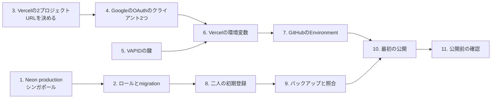

# 手順書: 本番を作り、公開し、運用する

- 対象: 本番（Vercelの`tomotabi-web`・`tomotabi-api`、Neonの`tomotabi-production`）
- 要件・設計: [docs/requirements/production-launch.md](../requirements/production-launch.md)、[docs/designs/production-launch.md](../designs/production-launch.md)
- バックアップと復元: [docs/runbooks/backup-and-restore.md](backup-and-restore.md)
- 公開の記録: [docs/releases/](../releases/README.md)
- 作業する人: ユーザー（管理画面の操作、秘密情報の登録、dump）。Claude Codeは秘密情報の値を見ないので、値をチャットに貼らない

本番の秘密情報（DBの接続、`BETTER_AUTH_SECRET`、Googleのシークレット、VAPIDの鍵、Vercelのトークン）は、検証用のものを使い回さず、すべて新しく作る。作り方は検証用の手順書（[docs/runbooks/integration-env.md](integration-env.md)）と同じで、名前と値の置き場所だけが違う。

## この手順で作るもの



## 0. 手元に用意するもの

- 検証用の手順書の0章のもの（`psql`、最新のmainと`npm ci`、パスワード管理ソフト）
- Docker Desktopと`age`（バックアップの手順書の「0. 準備」）

接続文字列やシークレットは、`read -rs`で端末の変数に入れてから使う（検証用の手順書の0章）。

## 1. Neonに本番のプロジェクトを作る

1. Neonの管理画面で新しいプロジェクトを作る。名前は`tomotabi-production`、PostgreSQLの版は16、地域は**AWS Asia Pacific (Singapore)**。
2. 所有者のロールの**直接の接続**を控える。以下「本番の管理者の接続」と呼ぶ。完全停止（14章）でも使うので、パスワード管理ソフトに「Tomotabi 本番 管理者」の名前で置く。

## 2. ロールを作り、migrationを適用する

検証用の手順書の2章と同じコマンドを、本番の管理者の接続で流す。パスワードは本番用に新しく作る。

パスワード管理ソフトには、次の3つを本番用として控える。

- migratorの直接の接続（`MIGRATION_DATABASE_URL`。8章・バックアップ・migrationで使う）
- app_runtimeのpooledの接続（`DATABASE_URL`。6章でVercelに置く）
- 2つのロールのパスワード

## 3. Vercelに2つのプロジェクトを作る

検証用の手順書の3章と同じ設定で、次の2つを作る。

- `tomotabi-api`: Root Directoryを`apps/api`
- `tomotabi-web`: Root Directoryを`apps/web`

Git連携は切る（mainへのpushで本番が変わらないようにするため）。固定のURLのDeployment Protectionは外す。関数の地域は`sin1`、apiの関数の時間の上限は60秒。

名前が取られていて作れないときは、末尾に短い文字を足し、決まった名前をこの章に書き足す。webのURLとapiのURLを控える。

PRのプレビューに使っている`tomotabi`のプロジェクトとは別にする。二人に渡すのは`tomotabi-web`のURLだけ。

## 4. GoogleのOAuthのクライアントを2つ作る

検証用とは別に、本番用のGoogle Cloudのプロジェクト（または同じプロジェクトの本番用のクライアント）で作る。同意の画面は「テスト」のままにし、テストユーザーには二人だけを足す。

- ログイン用（ウェブアプリケーション）: リダイレクトURIは`<webのURL>/api/auth/callback/google`
- 初期登録用（デスクトップアプリ）: 管理者の端末だけで使う

## 5. VAPIDの鍵を作る

```bash
npm run cli:generate-vapid-key -w @tomotabi/api -- "$HOME/tomotabi-vapid-production.json"
```

登録が済んだらファイルを消す。

## 6. Vercelの環境変数を登録する

`tomotabi-api`のSettings > Environment Variablesで、Environmentは**Production**、秘密情報は**Sensitive**にして登録する。

| 名前                   | 値                                                    | Sensitive |
| ---------------------- | ----------------------------------------------------- | --------- |
| `DATABASE_URL`         | 2章のapp_runtimeのpooledの接続                        | する      |
| `PUBLIC_APP_ORIGIN`    | webのURL                                              | しない    |
| `BETTER_AUTH_SECRET`   | 本番用に新しく作った乱数（`openssl rand -base64 32`） | する      |
| `GOOGLE_CLIENT_ID`     | 4章のログイン用のクライアントID                       | しない    |
| `GOOGLE_CLIENT_SECRET` | 4章のログイン用のシークレット                         | する      |
| `VAPID_KEYS`           | `[<5章の1要素>]`                                      | する      |
| `VAPID_SUBJECT`        | `https://github.com/oze-xxbumpxx/Tomotabi`            | しない    |

7つそろっていること、`MIGRATION_DATABASE_URL`など管理者の端末だけで使うものを置いていないことを確かめる。`tomotabi-web`には登録しない。

## 7. GitHubのEnvironmentを作る

**名前は`tomotabi-production`にする。** `production`にすると、VercelのGit連携が使っている`Production`と同じEnvironmentになる（GitHubは大文字と小文字を区別しない）。

**順番を守る。** 保護を付けてから、トークンを登録する。

1. Settings > Environmentsで`tomotabi-production`を作り、保護を付けて保存する。
   - Required reviewers: 自分
   - Deployment branches and tags: Selected branchesで`main`だけ
2. Environment variablesに`VERCEL_ORG_ID`・`VERCEL_PROJECT_ID_API`・`VERCEL_PROJECT_ID_WEB`・`API_ORIGIN`（本番のapiのURL）を足す。
3. Vercelでトークンを作る。名前は`tomotabi-deploy-production`、期限は90日。Vercel Hobbyのトークンはアカウント全体に効く。検証用のトークンでも本番のプロジェクトを操作でき、本番のトークンでも検証用を操作できる。守りはGitHubのEnvironmentの承認とmainだけの制限なので、検証用・本番のどちらの承認も、出すcommitと、直前にワークフローが変わっていればプロジェクトのIDが替わっていないかを見てから押す。
4. トークンを、1のEnvironmentの**Environment secrets**に`VERCEL_TOKEN`として登録する。
5. Settings > Secrets and variables > Actionsの「Repository secrets」に`VERCEL_TOKEN`が無いことを確かめる。ここにあると、Environmentに入れ忘れたときに黙ってそちらが使われる。

## 8. 二人を初期登録する

検証用の手順書の8章と同じ。`MIGRATION_DATABASE_URL`と初期登録用のクライアントは本番用のものを使う。

## 9. 最初の公開の前に、バックアップを戻して照合する

[バックアップと復元の手順書](backup-and-restore.md)の1〜4章を、きっかけ`before-launch`で行う。照合が合わなければ、ここで止めてClaude Codeに伝える。合えば10章へ進む。

## 10. 公開する

公開の順番は、毎回次のとおり。最初の公開では、1と3はもう済んでいる。

1. 出すcommitを、検証用のボタン（`deploy-integration`）で出し、検証用で確かめる。
2. DBを変えるcommitなら、[バックアップの手順書](backup-and-restore.md)できっかけ`before-change`のバックアップを取り、戻して照合する。合ってから、migrationを管理者の端末から1回だけ流す（`npm run db:migrate -w @tomotabi/api`、`MIGRATION_DATABASE_URL`は本番のmigrator）。
3. GitHubのActionsで「deploy-production」を選び、Run workflowを押す。出すcommitのSHAは、1で確かめたcommitの40桁のSHAを入れる。
4. 承認を求められたら、実行の名前（`deploy-production <出すcommitのSHA>`）とEnvironmentが`tomotabi-production`であることを見て承認する。
5. ワークフローは、SHAの形・`API_ORIGIN`・mainの履歴・CIの成功を確かめ、apiを出してからwebを出す。止まったときの直し方は検証用の手順書の9章の表と同じ。
6. 本番のwebのURLで、二人のログインとホームの表示を確かめる。
7. [公開の記録](../releases/README.md)を書く。

## 11. 公開前の確認（最初の公開のあと、二人に渡す前）

要件の「確かめること（P-12）」を順に確かめ、公開の記録に日付と結果を書く。そのうち、操作が要るものは次のとおり。

- OPS-14（前の版に戻す）: 12章の手順で、最初の公開のcommitより前の公開できるcommitに戻し、ログインとホームを確かめてから、最初の公開のcommitにもう一度出す。
- OPS-15（完全停止）: 14章の手順で止め、画面とAPIの表示を記録してから再開する。
- OPS-01・02: Vercel・Neon・GitHubが無料のプランで、PRのプレビューの`tomotabi`のプロジェクトに本番の秘密が無く、検証用から本番のDBへつながらないことを確かめる。

## 12. 前の版に戻す（アプリの不具合のとき）

1. 戻したいcommitを決める。公開の記録の「対象commit」から、直前に問題が無かった版を選ぶ。
2. 10章の3〜5と同じく、そのcommitの40桁のSHAで「deploy-production」を動かす。
3. DBは戻さない。migrationは後方互換の追加だけにしているので、前の版は今のスキーマで動く。
4. 公開の記録に、戻した理由とcommitを書く。

## 13. 障害のとき最初に残すこと

発生した時刻、画面の操作、`requestId`、保存が成功したか分からない操作、webとapiの版（公開の記録のcommit）、VercelとNeonの障害情報、最後に取ったバックアップの日時を書き留める。認証のトークンや通知のendpointは、スクリーンショットやIssueに貼らない。

通知だけの失敗、アプリの不具合、DBのデータの損失を分けて考える。アプリの不具合なら12章、データの損失なら14章で止めてから[バックアップの手順書](backup-and-restore.md)の6章へ進む。結果が分からない送金をやり直さない。

## 14. 完全停止と再開

止める（古いデプロイや直接のAPIも含めて、全部の読み書きが止まる）:

```bash
read -rs "ADMIN_URL?本番の管理者の接続: "; echo
psql "$ADMIN_URL" -v ON_ERROR_STOP=1 -f apps/api/db/admin/stop-runtime.sql
```

最後の表で`app_runtime_can_login`が`f`、`remaining_app_runtime_connections`が`0`なら止まっている。二人に「今は使えない。保存できたか分からない操作は、再開のあとに画面で確かめる」と伝える。

再開する:

```bash
psql "$ADMIN_URL" -v ON_ERROR_STOP=1 -f apps/api/db/admin/resume-runtime.sql
```

`app_runtime_can_login`が`t`なら再開した。二人に画面を開き直してもらう。止めているあいだも、migratorの接続でmigrationやバックアップはできる。

## 15. 日常の運用

| いつ                                        | すること                                                                                                                                                                                                                                            |
| ------------------------------------------- | --------------------------------------------------------------------------------------------------------------------------------------------------------------------------------------------------------------------------------------------------- |
| 利用中は週1回、旅行の前、旅行の終わったあと | [バックアップ](backup-and-restore.md)を取る（きっかけ`weekly`・`before-trip`・`after-trip`）                                                                                                                                                        |
| DBを変える前                                | バックアップを取り、戻して照合する（きっかけ`before-change`）                                                                                                                                                                                       |
| 月に1回                                     | VercelのUsage（関数の呼び出し、Fluid Active CPU、Fluid Provisioned Memory、転送量）とNeonのUsage（Compute、Storage、Network transfer）を見る。Vercelの枠は検証用・本番・PRのプレビューで共有。9割に近いものがあれば、検証用とPRのプレビューを止める |
| トークンの期限の前                          | `tomotabi-deploy-production`を作り直し、`VERCEL_TOKEN`を入れ替える                                                                                                                                                                                  |
